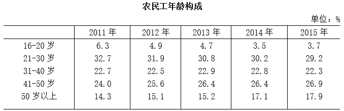

# 增长量比较（各年龄组人数=当年总量×当年占比，跨图表拼接计算）

考点：[[20-考点/资料分析/增长/增长量比较（各年龄组人数=当年总量×当年占比，跨图表拼接计算）|增长 / 增长量比较（各年龄组人数=当年总量×当年占比，跨图表拼接计算）]]
材料：[[15-材料/资料分析/187418 国家统计局抽样调查口径下，2011-|187418 国家统计局抽样调查口径下，2011-]]

**问法模型**：题干问'与2014年相比，2015年哪个年龄组的农民工总量增加最多'→ 采用增长量比较模型：各年龄组人数=当年农民工总量×当年占比，增长量=2015年总量×2015年占比−2014年总量×2014年占比，再横向比较

## 推理链
1. 第1步：从图2柱状图提取总量：2015年27747万人、2014年27395万人；从图1年龄构成表提取占比：16-20岁3.5%→3.7%，21-30岁30.2%→29.2%，31-40岁22.8%→22.3%，50岁以上17.1%→17.9%（41-50岁26.4%→26.9%不在选项中）
2. 第2步：所用规则：各年龄组人数=当年农民工总量×当年占比，增长量=2015年人数−2014年人数，需对每个选项分别计算
3. 第3步：代入计算B、C：21-30岁=27747×29.2%−27395×30.2%≈8102−8273≈−171万人，31-40岁=27747×22.3%−27395×22.8%≈6188−6246≈−58万人，均为负增长，排除B、C
4. 第4步：代入计算A、D：16-20岁=27747×3.7%−27395×3.5%≈1027−959≈+68万人；50岁以上=27747×17.9%−27395×17.1%≈4967−4685≈+282万人
5. 第5步：与选项对照：+282万人（D）> +68万人（A）> 0 > −58万（C）> −171万（B），50岁以上增加最多，故选D

**最快解法**：⚡ 增量分解（公式法）：增长量=基期总量×占比升幅+现期占比×总量增量，主项为27395×占比升幅。先看占比方向：B（29.2%<30.2%）、C（22.3%<22.8%）占比下降且降幅大，人数必为负，秒排B、C；剩下A（升0.2个百分点，27395×0.2%≈55万）与D（升0.8个百分点，27395×0.8%≈219万），D的升幅是A的4倍且基数占比也大，直接锁定D，全程无需精算

## 易错点
- ⚠ 基期现期混淆：必须用'2015占比×27747'与'2014占比×27395'分别计算再相减，不能偷懒用同一年的总量乘两个占比，也不能直接拿占比差乘同一总量
- ⚠ 只看占比升降就下结论：16-20岁2015年占比回升（3.5%→3.7%）但基数太小，增量仅约68万人；41-50岁升0.5个百分点（约+232万人）也小于50岁以上的0.8个百分点（约+282万人），占比升幅最大者（50岁以上）才对应人数增量最大
- ⚠ 误判总量增长则各组人数都增长：21-30岁、31-40岁占比降幅的影响超过总量增长的影响，人数实际是减少的（约−171万、−58万）；另注意双轴图中折线增速1.3%绝不能读成万人量级

## 母题抽象
> 🧩 当题干出现'与基期年相比，现期年某分类的人数/总量增加最多'而材料只给各年占比时，用'人数=当年总量×当年占比'跨图表拼接，先排掉占比下降的组，再在占比上升的组中按'基期总量×占比升幅'快速比较即可锁定答案

**同类特征**：与2014年相比，2015年、总量增加最多、年龄为多少岁、人数=总量×占比的跨图表拼接、增长量比较、占比表+总量柱状图双图联动

## 相关题
- [[10-真题/资料分析/增长/2144598 增长量比较|2144598]]（选调 2018，相关度1）
- [[10-真题/资料分析/增长/23447 增长量比较（现期量×r-(1+r)）|23447]]（云南 2011，相关度1）
- [[10-真题/资料分析/增长/49789 增长量（变化绝对值）比较|49789]]（云南 2013，相关度1）
- [[10-真题/资料分析/增长/465283 增长量比较|465283]]（江苏 2014，相关度1）
- [[10-真题/资料分析/增长/12881989 增长量比较（部分=整体×比重跨图还原后逐年作差）|12881989]]（广东 2025，相关度1）

---

### 题干
与2014年相比，2015年年龄为多少岁的农民工总量增加最多？

### 选项
- A. 16-20岁
- B. 21-30岁
- C. 31-40岁
- D. 50岁以上　✅

### 官方解析
根据题干所求，“与2014年相比，2015年年龄为多少岁的农民工总量增加最多”，可判定此题为增长量比较。
增长量

-
2015年，各年龄段农民工总量增长量 分别为：
A项：16-20岁：；
B项：21-30岁：；
C项：31-40岁：；
D项：50岁以上：。
观察数据，A和D项是正的，而B和C项是负的，排除B和C项。A项一定小于D项，排除A。故D项数值最大。
故正确答案为D。

### 给定材料

        根据国家统计局抽样调查结果，2015年农民工总量为27747万人，比上年增加352万人，增长。2011年以来农民工总量增速持续回落。2012年、2013年、2014年和2015年农民工总量增速分别比上年回落0.5、1.5、0.5和0.6个百分点，而且农民工年龄结构也有所变化。

