# 已知年均增长率求同比增量（增长量计算）

考点：[[20-考点/资料分析/增长/已知年均增长率求同比增量（增长量计算）|增长 / 已知年均增长率求同比增量（增长量计算）]]
材料：[[15-材料/资料分析/187290 2012-2015年我国国民经济发展|187290 2012-2015年我国国民经济发展]]

**问法模型**：题干出现'2015年……同比增加了'且选项带万亿元单位 → 给现期值和年均增长率r，用增长量=现期−现期/(1+r)=现期×r/(1+r)求同比增量

## 推理链
1. 第1步：定位材料第二段提取现期值：2015年服务业增加值=34.16万亿元；题干给定'按年均增长率为计算'，r即材料中2013-2015年均增速（原图数值）
2. 第2步：'同比增加'指2015年相对2014年的增量，按年均增长率r将现期倒推回基期：2014年值=34.16÷(1+r)，此处基期是2014年而非2012年
3. 第3步：代入公式：增长量=34.16−34.16/(1+r)=34.16×r/(1+r)；代入原图增速r（约8.3%，需回原图核对，材料呈现版留空）得≈34.16−31.5≈2.6万亿元
4. 第4步：对照选项：A(1.3万亿元)、B(31.6万亿元)、D(1.8万亿元)均明显偏离，C(2.6万亿元)最接近，故选C

**最快解法**：⚡ 百化分+公式法：增长量=现期×r/(1+r)；将原图年均增速r≈8.3%百化分为1/12，则r/(1+r)≈1/13，增长量≈34.16/13≈2.6万亿元，直接锁定C（r数值留空时必须先回原图补数再套用）

## 易错点
- ⚠ 基期取错：'2013-2015年均增长'间隔仅3年且本题求2015年同比增量，基期应为2014年，勿把2012年当基期，也勿把三年总增量当同比增量
- ⚠ 求增量误选基期值：B选项31.6万亿元恰为2014年基期值（34.16−2.6≈31.5），问'增加了多少'应选差值而非基期值
- ⚠ 口径陷阱：'同比增加了'+选项带单位=增长量问题而非增长率问题；且本材料呈现版所有百分比留空，r严禁凭经验补数，必须回原图核对

## 母题抽象
> 🧩 当题干出现'现期值明确+按年均增长率计算+同比增加了+选项带单位'时，用增长量=现期×r/(1+r)，把r百化分为1/n后增量≈现期/(n+1)，选最接近项

**同类特征**：按年均增长率为…计算、同比增加了、选项带万亿元单位、现期为2015年、服务业增加值、增长量计算

## 相关题
- [[10-真题/资料分析/增长/14993578 增长量计算（现期比重与增长量两步复合）|14993578]]（选调 2024，相关度2）
- [[10-真题/资料分析/增长/5699161 增长量计算（同比增量=现期量−基期量）|5699161]]（江苏 2023，相关度2）
- [[10-真题/资料分析/增长/7159 增长量计算|7159]]（北京 2009，相关度1）
- [[10-真题/资料分析/增长/2571729 增长量计算——每增长1个百分点对应的增量（基期量×1%）|2571729]]（山东 2020，相关度1）
- [[10-真题/资料分析/增长/3018839 增长量计算（负增长情形：基期减少量）|3018839]]（广东 2021，相关度1）

---

### 题干

按年均增长率为计算，2015年我国服务业增加值同比增加了：

### 选项
- A. 1.3万亿元
- B. 31.6万亿元
- C. 2.6万亿元　✅
- D. 1.8万亿元

### 官方解析

由题干“2015年……同比增加了”结合选项有单位，可知本题为增长量计算问题。定位材料第二段“2015年，我国服务业增加值为34.16万亿元”且题干要求按年均增长率计算，则：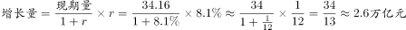 ，与C项最为接近。

故正确答案为C。

### 给定材料

        2012-2015年，我国国内生产总值年均增长率为，远高于世界同期（世界银行数据）的平均水平。对世界经济增长的贡献率平均约为。2015年被称为新常态元年，我国GDP占世界的比重为，比2012年高4个百分点。2015年GDP相当于美国的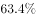，比2012年提高11个百分点。我国依然是世界经济增长的最重要引擎。

        2015年，我国服务业增加值为34.16万亿元，2013-2015年均增长，服务业增加值在国内生产总值中的比重从2012年的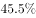提高到2015年的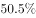，连续三年保持国民经济第一大产业的地位，2015年，我国服务业投资额为31.19万亿元，2012-2015年均增长。

        网络消费增长强劲，2014年、2015年全年网上零售额分别为2.79万亿元、3.88万亿元，增长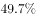和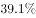，其中实物商品网上零售额占当年社会消费品零售总额的和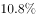。

        网络服务高速增长。2013-2015年，规模以上服务企业中“互联网和相关服务业”营业收入分别增长，和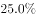，远高于同期规模以上服务业营业收入的增速。

        电子商务交易额快速增长。2014年电子商务交易额达16.4万亿元，增长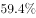；其中，自营电商交易额为8.7万亿元，增长。

        现代金融服务业支撑作用不断增强，2013-2015年，上市公司通过境内市场累计筹资年均增长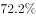。金融对重点领域支持力度明显加强。2014年，新增小微企业贷款2.1万亿元，占企业新增贷款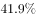，2015年末，主要农村金融机构贷款余额12.03万亿元，增长。

> [!warning] 疑点（官方解析可能有误，待人工复核）
> 材料呈现版中'2013-2015年均增长'的百分比数值留空（官方解析公式同样未显示r），无法直接验算；按官方答案C(2.6万亿元)反推r应约为8.3%（34.16−34.16/1.083≈2.6），计算逻辑与官方答案一致，属材料数据呈现缺失而非答案错误，r需回原图核对

<!-- CODEX-ANSWER-REVIEW:BEGIN -->
### 本次独立复核

**复核状态：** `resolved`（答案与解析已核定）

**计分答案：** C（可计分）

**复核解析：**

2015年服务业增加值为34.16万亿元，年均增速8.1%。按增长量=现期量×增长率/(1+增长率)，相应增量为34.16×0.081/1.081≈2.56万亿元；对照原题选项应选C。题库旧答案栏的D与其解析末尾写出的C不一致，D是答案栏误标。

**相关信息：**

现期增长率对应的增长量分母为1+r；答案栏应与公式计算和选项一致。

**题源依据：** [固定版本原题](https://github.com/Mentat-Uran/kaogongzhentizhengliu/blob/84ab93d4b64b61d897bece8a1c0a5bab06b4feb2/10-%E7%9C%9F%E9%A2%98/%E8%B5%84%E6%96%99%E5%88%86%E6%9E%90/%E5%A2%9E%E9%95%BF/2052072%20%E5%B7%B2%E7%9F%A5%E5%B9%B4%E5%9D%87%E5%A2%9E%E9%95%BF%E7%8E%87%E6%B1%82%E5%90%8C%E6%AF%94%E5%A2%9E%E9%87%8F%EF%BC%88%E5%A2%9E%E9%95%BF%E9%87%8F%E8%AE%A1%E7%AE%97%EF%BC%89.md)；固定内容 commit `84ab93d4b64b61d897bece8a1c0a5bab06b4feb2`，Markdown blob `436225cdee03c0da8f551f1b2ea7f9d328b81838`。
<!-- CODEX-ANSWER-REVIEW:END -->
