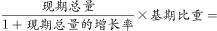
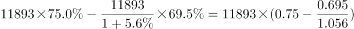
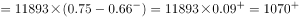

# 部分量增长量计算（总量×占比联动型）

考点：[[20-考点/资料分析/增长/部分量增长量计算（总量×占比联动型）|增长 / 部分量增长量计算（总量×占比联动型）]]
材料：[[15-材料/资料分析/187410 2016年我国电信业务收入（1189|187410 2016年我国电信业务收入（1189]]

**问法模型**：'某部分（非话音收入）同比增加了约多少亿元'+材料给整体总量、整体增速与两期占比 → 增长量=现期总量×现期比重−基期总量×基期比重，其中基期总量=现期总量/(1+整体增速)

## 推理链
1. 第1步：题干'2016年非话音业务收入同比增加了约（）亿元'判定为增长量计算；提取数据：2016年电信业务收入11893亿元、图中非话音占比2016年75.0%、2015年69.5%；收入增速数值在所给文字中空缺，按官方解析以完整原卷增速5.6%代入（可由11893×75%−11893/(1+r)×69.5%≈1093反推自洽，且'回升7.6个百分点'⟹2015年收入增速=5.6%−7.6%=−2.0%）
2. 第2步：公式——非话音收入=电信业务收入×占比，故增长量=现期总量×现期比重−基期总量×基期比重，基期总量=11893/(1+5.6%)
3. 第3步：现期非话音收入=11893×75.0%=8919.75≈8920亿元；基期（2015年）电信业务收入=11893/1.056≈11263亿元
4. 第4步：基期非话音收入=11263×69.5%≈7828亿元
5. 第5步：增长量≈8920−7828=1092亿元，与C项1093最接近，故选C

**最快解法**：⚡ 截位直除+有效数字乘法：①现期部分11893×75%=8920；②基期总量11893÷1.056≈11263（截位直除）；③11263×69.5%≈11263×0.7−11263×0.5%≈7884−56≈7828；④8920−7828≈1092→直接锁定C（1093），全程三位有效数字即可

## 易错点
- ⚠ 典型错解'占比差×现期总量'：(75.0%−69.5%)×11893≈654亿元（等价于8920−11893×69.5%），错在基期占比69.5%必须乘基期总量11263而非现期总量——总量本身在增长，不能省略基期换算
- ⚠ 指标张冠李戴：把'电信业务总量35948亿元'误当'电信业务收入11893亿元'代入；或把'回升7.6个百分点''提高25.5个百分点'当增速本身用（它们是增速的同比变化，单位是百分点，据此还原的2015年收入增速为−2.0%，负增长）
- ⚠ 双轴图文陷阱：75.0%/69.5%须读堆积柱形（左轴，合计恒为100%）中的浅色段，勿误读折线右轴的36.4/26.9（那是移动数据收入占比，对应兄弟题4）；且本题文字中增速数值空缺，须按完整原卷增速代入，不能臆测或直接用11893×69.5%当基期部分量

## 母题抽象
> 🧩 当题干出现'某部分同比增加约多少亿元'且材料只给整体现期总量、整体增速与两期占比时，用'增长量=现期总量×现期比重−现期总量/(1+g)×基期比重'，验证时切勿用'占比差×现期总量'走捷径

**同类特征**：同比增加了约（）亿元、部分量（非话音收入）增长量、两期占比（75.0%/69.5%）、整体增速换算基期总量、现期总量×现期比重−基期总量×基期比重、占比'提高至'两期对比

## 相关题
（暂无）

---

### 题干
2016年非话音业务收入同比增加了约（  ）亿元。

### 选项
- A. 1903
- B. 1309
- C. 1093　✅
- D. 1039

### 官方解析

根据题干所求“2016年······同比增长加了······亿元”，材料数据为2016年，可判定此题为增长量计算问题。定位文字材料“2016年电信业务收入完成11893亿元，同比增长······非话音业务收入占比由上年的提高至”，增长量现期量基期量现期总量现期比重基期总量基期比重现期总量现期比重亿元。C项最接近。

故正确答案为C。

### 给定材料

        2016年电信业务收入完成11893亿元，同比增长，比上年回升7.6个百分点。电信业务总量完成35948亿元，同比增长，比上年提高25.5个百分点。2016年，电信业务收入结构继续向互联网接入和移动流量业务倾斜。非话音业务收入占比由上年的提高至；移动数据及互联网业务收入占电信业务收入的比重从上年的提高至。

        2010-2016年话音业务和非话音业务收入占比变化情况

> [!warning] 疑点（官方解析可能有误，待人工复核）
> 所给文字材料中2016年电信业务收入增速数值空缺（仅'比上年回升7.6个百分点'可读），官方解析按完整原卷数值代入计算；由官方答案1093与计算式可自洽反推该增速约为5.6%（对应2015年收入增速−2.0%），解析本身无矛盾，不影响正确答案C

<!-- CODEX-ANSWER-REVIEW:BEGIN -->
### 本次独立复核

**复核状态：** `resolved`（答案与解析已核定）

**计分答案：** C（可计分）

**复核解析：**

2016年电信业务收入11893亿元、同比增长5.6%，非话音业务占比由2015年的69.5%升至2016年的75.0%。2016年非话音收入减2015年非话音收入=11893×75%−(11893/1.056)×69.5%≈1093亿元，选C。

**相关信息：**

部分收入=总收入×比重；计算两年差额时应先还原2015年总收入，再使用各年的占比。

**题源依据：** [固定版本原题](https://github.com/Mentat-Uran/kaogongzhentizhengliu/blob/84ab93d4b64b61d897bece8a1c0a5bab06b4feb2/10-%E7%9C%9F%E9%A2%98/%E8%B5%84%E6%96%99%E5%88%86%E6%9E%90/%E5%A2%9E%E9%95%BF/2054180%20%E9%83%A8%E5%88%86%E9%87%8F%E5%A2%9E%E9%95%BF%E9%87%8F%E8%AE%A1%E7%AE%97%EF%BC%88%E6%80%BB%E9%87%8F%C3%97%E5%8D%A0%E6%AF%94%E8%81%94%E5%8A%A8%E5%9E%8B%EF%BC%89.md)；固定内容 commit `84ab93d4b64b61d897bece8a1c0a5bab06b4feb2`，Markdown blob `4f5eb940afe0b91d21e1c86b4aff25a2527592c5`。
<!-- CODEX-ANSWER-REVIEW:END -->
