# 部分量（话音业务收入）增长率计算——占比×总量法，可逆用两期比重差公式

考点：[[20-考点/资料分析/增长/部分量（话音业务收入）增长率计算——占比×总量法，可逆用两期比重差公式|增长 / 部分量（话音业务收入）增长率计算——占比×总量法，可逆用两期比重差公式]]
材料：[[15-材料/资料分析/187410 2016年我国电信业务收入（1189|187410 2016年我国电信业务收入（1189]]

**问法模型**：题干问'××业务收入增速同比降低（选项为百分数）'→ 用'部分量=总量×占比'拆出现期与基期部分量，套增速=现期/基期−1求增速，并按'降低'确定负号方向

## 推理链
1. 第1步：从统计图读数——话音收入占比2016年为25.0%、2015年为30.5%（深灰柱，读左轴）；文字材料：2016年电信业务收入11893亿元、同比增长5.2%（原卷数值，本文本该处空缺）
2. 第2步：模型公式：话音收入=电信业务收入×占比，两期合并得 r=(25.0%/30.5%)×(1+5.2%)−1
3. 第3步：截位直除：25.0/30.5≈0.82，0.82×1.052≈0.862，r≈0.862−1=−13.8%，即2016年话音收入同比下降约13.8%
4. 第4步：交叉验证（两期比重差逆向）：25.0%−30.5%=−5.5个百分点=25.0%×(a−5.2%)/(1+a)，解得a≈−13.8%，两法一致
5. 第5步：与选项对照，仅D（约13.8%）符合，故选D

**最快解法**：⚡ 公式法+截位直除：r=(占比现/占比基)×(1+总量增速)−1=(25.0/30.5)×1.052−1≈0.82×1.052−1≈−13.8%，一步合并，避免分别算两期部分量（2973.25亿元 vs 约3448亿元）

## 易错点
- ⚠ '同比降低'指2016年话音收入增速本身为负（降约13.8%），不是'2016与2015两期增速之差'；若误求增速差，2015年话音增速约−28.8%，则−13.8%−(−28.8%)≈+15个百分点，方向为'回升'，与题干'降低'矛盾，即可自我纠错
- ⚠ 求基期部分量必须先对总量做基期换算（11893÷1.052≈11305亿元）再乘2015年占比30.5%，不能用'占比差×现期总量11893'，也不能把25.0%/30.5%直接当增速
- ⚠ 指标与读数勿混：本题用电信业务收入（11893亿元、增速5.2%），不是电信业务总量（35948亿元、增速54.2%）；图例'话音收入占比'取深灰柱（左轴，25.0%/30.5%），勿误取非话音75.0%或移动数据36.4%（右轴折线）

## 母题抽象
> 🧩 当题干要求'某部分量的增速（降幅）'且材料只给'总量现期值+总量增速+两期占比'时，用 r=(占比现/占比基)×(1+总量增速)−1 一步求出部分量增速，并验证结果符号与'降低/提高'的方向表述一致

**同类特征**：话音业务收入、增速同比降低、选项为百分数、部分量增速、两期占比取自统计图、总量现期与总量增速联动

## 相关题
- [[10-真题/资料分析/增长/9629 一般增长率计算（现期需由增量倒推）|9629]]（安徽 2009，相关度1）
- [[10-真题/资料分析/比重/2604234 现期比重计算|2604234]]（广东 2020，相关度1）
- [[10-真题/资料分析/增长/27835 一般增长率计算（已知现期量与增长量求增长率）|27835]]（河北 2012，相关度1）
- [[10-真题/资料分析/平均数/10204497 平均数增长率（均价=值-量的比值增长率）|10204497]]（海南 2024，相关度1）
- [[10-真题/资料分析/增长/12536395 隔年（间隔）增长率|12536395]]（四川 2024，相关度1）

---

### 题干
2016年话音业务收入增速同比降低（  ）。

### 选项
- A. 

- B. 

- C. 

- D. 

　✅

### 官方解析

根据题干所求“2016年······收入增速同比降低”，选项为百分数，材料数据为2016年，可判定此题为一般增长率问题。

方法一：定位文字材料可得“2016年电信业务收入完成11893亿元，同比增长，”定位柱状图可得，2016年与2015年话音收入占比分别为、。代入公式：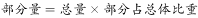，2016年话音收入为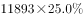，，2015年话音收入为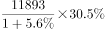，2016年话音收入增长率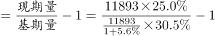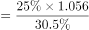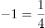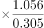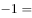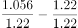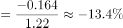。

方法二：根据两期比重比较逆向考查进行求解。定位柱状图可得，2016年与2015年话音收入占比分别为、，即2016年话音收入占比相对于2015年降低了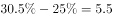个百分点。定位文字材料可得“2016年电信业务收入完成11893亿元，同比增长”，设2016年话音业务收入同比增速为，根据两期比重比较公式，代入数据可得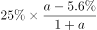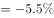，做一简单化简，即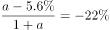，进一步化简可求得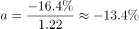。当然也可以直接代入排除来做。

故正确答案为D。

### 给定材料

        2016年电信业务收入完成11893亿元，同比增长，比上年回升7.6个百分点。电信业务总量完成35948亿元，同比增长，比上年提高25.5个百分点。2016年，电信业务收入结构继续向互联网接入和移动流量业务倾斜。非话音业务收入占比由上年的提高至；移动数据及互联网业务收入占电信业务收入的比重从上年的提高至。

        2010-2016年话音业务和非话音业务收入占比变化情况

