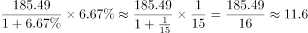

# 同比增长量比较（增长量=现期×r/(1+r)）

考点：[[20-考点/资料分析/增长/同比增长量比较（增长量=现期×r/(1+r)）|增长 / 同比增长量比较（增长量=现期×r/(1+r)）]]
材料：[[15-材料/资料分析/187690 2015年H市全社会用电量（1405|187690 2015年H市全社会用电量（1405]]

**问法模型**：题干问'各产业和生活用电同比增量最大的是'→增长量比较模型，对四个分项分别用现期×r/(1+r)计算增量（或以可算项为基准用临界增速排除）后比大小

## 推理链
1. 第1步：题干锁定文字段四大分项，提取现期值：第一产业7.35、第二产业800.37、第三产业412.34、生活用电185.49亿千瓦时
2. 第2步：用增长量公式'增长量=现期×r/(1+r)'逐项计算，增速r从材料中读取
3. 第3步：第三产业增速由表2合计行读取为6.09%，增量=412.34×6.09/106.09≈23.7亿千瓦时
4. 第4步：第二产业增速在文字段空缺，但其主体工业用电787.02增速仅+0.18%（表1合计行），按此量级估算二产增量≈800.37×0.18/100.18≈1.4亿千瓦时，远小于23.7
5. 第5步：第一产业现期仅7.35亿千瓦时，任何增速下增量都小于现期值7.35<23.7，必然不是最大
6. 第6步：生活用电185.49需增速高于约14.6%其增量才能超过23.7（185.49×r/(1+r)>23.7），此水平过高，故生活用电增量小于三产
7. 第7步：四项中第三产业用电增量≈23.7亿千瓦时最大，对照选项选C

**最快解法**：⚡ 基准排除法+百化分：先算唯一可直接读取增速的三产增量——6.09%≈1/16.4，增量≈412.34/17.4≈23.7亿千瓦时；再以23.7为基准排除：一产7.35增量上限即7.35必小于基准，二产按其主体工业0.18%估算仅约1.4，生活用电185.49需增速>约14.6%才可能超基准（常规增速下不可能），直接锁定C

## 易错点
- ⚠ 口径嵌套：第二产业800.37≠工业787.02≠规上工业706.95，本题比较的是文字段四大分项，若误拿表1工业数据当作二产比较即口径错位
- ⚠ 增量与增速混淆：不能直接比增速大小，第二产业基数800.37最大但增速极低（其主体工业仅+0.18%），基数大≠增量大
- ⚠ 阅读陷阱：所给文字材料中一产、二产、生活用电的同比增速显示为空缺，三产6.09%须从表2合计行反查（表1仅可反查工业0.18%），做题须以原始材料完整增速为准，不得凭空补数

## 母题抽象
> 🧩 当题干出现'同比增量最大/最小的是'且各分项基数悬殊时，先用现期×r/(1+r)算出增速可读项的增量作基准，再用'增量必小于现期'和临界增速排除其余项，无需每项精算

**同类特征**：同比增量最大的是、各产业和生活用电四大分项、现期值7.35/800.37/412.34/185.49、增长量公式现期×r/(1+r)、增速需跨文字段与表格拼接、基数大而增速极小的错位项

## 相关题
（暂无）

---

### 题干
2015 年，H市各产业和生活用电同比增量最大的是( )。

### 选项
- A. 第一产业用电
- B. 第二产业用电
- C. 第三产业用电　✅
- D. 生活用电

### 官方解析

根据“2015年······同比增量最大的是”，判断本题为增长量比较问题。定位文字材料，第一产业用电量7.35亿千瓦时，比上年增长；第二产业用电量800.37亿千瓦时，比上年增长；第三产业用电量412.34亿千瓦时，比上年增长；生活用电量共计185.49亿千瓦时，比上年增长。根据增长量公式，第一产业：亿千瓦时；第二产业：亿千瓦时；第三产业：亿千瓦时；生活用电：亿千瓦时。

因此第三产业用电同比增量最大。

故正确答案为C。

### 给定材料

       2015年，H市全社会用电量1405.55亿千瓦时，比上年增长。全年各产业和生活用电情况分别为：第一产业用电量7.35亿千瓦时，比上年增长；第二产业用电量800.37亿千瓦时，比上年增长；第三产业用电量412.34亿千瓦时，比上年增长；生活用电量由城镇居民用电量与乡村居民用电量构成，共计185.49亿千瓦时，比上年增长，其中，城镇居民用电量增长，乡村居民用电量增长。

> [!warning] 疑点（官方解析可能有误，待人工复核）
> 所给文字材料中一产、二产、生活用电的同比增速为空缺，官方解析中四个分项的增量数值亦被隐去，无法用完整原始增速复算四项增量；仅三产6.09%（表2）与工业0.18%（表1）可读，据此三产增量≈23.7、二产按其主体工业0.18%估算仅≈1.4亿千瓦时，与官方结论C方向一致，严格复核需原始材料完整文字中的增速，本题依官方答案定C

<!-- CODEX-ANSWER-REVIEW:BEGIN -->
### 本次独立复核

**复核状态：** `resolved`（答案与解析已核定）

**计分答案：** C（可计分）

**复核解析：**

同比增量=现期量×r/(1+r)。第一产业7.35×1.30%/1.013≈0.094亿千瓦时；第二产业800.37×0.14%/1.0014≈1.12；第三产业412.34×6.09%/1.0609≈23.67；生活用电185.49×6.67%/1.0667≈11.60。最大为第三产业，选C。

**相关信息：**

给定的是现期用电量和同比增速，不能直接用现期×增速；需除以(1+r)还原基期关系。

**题源依据：** [固定版本原题](https://github.com/Mentat-Uran/kaogongzhentizhengliu/blob/84ab93d4b64b61d897bece8a1c0a5bab06b4feb2/10-%E7%9C%9F%E9%A2%98/%E8%B5%84%E6%96%99%E5%88%86%E6%9E%90/%E5%A2%9E%E9%95%BF/2062842%20%E5%90%8C%E6%AF%94%E5%A2%9E%E9%95%BF%E9%87%8F%E6%AF%94%E8%BE%83%EF%BC%88%E5%A2%9E%E9%95%BF%E9%87%8F%3D%E7%8E%B0%E6%9C%9F%C3%97r-(1%2Br)%EF%BC%89.md)；固定内容 commit `84ab93d4b64b61d897bece8a1c0a5bab06b4feb2`，Markdown blob `a3c997a175199e9085ba6e4a24a2ff1d807b7297`。
<!-- CODEX-ANSWER-REVIEW:END -->
