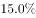
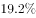

# 增速差值比较（主体换算＋百分点运算）

考点：[[20-考点/资料分析/增长/增速差值比较（主体换算＋百分点运算）|增长 / 增速差值比较（主体换算＋百分点运算）]]
材料：[[15-材料/资料分析/189698 2015年全国纺织行业运行情况：规模|189698 2015年全国纺织行业运行情况：规模]]

**问法模型**：题干问'化纤行业增速比规模以上工业整体增速高/低多少个百分点'→先用'高于0.2个百分点'把基准（规模以上工业整体）增速换算出来，再与化纤增速作差，差值为正即'高'、为负即'低'，结果单位是个百分点

## 推理链
1. 第1步：从材料第1段提取：2015年规模以上纺织企业工业增加值同比增速为a（原卷数值，转录文本空缺），且'高于规模以上工业整体水平0.2个百分点'
2. 第2步：换算基准主体：规模以上工业增加值增速＝a−0.2（纺织比整体高0.2个百分点，故整体要在纺织基础上减0.2）
3. 第3步：从同段提取比较项：化学纤维行业增加值同比增速为b（原卷数值，方向为增长）；'增速比上年回落0.7个百分点'是纺织与2014年比，属干扰信息不参与本题计算
4. 第4步：列式代入：化纤−整体＝b−(a−0.2)＝(b−a)+0.2；其中b−a＝4.9个百分点（可由官方结果反推：5.1−0.2＝4.9，恰为选项B的数值），故差值＝4.9+0.2＝5.1个百分点，符号为正即'高'
5. 第5步：与选项对照：A高4.7（把0.2多减了一次）、B高4.9（直接化纤−纺织、未换算主体）、C高5.1、D低1.9，与官方答案一致，选C

**最快解法**：⚡ 考场最快解法：主体换算＋百分点直减（心算级）。口诀'谁高0.2就从谁身上减'：整体＝纺织增速−0.2，所求＝化纤−(纺织−0.2)＝(化纤−纺织)+0.2；数值空缺时按选项结构反推——B的4.9即化纤与纺织直接相减的差（未换算主体的陷阱值），再补加0.2个百分点即得5.1，锁定C

## 易错点
- ⚠ 主体错位直接相减：化纤−纺织＝4.9个百分点会误选B；题干基准是'规模以上工业整体'，必须先做−0.2换算
- ⚠ 换算方向搞反：'纺织高于整体0.2'应为整体＝纺织−0.2，若误写为整体＝纺织+0.2，得4.9−0.2＝4.7误选A
- ⚠ 口径与阅读陷阱：'回落0.7个百分点'是纺织与上年比较的干扰信息，勿混入；'个百分点'是差值单位，勿与百分率混淆；转录文本中增速数值全部空缺，须以原始试卷数值代入，严禁凭空填数

## 母题抽象
> 🧩 当题干出现'A比B高/低多少个百分点'且A、B主体不一致、需借材料中'高于/低于N个百分点'换算时，先把基准B的增速用差值关系换算出来再作差，差值符号定'高/低'——每多一个'高/低N个百分点'的中间环节，就多一次±N的方向判断

**同类特征**：两个增速作差比较，问'高/低多少个百分点'、比较主体不一致：子行业（化纤）vs 全部规模以上工业、需借'高于0.2个百分点'连环换算基准增速、选项统一为'高/低＋数值＋个百分点'结构，干扰项对应少一次或反方向换算、数据来自材料第1段增加值增速段落、同段存在'回落0.7个百分点'等相邻干扰条件

## 相关题
（暂无）

---

### 题干
2015年，化学纤维行业增加值同比增速比规模以上工业增加值同比增速：

### 选项
- A. 高4.7个百分点
- B. 高4.9个百分点
- C. 高5.1个百分点　✅
- D. 低1.9个百分点

### 官方解析

由题目材料第一段“2015年，全国规模以上纺织企业工业增加值同比增长，高于规模以上工业整体水平0.2个百分点”“其中······化学纤维行业增加值同比增长”。可得规模以上工业增加值同比增速为；“化学纤维行业增加值同比增速”与“规模以上工业增加值同比增速”相比较：，即高5.1个百分点。

故正确答案为C。

### 给定材料

        2015年，全国规模以上纺织企业工业增加值同比增长，高于规模以上工业整体水平0.2个百分点，增速比上年同期回落0.7个百分点。其中，纺织业、服装服饰行业、化学纤维行业增加值同比分别增长、和。

        2015年，纺织行业规模以上企业累计实现主营业务收入70713亿元，同比增长；实现利润总额3860亿元，同比增长；企业亏损面(亏损企业占所有企业比重)，比上年低0.1个百分点。

        2015年，我国出口纺织品、服装2912亿美元，同比下降，按出口商品类型看，纺织品出口1153亿美元，同比下降；服装出口1759亿美元，同比下降。按出口对象看，对美国出口额同比增长，对欧盟出口额同比下降，对日本出口额同比下降，对东盟出口额同比下降。

        2015年，我国纺织行业500万元以上项目固定资产投资完成额11913亿元，同比增长。其中东部地区固定资产投资完成额同比增长，中部地区固定资产投资完成额同比增长，西部地区固定资产投资完成额同比增长。行业新开工项目数呈现增速提升势头，新开工项目16149项，同比增长。

