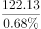
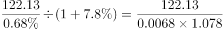
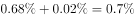
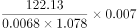
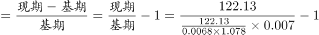
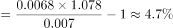

# 增长率计算（基期反推型：借现期比重+比重百分点变化+总体增速反推基期部分量）

考点：[[20-考点/资料分析/增长/增长率计算（基期反推型：借现期比重+比重百分点变化+总体增速反推基期部分量）|增长 / 增长率计算（基期反推型：借现期比重+比重百分点变化+总体增速反推基期部分量）]]
材料：[[15-材料/资料分析/189700 某省科技创新概况：2014年全社会研|189700 某省科技创新概况：2014年全社会研]]

**问法模型**：题干给出'现期部分量122.13亿元、占GDP比重（较2013年下降0.02个百分点）、2014年GDP同比增速'→ 用基期反推链先求2013年研发经费，再以（现期−基期）÷基期求研发经费同比增速

## 推理链
1. 第1步：从文字材料提取：2014年全社会研发经费122.13亿元，占GDP比重为X%（X%为试卷原百分数，所给文本显示空缺），比2013年下降0.02个百分点
2. 第2步：规则1（部分=总体×比重）→ 2014年GDP=122.13÷X%
3. 第3步：规则2（基期量公式）→ 2013年GDP=122.13÷X%÷(1+g)，g为题干给出的2014年GDP同比增速
4. 第4步：规则3（比重差方向）→ 比重为'下降'0.02个百分点，故2013年比重=X%+0.02个百分点，2013年研发经费=[122.13÷X%÷(1+g)]×(X%+0.02pp)
5. 第5步：公式 → 2014年研发经费同比增速=(122.13−2013年研发经费)÷2013年研发经费，可一步化简为(1+g)×X%÷(X%+0.02pp)−1
6. 第6步：代入完整试卷数据计算，与四个选项量级对照，结果与B最接近，故选B

**最快解法**：⚡ 比重联动公式法（跳过GDP中间量）：部分增速=(1+总体增速)×(现期比重÷基期比重)−1=(1+g)×X%÷(X%+0.02pp)−1；对X%与(X%+0.02pp)的比值用截位直除处理，再乘(1+g)后减1，与选项对照排除即可

## 易错点
- ⚠ '下降0.02个百分点'是比重差不是经费增速，且因是'下降'，2013年比重应在现期比重上加0.02pp，方向易写反
- ⚠ 所给文本中比重百分数与GDP同比增速均显示空缺，必须以完整试卷数据代入，不能凭空补数，更不能把百分点差直接当增速用
- ⚠ 基期反推链条长（2014年GDP→2013年GDP→2013年经费→增速），基期/现期易混淆，增速分母必须用2013年（基期）研发经费而非122.13

## 母题抽象
> 🧩 当题干出现'现期部分量+占总体比重+比重较基期变动N个百分点+总体同比增速'时，用'部分增速=(1+总体增速)×(现期比重÷基期比重)−1'一步求解，或按'总体基期→部分基期→增速'链条反推，验证与选项最接近者

**同类特征**：全社会研发经费同比增速约为、占GDP比重比2013年下降0.02个百分点、题干补充GDP同比增速、基期反推、比重百分点变动、增速求近似值

## 相关题
- [[10-真题/资料分析/综合/2045762 数据可得性判断（选非题）|2045762]]（广州市考 2017，相关度1）
- [[10-真题/资料分析/综合/2264423 综合判断题（两期平均数比较判定为主，辅以基期反推与月度加总排除）|2264423]]（国考 2019，相关度1）

---

### 题干

若2014年该省GDP同比增速为，则当年该省全社会研发经费同比增速约为：

### 选项
- A. 

- B. 

　✅
- C. 

- D. 

### 官方解析

由题干“当年该省全社会研发经费同比增速为”可知，本题为增长率计算问题。根据题干和材料中已知条件求出2013年该省全社会研发经费即可求出2014年的同比增速。定位文字材料“2014年，某省全社会研发经费达122.13亿元，研发经费占GDP的比重为”，可求出2014年该省GDP为亿元；根据题干条件“2014年该省GDP同比增速为”，根据基期量的公式可求出2013年该省GDP为亿元；由“2014年，研发经费占GDP的比重为，比2013年下降0.02个百分点”，可得2013年该省研发经费占GDP的比重为，因此可求出2013年该省研发经费为亿元，所以2014年该省全社会研发经费同比增速，与最为接近。

故正确答案为B。

### 给定材料

        2014年，某省全社会研发经费达122.13亿元，研发经费占GDP的比重为，比2013年下降0.02个百分点。

> [!warning] 疑点（官方解析可能有误，待人工复核）
> 所给文本中'占GDP比重'百分数、题干GDP增速数值及选项公式均显示为空缺/图片占位，无法代入具体数值复核计算结果；模型与官方答案B予以保留，数值层面须以完整试卷数据为准

<!-- CODEX-ANSWER-REVIEW:BEGIN -->
### 本次独立复核

**复核状态：** `resolved`（答案与解析已核定）

**计分答案：** B（可计分）

**复核解析：**

2014年GDP增速7.8%，研发经费占GDP比重为0.68%，比2013年低0.02个百分点，故2013年比重0.70%。研发经费同比变化倍数=1.078×0.68÷0.70≈1.0472，增速约4.72%，最接近B项5%。

**相关信息：**

资料分析—比重变化与增长率关系；部分量增长倍数=总体增长倍数×现期比重÷基期比重。

**题源依据：** [固定版本原题](https://github.com/Mentat-Uran/kaogongzhentizhengliu/blob/84ab93d4b64b61d897bece8a1c0a5bab06b4feb2/10-%E7%9C%9F%E9%A2%98/%E8%B5%84%E6%96%99%E5%88%86%E6%9E%90/%E5%A2%9E%E9%95%BF/2097172%20%E5%A2%9E%E9%95%BF%E7%8E%87%E8%AE%A1%E7%AE%97%EF%BC%88%E5%9F%BA%E6%9C%9F%E5%8F%8D%E6%8E%A8%E5%9E%8B%EF%BC%9A%E5%80%9F%E7%8E%B0%E6%9C%9F%E6%AF%94%E9%87%8D%2B%E6%AF%94%E9%87%8D%E7%99%BE%E5%88%86%E7%82%B9%E5%8F%98%E5%8C%96%2B%E6%80%BB%E4%BD%93%E5%A2%9E%E9%80%9F%E5%8F%8D%E6%8E%A8%E5%9F%BA%E6%9C%9F%E9%83%A8%E5%88%86%E9%87%8F%EF%BC%89.md)；固定内容 commit `84ab93d4b64b61d897bece8a1c0a5bab06b4feb2`，Markdown blob `b2e5c7bf7f86eb031dd7271d4ab1d49fd2a3b50c`。
<!-- CODEX-ANSWER-REVIEW:END -->
