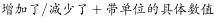
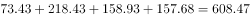
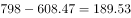
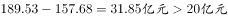
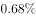
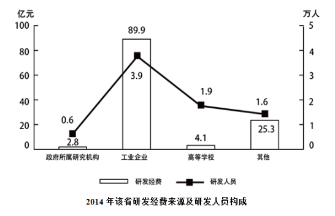
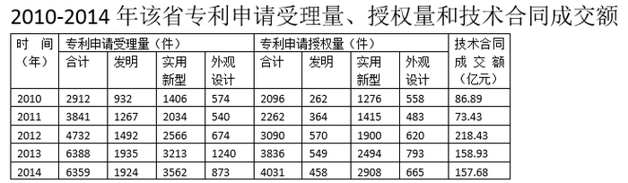

# 增长量计算（累计总额倒减隐含现期值）

考点：[[20-考点/资料分析/增长/增长量计算（累计总额倒减隐含现期值）|增长 / 增长量计算（累计总额倒减隐含现期值）]]
材料：[[15-材料/资料分析/189700 某省科技创新概况：2014年全社会研|189700 某省科技创新概况：2014年全社会研]]

**问法模型**：题干给出'十二五(2011-2015)累计总额约798亿元'而表2只到2014年 → 用累计总额减去2011-2014四年之和倒推2015年当期值，再减2014年157.68亿元求增长量并判断方向与是否超过20亿元。

## 推理链
1. 第1步：从题干提取隐含条件——十二五(2011-2015)技术合同成交总额约798亿元；表2只有2011-2014年数据（2015年不在表中），须联立题干才能求解。
2. 第2步：从表2提取2011-2014年技术合同成交额：73.43、218.43、158.93、157.68亿元，四项相加（尾数0.43+0.43+0.93+0.68=2.47，整数部分73+218+158+157=606）得608.47亿元。
3. 第3步：2015年当期值=798-608.47=189.53亿元。
4. 第4步：与2014年157.68亿元比较，增长量=189.53-157.68=31.85亿元，为正即同比增加。
5. 第5步：31.85亿元>20亿元，对应'增加了20亿元以上'，与选项C一致。

**最快解法**：⚡ 尾数法+截位估算：先算尾数0.43+0.43+0.93+0.68=2.47锁定四年合计608.47；798-608.47≈189.5，再189.5-157.68≈31.9，明显大于20且方向为增，直接选C，无需精确计算。

## 易错点
- ⚠ 2015年数据不在表2中，必须用题干'累计798亿元'倒减，漏读题干条件会误以为数据缺失无从下手。
- ⚠ 累计口径：798亿元是2011-2015五年之和（不含2010年的86.89亿元），若误把2010年计入扣减项，会得出2015年约102.64亿元、误判为减少。
- ⚠ 同比方向须先判断：2015年189.53亿元>2014年157.68亿元为增加；技术合同成交额2011、2013、2014均下降，不能凭'近年连降'惯性误选减少项，且'20亿元'是增长量阈值而非增速。

## 母题抽象
> 🧩 当题干出现'某五年累计总额约X'且所求末年数据不在统计表中时，用'累计总额−已知各年当期值之和'倒推末年值，再与上年作差求增长量，按选项阈值（不到/以上）直接比较定答案。

**同类特征**：十二五(2011-2015)累计总额、同比增加/减少、技术合同成交额、末年数据不在表中、累计值倒减当期值、增长量阈值20亿元(不到/以上)

## 相关题
（暂无）

---

### 题干
已知“十二五”（2011-2015年）期间该省技术合同成交总额约为798亿元，则2015年该省技术合同成交额同比：

### 选项
- A. 增加了不到20亿元
- B. 减少了不到20亿元
- C. 增加了20亿元以上　✅
- D. 减少了20亿元以上

### 官方解析

由题干“2015年该省技术合同成交额同比”可知，本题为增长量计算问题。根据题干已知条件“（2011-2015年）期间该省技术合同成交总额约为798亿元”和统计表2给出的2011-2014年技术合同成交额，可求出2015年该省技术合同成交额，继而求出增长量。定位统计表2最后一列数据，2011-2014年该省技术合同成交总额为亿元，则2015年该省技术合同成交额为亿元。又已知2014年该省技术合同成交额为157.68亿元，所以2015年该省技术合同成交额同比增加了。

故正确答案为C。

### 给定材料

        2014年，某省全社会研发经费达122.13亿元，研发经费占GDP的比重为，比2013年下降0.02个百分点。

> [!warning] 疑点（官方解析可能有误，待人工复核）
> 官方解析中'2011-2014年总额为＿亿元''2015年成交额为＿亿元''同比增加了＿'等处数值显示空缺，但按表2数据算得合计608.47亿元、2015年189.53亿元、增长量+31.85亿元，结论与答案C一致，无实质矛盾。

<!-- CODEX-ANSWER-REVIEW:BEGIN -->
### 本次独立复核

**复核状态：** `resolved`（答案与解析已核定）

**计分答案：** C（可计分）

**复核解析：**

2011–2014成交额合计608.47亿元，2015=798−608.47=189.53亿元；较2014年157.68亿元增加31.85亿元，增加20亿元以上，C。

**相关信息：**

增长量=现期量×增长率/(1+增长率)；同比下降题先明确增长量符号。百分点和百分比需按材料口径区分。

**题源依据：** [固定版本原题](https://github.com/Mentat-Uran/kaogongzhentizhengliu/blob/84ab93d4b64b61d897bece8a1c0a5bab06b4feb2/10-%E7%9C%9F%E9%A2%98/%E8%B5%84%E6%96%99%E5%88%86%E6%9E%90/%E5%A2%9E%E9%95%BF/2097174%20%E5%A2%9E%E9%95%BF%E9%87%8F%E8%AE%A1%E7%AE%97%EF%BC%88%E7%B4%AF%E8%AE%A1%E6%80%BB%E9%A2%9D%E5%80%92%E5%87%8F%E9%9A%90%E5%90%AB%E7%8E%B0%E6%9C%9F%E5%80%BC%EF%BC%89.md)；固定内容 commit `84ab93d4b64b61d897bece8a1c0a5bab06b4feb2`，Markdown blob `39750c8b3172dbb718073b4f5e16f21be9c0806f`。
<!-- CODEX-ANSWER-REVIEW:END -->
