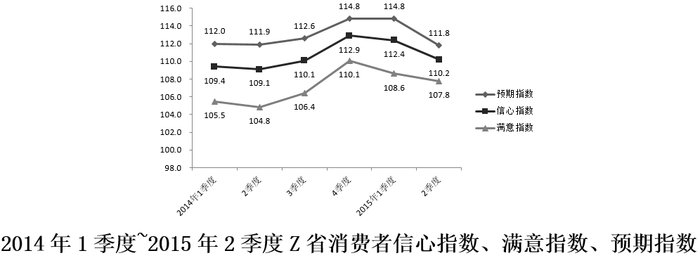

# 百分点降幅还原基期值并比较大小

考点：[[20-考点/资料分析/增长/百分点降幅还原基期值并比较大小|增长 / 百分点降幅还原基期值并比较大小]]
材料：[[15-材料/资料分析/189702 2015年2季度J省消费者信心指数（|189702 2015年2季度J省消费者信心指数（]]

**问法模型**：题干问'2015年1季度（环比基期）满意指数构成中数值最低的是'→ 用'基期值=现期值+环比下降幅度（个百分点，加减法）'还原四个城乡分项2015Q1值后比大小

## 推理链
1. 第1步：定位材料第二段，2015Q2就业满意指数城镇99.3、农村104.2，环比分别下降6.1个、3.3个百分点；家庭收入满意指数城镇100.4、农村98.1，环比分别下降9.6个、3.1个百分点
2. 第2步：各指数本季度均为下降，故2015年1季度（基期）值=2015年2季度（现期）值+下降幅度，'个百分点'只能用加减法，不能按百分比折算
3. 第3步：逐项还原2015Q1值：城镇就业=99.3+6.1=105.4；农村就业=104.2+3.3=107.5；城镇收入=100.4+9.6=110.0；农村收入=98.1+3.1=101.2
4. 第4步：比较四数：101.2<105.4<107.5<110.0，最低者为农村家庭收入满意指数101.2，对照选项选D

**最快解法**：⚡ 加法还原+直接比大小：基期=现期+降幅，四个数心算得105.4/107.5/110.0/101.2；可先锁定现期最低的农村收入98.1，其降幅3.1也很小，还原后101.2必最低，无需精确算出全部四数

## 易错点
- ⚠ 把'下降6.1个百分点'误当'下降6.1%'按乘法折算（如99.3×(1-6.1%)），本材料第一大坑，个百分点必须用加减法
- ⚠ 变化方向搞反：本季度为下降，基期=现期+降幅；若误用'现期−降幅'（得93.2、100.9、90.8、95.0）会误判为城镇收入最低而错选C
- ⚠ 对象串位：满意指数总体ICC=96.9不参与构成比较，只比就业/收入两个分项的城乡四数；且J省文字数据与Z省图表数据是两省口径，切勿混用

## 母题抽象
> 🧩 当题干问'基期（上季度/上年同期）某指标构成中最高/最低'且材料给'现期值+环比升降N个百分点'时，用'基期=现期±变化幅度（个百分点一律加减）'逐项还原后比大小，方向先判升降再定加减

**同类特征**：2015年1季度（环比基期）、满意指数构成、城乡×就业/收入四个分项、数值最低、环比下降N个百分点、J省文字材料

## 相关题
（暂无）

---

### 题干
2015年1季度，J省消费者满意指数构成中，数值最低的是：

### 选项
- A. 城镇就业满意指数
- B. 农村就业满意指数
- C. 城镇家庭收入满意指数
- D. 农村家庭收入满意指数　✅

### 官方解析
定位文字材料第二段可得，2015年2季度······消费者对当前就业满意指数为101.2，其中城乡指数分别为99.3、104.2，环比分别下降6.1个、3.3个百分点······城乡家庭收入满意指数分别为100.4、98.1，环比分别下降9.6个、3.1个点。则2015年1季度，，，，，数值最低的是农村家庭收入满意指数。
故正确答案为D。

### 给定材料

        2015年2季度，J省消费者信心指数（CCI）为101.1，环比、同比分别下降4.6个、10.7个百分点。分城乡看，城镇和农村消费者信心指数分别为101.6和100.1，环比分别下降5.2、3.8个百分点。

        从体现消费者对当前形势的满意程度看，2015年2季度，J省消费者满意指数（ICC）为96.9，从满意指数的构成看，消费者对当前就业满意指数为101.2，其中城乡指数分别为99.3、104.2，环比分别下降6.1个、3.3个百分点；对当前家庭收入的满意程度看，满意指数为99.5，其中城乡家庭收入满意指数分别为100.4、98.1，环比分别下降9.6个、3.1个百分点。

        从反映消费者对未来乐观程度的预期指数看，2015年2季度，J省消费者预期指数（ICS）为103.8，在持续两个季度小幅回升后，本季度有所回落，环比、同比分别下降4.1个、12.0个百分点。

        2015年2季度，Z省城乡消费者信心指数均呈下行态势，其中，城镇消费者信心指数为111.1，较一季度下降1.4个百分点；农村消费者信心指数为108.7，较一季度下降3.4个百分点。

