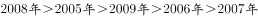
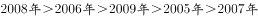
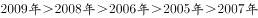
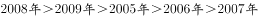
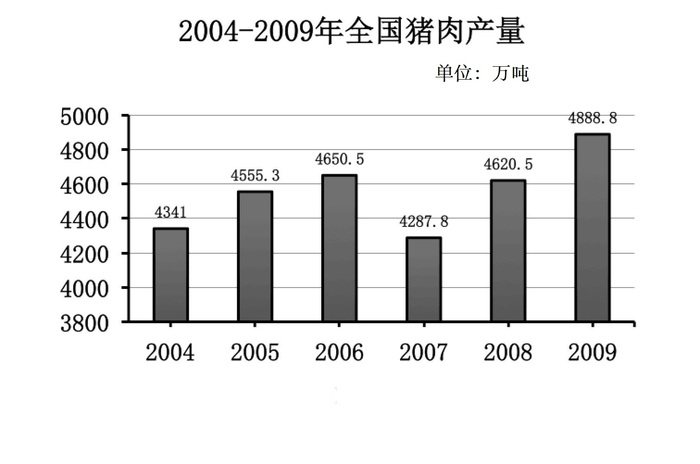

# 逐年增长率计算与大小排序

考点：[[20-考点/资料分析/增长/逐年增长率计算与大小排序|增长 / 逐年增长率计算与大小排序]]

**问法模型**：题干问'2005-2009年增长率从高到低排列' → 对每个年份用（当年产量-上年产量）÷上年产量逐一求增长率，再比较排序对照选项

## 推理链
1. 第1步：题干要求对2005-2009年各年猪肉产量增长率排序，从统计图中读取2004-2009年逐年产量（2004年数据是2005年增长率的基期，不可遗漏）
2. 第2步：每年增长率=（当年产量-上年产量）/上年产量，需连算5个年份
3. 第3步：代入计算：2005年206/4349≈4.7%，2006年95/4555≈2.1%，2007年(3286-4650)/4650≈-29.3%为负增长，2008年1328/3286≈40.4%，2009年275/4614≈6.0%
4. 第4步：按数值排序得2008年（约40.4%）＞2009年（约6.0%）＞2005年（约4.7%）＞2006年（约2.1%）＞2007年（约-29.3%）
5. 第5步：对照选项，只有D项为2008年＞2009年＞2005年＞2006年＞2007年，故选D

**最快解法**：⚡ 先定性粗排缩小范围：2008年产量从谷底3286大幅反弹至4614，增速显然最大；2007年产量骤降为负增长，显然最小；再对中间三个正增长年份用截位直除比较：2009年275/4614≈6.0%、2005年206/4349≈4.7%、2006年95/4555≈2.1%，即锁定2008＞2009＞2005＞2006＞2007，选D

## 易错点
- ⚠ 基期找错：每一年增长率的基期都是上一年，2005年的基期是2004年，漏看图中首年会导致2005年增长率算不出
- ⚠ 混淆'产量最高'与'增速最高'：2008年增速最高但产量并非最高（2009年产量4889更高），排序看的是增长率不是产量
- ⚠ 负增长与接近年份排序失误：2007年增速为负应排最后；2005年（约4.7%）与2006年（约2.1%）、2009年（约6.0%）数值接近，不精算容易排错，中间三位正是四个选项的区别所在

## 母题抽象
> 🧩 当题干出现'某几年增长率从高到低/从低到高排列'时，用（现期-基期）/基期逐年计算，先按正负和量级粗排（大幅反弹年最大、骤降负增长年最小），再对量级接近的年份截位直除精确区分，验证与选项逐一对照

**同类特征**：增长率从高到低、排序型比较题、逐年（同比）增长率、跨多个连续年份、统计图读数、只需比大小不需精确值

## 相关题
- [[10-真题/资料分析/增长/2388028 增长率大小比较（含负增长的增速排序）|2388028]]（河北 2019，相关度1）

---

### 题干
2005-2009年，增长率从高到低依次排列正确的是：

### 选项
- A. 

- B. 

- C. 

- D. 

　✅

### 官方解析
根据题干“······增长率从高到低······”，可判定本题为一般增长率问题。定位统计图可得：2004年-2009年猪肉产量。根据公式：增长率，各时期猪肉产量增长率如下：
2005年：；
2006年：；
2007年：；
2008年：；
2009年：，则2005-2009年，增长率从高到低依次为2008年2009年2005年2006年2007年。
故正确答案为D。

### 给定材料

根据以下资料，完成各题。

