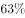
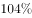

# 一般增长率计算（同比增速）

考点：[[20-考点/资料分析/增长/一般增长率计算（同比增速）|增长 / 一般增长率计算（同比增速）]]
材料：[[15-材料/资料分析/191534 2015~2016年中国生活服务电商|191534 2015~2016年中国生活服务电商]]

**问法模型**：题干'2016年…约比上年增加了'且选项为百分数 → 判定为一般增长率问题，套用 g=(现期−基期)÷基期 模型

## 推理链
1. 第1步：定位统计表，在线旅游市场2015年交易规模4487.2亿元（基期），2016年为6138.0亿元（现期）
2. 第2步：选项为百分数，确认求同比增长率而非增长量，公式 g=(现期−基期)÷基期
3. 第3步：先求同比增量：6138.0−4487.2=1650.8亿元
4. 第4步：代入计算 g=1650.8÷4487.2≈0.368，即约36.8%≈37%
5. 第5步：与选项对照，约37%与D项最接近，故选D

**最快解法**：⚡ 截位直除：先心算增量1650.8，再截位直除 1650.8÷4487.2≈165÷449≈36.8%，即约37%，直接锁定D；可用4487.2×37%≈1660＞1650.8自检（真实值略小于37%但离37%最近）

## 易错点
- ⚠ 增长率与增长量混淆：'比上年增加了'后接百分数选项求的是增长率，若误按增量1650.8亿元去匹配选项必错
- ⚠ 基期现期混淆：分母必须用基期2015年的4487.2，误用现期6138.0作分母会错得约26.9%
- ⚠ 口径串用：组合图折线是餐饮外卖的环比增速，与本题在线旅游的同比无关，且图中无在线旅游季度数据，必须回统计表取两年全年值

## 母题抽象
> 🧩 当题干出现'某年某市场规模约比上年增加了'且选项为百分数时，用增长率模型(现期−基期)÷基期，先算增量再截位直除，选与结果最接近的选项

**同类特征**：2016年…约比上年增加了、选项为百分数、单一细分市场（在线旅游）、同比口径（比上年）、表格取两年全年值、增长量/增长率辨析

## 相关题
- [[10-真题/资料分析/增长/9629 一般增长率计算（现期需由增量倒推）|9629]]（安徽 2009，相关度1）
- [[10-真题/资料分析/比重/2604234 现期比重计算|2604234]]（广东 2020，相关度1）
- [[10-真题/资料分析/增长/27835 一般增长率计算（已知现期量与增长量求增长率）|27835]]（河北 2012，相关度1）
- [[10-真题/资料分析/平均数/10204497 平均数增长率（均价=值-量的比值增长率）|10204497]]（海南 2024，相关度1）
- [[10-真题/资料分析/增长/12536395 隔年（间隔）增长率|12536395]]（四川 2024，相关度1）

---

### 题干
2016年在线旅游市场交易规模约比上年增加了：

### 选项
- A. 

- B. 

- C. 

- D. 

　✅

### 官方解析
由题干“2016年比上年增加了……”且选项为百分数，可判定本题为一般增长率问题。定位表格材料可知，在线旅游市场交易规模2015年为4487.2亿元，2016年为6138.0亿元。根据公式，2016年在线旅游市场交易规模约比上年增加了，与D项最接近。
故正确答案为D。

### 给定材料

