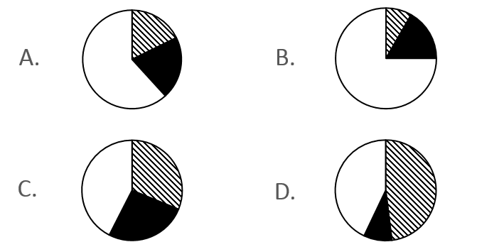
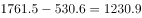
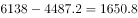
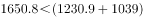

# 同比增量计算与多主体增量比例结构比较

考点：[[20-考点/资料分析/增长/同比增量计算与多主体增量比例结构比较|增长 / 同比增量计算与多主体增量比例结构比较]]
材料：[[15-材料/资料分析/191534 2015~2016年中国生活服务电商|191534 2015~2016年中国生活服务电商]]

**问法模型**：题干问三个市场'同比增量的比例关系'→逐个用现期(2016)减基期(2015)算出三个增量，再按'最大增量是否大于其余两者之和''是否存在明显倍数关系'两条结构规则对照选项排除

## 推理链
1. 第1步：从统计表提取两期数据：在线餐饮外卖530.6→1761.5，移动出行999.0→2038.0，在线旅游4487.2→6138.0（单位亿元）
2. 第2步：明确口径——本题问同比'增量'而非增速，公式为增量=2016年全年值−2015年全年值（须回统计表取两年全年值，与图中季度环比无关）
3. 第3步：代入做差：餐饮外卖1761.5−530.6=1230.9亿元；移动出行2038.0−999.0=1039.0亿元；在线旅游6138.0−4487.2=1650.8亿元
4. 第4步：排序得：在线旅游1650.8＞餐饮外卖1230.9＞移动出行1039.0，最大增量为在线旅游1650.8亿元
5. 第5步：结构检验：其余两增量之和1230.9+1039.0=2269.9＞1650.8，即最大增量小于另两者之和；且相邻比值1650.8/1230.9≈1.34倍、1230.9/1039.0≈1.18倍，三者间无整数倍关系
6. 第6步：对照选项：A、B项最大比另两个加和还大，排除；D项第二大是第三大的几倍，排除；仅C项符合'最大小于其余之和且无倍数关系'，故选C

**最快解法**：⚡ 增长量做差+结构排除法：三组现期−基期心算（≈1231、1039、1651）后，先用'最大1650.8＜其余之和2269.9'一票秒杀A/B，再用'第二大1230.9仅约为第三大1039.0的1.2倍而非数倍'排除D，无需精确算出比例

## 易错点
- ⚠ 把'同比增量'误当'同比增速'：三市场同比增速约132%、104%、37%，增速最高的餐饮外卖并非增量最大，增速最低（约37%）的在线旅游反而增量最大，切忌凭增速直觉排序
- ⚠ 增量排序须实际做差：最大是在线旅游1650.8而非餐饮外卖1230.9，凭感觉排会选错对应选项
- ⚠ 忽视选项结构判定规则：此类'比例关系'题不必算出精确比值，用'最大是否大于其余之和''是否存在倍数关系'两条结构特征即可快速排除三个选项

## 母题抽象
> 🧩 当题干出现'多个主体同比增量的比例关系/结构相符'特征时，逐个做差（现期−基期）得增量并排序，再用'最大与两小之和比大小＋相邻是否成倍数'两条规则排除选项，无需精确比值

**同类特征**：同比增量的比例关系、三个细分市场、两期统计表做差、不问增速问增量、结构性排除（最大与另两者之和）、无明显倍数关系

## 相关题
（暂无）

---

### 题干

以下哪项最能准确描述2016年生活服务电商市场中，三个不同细分市场交易规模同比增量的比例关系？

### 选项
- A. A
- B. B
- C. C　✅
- D. D

### 官方解析

由题干“同比增量的比例关系”，可判定本题为增长量的计算问题。定位图表可知，2016年，在线餐饮外卖市场的同比增量为亿元；移动出行市场同比增量为亿元；在线旅游市场同比增量为亿元。，即最大的增量小于另外两者之和，且三者之间不存在明显倍数关系。分析选项，A、B项最大的比另两个加和还大，排除；D项第二大是第三大的几倍，不满足，排除。

故正确答案为C。

### 给定材料

