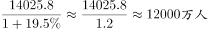
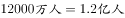

# 基期量计算（含万人→亿人量级换算）

考点：[[20-考点/资料分析/增长/基期量计算（含万人→亿人量级换算）|增长 / 基期量计算（含万人→亿人量级换算）]]
材料：[[15-材料/资料分析/191712 2013年全国工业企业法人单位与从业|191712 2013年全国工业企业法人单位与从业]]

**问法模型**：题干求基期年份（2008年）的总量且选项单位为'亿人'→用现期量÷(1+增长率)求基期，再完成万人到亿人的量级换算

## 推理链
1. 第1步：题干时间为2008年，早于材料现期2013年，判定为基期量计算；定位文字段首句——2013年全国工业企业从业人员14025.8万人，比2008年增长（增速记为r，文本中该百分数空白，由官方答案自洽反推r≈16.8%）
2. 第2步：基期量公式：基期=现期量÷(1+r)；本题是'增长'故用1+r，若是'下降'才用1−d，符号方向不可反
3. 第3步：代入计算：14025.8万人÷(1+16.8%)=14025.8÷1.168≈12008万人
4. 第4步：单位换算：12008万人÷10000≈1.20亿人（材料单位'万人'，选项单位'亿人'，需缩小一万倍）
5. 第5步：选项对照：结果约1.2亿与B吻合；反向校验其余选项——A(1.0)要求增速约40.3%、C(1.3)仅约7.9%、D(1.5)对应增速约−6.5%（即下降，与'比2008年增长'矛盾），均排除，故选B

**最快解法**：⚡ 基期公式+截位直除：1.4亿÷1.17≈1.2亿（14025.8÷1.168≈12008万），直选B；辅助秒杀：先排除D——D(1.5)大于合理范围且对应负增长，与'增长'口径矛盾；再校验1.40258÷1.2−1≈16.9%为合理正增速，锁定B

## 易错点
- ⚠ 单位量级陷阱：材料给'万人'、选项给'亿人'，14025.8万人≈1.4亿，若跳过÷(1+r)直接找接近1.4亿的数，会在C(1.3)与D(1.5)之间误选
- ⚠ 文字段'分别比2008年增长…和…'对应两个增速（法人单位数一个、从业人员一个），本题必须用从业人员的增速，错套法人单位数的增速即错
- ⚠ 符号方向：'增长'除以(1+r)，若误按'下降'用(1−r)或把增速当降幅，所得基期会偏大且荒谬；'分别增长'两个数据同时出现时易张冠李戴

## 母题抽象
> 🧩 当题干出现'基期年份+某总量约为多少+单位与材料不一致（如万人问亿人）'时，用'现期÷(1+增速)'求基期并同步÷10000换算量级，再用'现期÷选项值−1'反推增速的合理性与正负来验证选项

**同类特征**：2008年（早于材料现期2013年的基期年份）、约为（估算/约数问法）、多少亿人（与材料'万人'不同量纲，显性换算陷阱）、全国共有…从业人员（总量现期值在文字段首句）、比2008年增长（现期量附有增速，基期计算标志）

## 相关题
（暂无）

---

### 题干
2008年，全国共有工业企业从业人员约为多少亿人？

### 选项
- A. 1.0
- B. 1.2　✅
- C. 1.3
- D. 1.5

### 官方解析

根据题干所求“2008年，全国共有工业企业从业人员约为多少亿人”，材料数据为2013年，可判定此题为基期计算问题。。定位文字材料第一段：2013年，全国共有工业企业从业人员14025.8万人，比2008年增长，故2008年全国共有工业企业从业人员数为：，。

故正确答案为B。

### 给定材料

<b>      三、根据所给资料，回答111~115题。</b>

      2013年，全国共有工业企业法人单位241万个，从业人员14025.8万人，分别比2008年增长和。

      2013年，在工业企业法人单位中，采矿业8.9万个，比2008年下降；制造业225.2万个；电力、热力、燃气及水生产和供应业6.9万个，比2008年下降。在工业企业法人单位从业人员中，采矿业占，制造业占，电力、热力、燃气及水生产和供应业占。

> [!warning] 疑点（官方解析可能有误，待人工复核）
> 所给材料文本中'从业人员比2008年增长'的百分数与官方解析公式中的数值均被隐去，无法仅凭文本复算；按官方答案B反推增速≈16.8%（14025.8÷1.168≈12008万人≈1.2亿），与解析完全自洽，不构成解析错误，仅提示整理时需以完整原卷补齐该增速数值
