# 基期量计算（基期和差·差减拼合求分项基期）

考点：[[20-考点/资料分析/增长/基期量计算（基期和差·差减拼合求分项基期）|增长 / 基期量计算（基期和差·差减拼合求分项基期）]]
材料：[[15-材料/资料分析/191712 2013年全国工业企业法人单位与从业|191712 2013年全国工业企业法人单位与从业]]

**问法模型**：题干给基期时间'2008年'并求'约多少万个'，而制造业只给2013年现期225.2万个且未给自身增速 → 采用基期和差模型：2008年制造业=总量基期241/(1+r)−采矿基期8.9/(1−d₁)−电力热力基期6.9/(1−d₂)。

## 推理链
1. 第1步：定位文字材料提取条件：2013年全国工业企业法人单位241万个（比2008年增长r，r数值在所给文本中空白）、采矿业8.9万个（比2008年下降d₁，数值空白）、电力热力燃气及水生产和供应业6.9万个（比2008年下降d₂，数值空白）；制造业2013年为225.2万个，材料未给其自身增长率。
2. 第2步：制造业无自身增速，不能直接套单一基期公式，但采矿、制造、电力热力三大行业门类共同构成总量，故用基期和差：2008年制造业=2008年总量−2008年采矿−2008年电力热力。
3. 第3步：按方向规则写基期式：'增长'除以(1+r)，'下降'除以(1−d)，即2008总量=241/(1+r)（结果<241），2008采矿=8.9/(1−d₁)（结果>8.9），2008电力=6.9/(1−d₂)（结果>6.9）。
4. 第4步：代入三个基期式做差减：241/(1+r)−8.9/(1−d₁)−6.9/(1−d₂)（所给文本中r、d₁、d₂为空白，按材料导读须以完整原卷增长率数据补齐，不得臆造数值）。
5. 第5步：差减结果约174万个，与选项对照：A160、B174、C186、D200，B项最接近，故选B。

**最快解法**：⚡ 公式法（基期和差）+截位直除粗算：①2008总量=241/(1+r)，因'增长'结果必小于241；②采矿、电力为'下降'，基期=现期/(1−d)，分别略大于8.9和6.9；③三式差减后对照选项，四个选项间隔约12~14万个、差距大，首两位直除即可锁定B（174）；增长率具体数值原文空白，代入时以完整原卷数据为准。

## 易错点
- ⚠ 模型错配：制造业只给2013年现期225.2万个、未给自身增长率，误直接套225.2/(1+r)；必须走'总基期−采矿基期−电力热力基期'的差减拼合。
- ⚠ 基期还原方向：总量是'增长'，除(1+r)后小于241；采矿、电力是'下降'，除(1−d)后分别大于8.9、6.9，符号方向搞反即错。
- ⚠ 跨口径拼数陷阱：表格按登记注册类型（内资229.3/港澳台5.7/外商5.9万个）与文字段按行业门类是同一总量的两种切法，数字不能跨口径相加减推导制造业基期；且三大行业单位数加总240.9万与合计241.0万存在0.1万舍入差，涉及单位数精确加减时要留意。

## 母题抽象
> 🧩 当题干求'某分项的基期量'而材料未给该分项自身增速，但给出总量及其余分项的现期值与增/降方向时，用基期和差模型'总基期−其余分项基期'，按'增长除(1+r)、下降除(1−d)'还原，差减后对照选项验证。

**同类特征**：问基期年份'2008年……约多少万个'（'约'提示估算量级）、求分项（制造业）基期但材料未给该分项增长率、材料给出总量及两个分项'比2008年增长/下降'的同比方向、需多量差减拼合（基期和差）而非单一公式、选项为整数万个且间隔较大，适合粗算对照

## 相关题
（暂无）

---

### 题干
2008年，全国制造业企业法人单位有约多少万个？

### 选项
- A. 160
- B. 174　✅
- C. 186
- D. 200

### 官方解析

根据题干所求“2008年全国制造业企业法人单位有······万个”，材料给了2013年全国共有工业企业法人单位数及增长率，采矿业法人单位数及增长率，电力、热力、燃气及水生产和供应业法人单位数及增长率，故可判断本题为基期和差问题。定位文字材料，已知：“全国共有工业企业法人单位241万个，比2008年增长”“采矿业8.9万个，比2008年下降”“电力、热力、燃气及水生产和供应业6.9万个，比2008年下降”，根据材料可得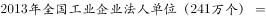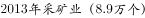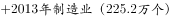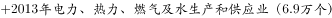，故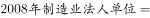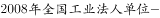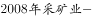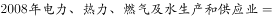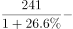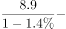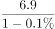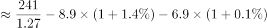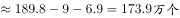，B项最接近。

故正确答案为B。

### 给定材料

<b>      三、根据所给资料，回答111~115题。</b>

      2013年，全国共有工业企业法人单位241万个，从业人员14025.8万人，分别比2008年增长和。

      2013年，在工业企业法人单位中，采矿业8.9万个，比2008年下降；制造业225.2万个；电力、热力、燃气及水生产和供应业6.9万个，比2008年下降。在工业企业法人单位从业人员中，采矿业占，制造业占，电力、热力、燃气及水生产和供应业占。

> [!warning] 疑点（官方解析可能有误，待人工复核）
> 所给材料文本中三处'比2008年增长/下降'后的具体百分数及官方解析中的代入算式均为空白（省略），本题数值代入无法用所给文本完整复算，需按材料导读以完整原卷增长率数据补齐，不得臆造数值；官方答案B（174）作为唯一事实采用，基期和差模型与解析思路一致，无矛盾。

<!-- CODEX-ANSWER-REVIEW:BEGIN -->
### 本次独立复核

**复核状态：** `confirmed`（独立复算确认答案）

**计分答案：** B（可计分）

**复核解析：**

2013年全国工业企业法人单位合计241万个，比2008年增长26.6%；其中采矿业8.9万个、比2008年下降1.4%，电力热力燃气及水生产供应业6.9万个、下降0.1%。2008年制造业主体数=241÷1.266−8.9÷0.986−6.9÷0.999≈174.43万个，最接近B项174万个。

**相关信息：**

资料分析—基期量与部分量；先分别反推总量及两个非制造业分项的基期，再用总量减分项，不能直接减现期数。

**题源依据：** [固定版本原题](https://github.com/Mentat-Uran/kaogongzhentizhengliu/blob/84ab93d4b64b61d897bece8a1c0a5bab06b4feb2/10-%E7%9C%9F%E9%A2%98/%E8%B5%84%E6%96%99%E5%88%86%E6%9E%90/%E5%A2%9E%E9%95%BF/2136496%20%E5%9F%BA%E6%9C%9F%E9%87%8F%E8%AE%A1%E7%AE%97%EF%BC%88%E5%9F%BA%E6%9C%9F%E5%92%8C%E5%B7%AE%C2%B7%E5%B7%AE%E5%87%8F%E6%8B%BC%E5%90%88%E6%B1%82%E5%88%86%E9%A1%B9%E5%9F%BA%E6%9C%9F%EF%BC%89.md)；固定内容 commit `84ab93d4b64b61d897bece8a1c0a5bab06b4feb2`，Markdown blob `4a14a39408151b878bd972e29e01558b52284806`。
<!-- CODEX-ANSWER-REVIEW:END -->
