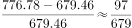
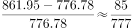
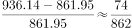
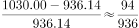

# 增长率比较（逐年环比增速）

考点：[[20-考点/资料分析/增长/增长率比较（逐年环比增速）|增长 / 增长率比较（逐年环比增速）]]
材料：[[15-材料/资料分析/191714 2016年S市科技创新年度情况：以2|191714 2016年S市科技创新年度情况：以2]]

**问法模型**：题干问'2013～2016年间与上年相比增速最快的年份'→对每一年计算 增长率=（当年R&D支出-上年R&D支出）/上年R&D支出，比较四个分数取最大

## 推理链
1. 第1步：从统计图柱顶标注读取各年R&D经费支出：2012年679.46、2013年776.78、2014年861.95、2015年936.14、2016年1030.00亿元（柱形为各年度当期支出，非累计）
2. 第2步：增长率=现期/基期-1=增长量/基期量，比较增速可转化为比较'增长量/基期量'的分数大小
3. 第3步：逐年求增量与基期：2013年增量97.32（776.78-679.46）基期679.46；2014年增量85.17（861.95-776.78）基期776.78；2015年增量74.19（936.14-861.95）基期861.95；2016年增量93.86（1030.00-936.14）基期936.14
4. 第4步：按分数性质，2013年分子（97.32）为四年最大、分母（679.46）为四年最小，该分数必为最大，无需精算；代回验证2013年≈97.32/679.46≈14.3%>2014年≈11.0%>2016年≈10.0%>2015年≈8.6%
5. 第5步：增速最快的年份为2013年，对照选项选A

**最快解法**：⚡ 分数性质比较法（分子大且分母小则分数大）：先目测各年柱顶差值，2013年增量97.32亿元最大且其基期679.46亿元最小，直接锁定2013年，全程不用算出百分比

## 易错点
- ⚠ 混淆'增长量最大'与'增速最快'：2016年增量93.86亿元大于2014、2015年，若只比增量易误选D，必须除以各自基期量
- ⚠ 柱形为各年度当期支出而非累计值，直接用相邻两年环比即可，勿按累计口径处理
- ⚠ 双轴图陷阱：柱形读左轴（亿元200～1200），折线读右轴（%），本题只需柱形数据，误把3.37%～3.80%的比例当增速会算错

## 母题抽象
> 🧩 当题干出现'某几年间与上年相比增速最快（的年份）'且图上直接标注各年数值时，先求逐年增量，若某一年'增量最大且基期最小'同时成立，用分数性质直接锁定该年，无需逐一求百分比

**同类特征**：与上年相比增速最快、逐年环比比较、2013～2016时间范围、柱形图柱顶直接标注数值、增长率比较模型、当年R&D经费支出

## 相关题
- [[10-真题/资料分析/增长/2741707 增长率（同比增速）比较|2741707]]（山东 2021，相关度1）
- [[10-真题/资料分析/增长/13504524 同比增速（增长率）比较|13504524]]（云南 2025，相关度1）
- [[10-真题/资料分析/其他/11226442 多指标逐年增长判断与年份计数（环比取交集）|11226442]]（江苏 2025，相关度1）
- [[10-真题/资料分析/增长/16437529 增长率比较（同比增速最大的年份）|16437529]]（山东 2024，相关度1）
- [[10-真题/资料分析/增长/2452966 增长率比较（多年同比增速趋势判断）|2452966]]（上海 2020，相关度1）

---

### 题干
2013～2016年间，S市研究与试验发展经费与上年相比增速最快的年份是：

### 选项
- A. 2013年　✅
- B. 2014年
- C. 2015年
- D. 2016年

### 官方解析

根据题干，求“与上年相比增速最快的年份”，可知，本题为一般增长率问题。定位统计图，可得每年S市全年用于研究与试验发展（R&amp;D）经费，根据可得2013年对应增速为：；2014年对应增速为：；2015年对应增速为：；2016年对应增速为：。2013年对应增速分子最大，分母最小，故分数最大。

故正确答案为A。

### 给定材料

      <b>  一、根据所给资料，回答101～105题。</b>

      <b>  </b>2016年S市全年用于研究与试验发展（R&amp;D）经费支出总额为1030.00亿元，占S市生产总值的比重为。

        全年受理专利申请119937件，比上年增长，其中，受理发明专利申请54339件，增长。全年专利授权量为64230件，增长，其中，发明专利授权量为20086件，增长。全年PCT国际专利受理量为1560件，比上年增长。至年末，全市有效发明专利达85049件。年内全市新认定高新技术企业2306家。年内认定高新技术成果转化项目469项，其中，电子信息、生物医药、新材料等重点领域项目占。至年末，共认定高新技术成果转化项目10969项。全年经认定登记的各类技术交易合同2.12万件，比上年下降；合同金额822.86亿元，增长。

