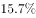
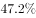
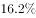
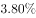
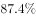
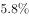

# 同比增长速度大小比较（文字读数型）

考点：[[20-考点/资料分析/增长/同比增长速度大小比较（文字读数型）|增长 / 同比增长速度大小比较（文字读数型）]]
材料：[[15-材料/资料分析/191714 2016年S市科技创新年度情况：以2|191714 2016年S市科技创新年度情况：以2]]

**问法模型**：题干问'2016年同比增长速度最慢的是哪项'→ 定位四个选项指标各自的同比增速读数，直接比较大小取最小值，无需列式计算

## 推理链
1. 第1步：由题干确定需比较的四个指标——受理发明专利申请量（54339件）、发明专利授权量（20086件）、PCT国际专利受理量（1560件）、技术交易合同金额（822.86亿元），均需读取各自2016年同比增速
2. 第2步：回文字材料定位四个指标的增速——'受理发明专利申请54339件，增长…''发明专利授权量为20086件，增长…''PCT国际专利受理量为1560件，比上年增长…''合同金额822.86亿元，增长…'
3. 第3步：比较四个同比增速——受理发明专利申请量、PCT国际专利受理量、技术交易合同金额均为正增长，而发明专利授权量的同比增速最低（同比不升反降）
4. 第4步：增速最低即'增长速度最慢'，对照选项为发明专利授权量，对应B项，与官方答案一致

**最快解法**：⚡ 读数比较法（增速排序题）：四个选项在文字中各对应一句'增长（下降）x%'，逐项读数后找数值最小（唯一为负增长优先）的一项——发明专利授权量增速为负、其余三项为正，秒选B

## 易错点
- ⚠ 增速与绝对量混淆：20086件是四个现期值中数量最小的，但题干比较的是'速度'，不能以现期量小代增速慢
- ⚠ 读数缺口陷阱：本卷文字中各增速百分数留空，只盯本卷无法作答，须按原卷数字读出增速再比较
- ⚠ 存量与流量混淆：'至年末有效发明专利85049件'是时点存量、无同比增速，不在本题比较范围；且技术交易'合同件数下降而金额增长'一降一升，D项问的是金额（正增长），勿误选D

## 母题抽象
> 🧩 当题干出现'××指标中增长速度最快/最慢的是'且四个指标在文字材料中各带'增长（下降）x%'读数时，用直接读数比较法，先找唯一负增长项，再比正增长数值大小，无需计算

**同类特征**：2016年同比增长速度最慢、四个选项均为全年流量指标、文字材料中各带增长百分数、读数比较而非计算、增速排序选最值

## 相关题
（暂无）

---

### 题干
S市下列各项指标中，2016年同比增长速度最慢的是：

### 选项
- A. 受理发明专利申请量
- B. 发明专利授权量　✅
- C. PCT国际专利受理量
- D. 经认定登记的各类技术交易合同金额

### 官方解析

定位文字材料第2段：“受理发明专利申请54339件，增长；发明专利授权量为20086件，增长；全年PCT国际专利受理量为1560件，比上年增长；全年经认定登记的各类技术交易合同2.12万件，合同金额822.86亿元，增长”，因此S市2016年同比增长速度最慢的是发明专利授权量。

故正确答案为B。

### 给定材料

      <b>  一、根据所给资料，回答101～105题。</b>

      <b>  </b>2016年S市全年用于研究与试验发展（R&amp;D）经费支出总额为1030.00亿元，占S市生产总值的比重为。

        全年受理专利申请119937件，比上年增长，其中，受理发明专利申请54339件，增长。全年专利授权量为64230件，增长，其中，发明专利授权量为20086件，增长。全年PCT国际专利受理量为1560件，比上年增长。至年末，全市有效发明专利达85049件。年内全市新认定高新技术企业2306家。年内认定高新技术成果转化项目469项，其中，电子信息、生物医药、新材料等重点领域项目占。至年末，共认定高新技术成果转化项目10969项。全年经认定登记的各类技术交易合同2.12万件，比上年下降；合同金额822.86亿元，增长。

> [!warning] 疑点（官方解析可能有误，待人工复核）
> 所给文本中各指标增速百分数均为空白，本卷无法直接读数验证四个增速的大小关系；官方解析按原卷数字判定发明专利授权量增速最慢（其余三项为正增长），结论与答案B一致，予以采信
