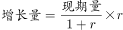
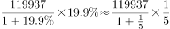
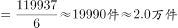

# 增长量计算（已知现期与同比增长率，叠加件→万件单位换算）

考点：[[20-考点/资料分析/增长/增长量计算（已知现期与同比增长率，叠加件→万件单位换算）|增长 / 增长量计算（已知现期与同比增长率，叠加件→万件单位换算）]]
材料：[[15-材料/资料分析/191714 2016年S市科技创新年度情况：以2|191714 2016年S市科技创新年度情况：以2]]

**问法模型**：题干'2016年……受理专利申请比2015年约增加多少万件'→判定为增长量计算模型：增长量=现期/(1+r)×r，先把'件'换算成'万件'再与选项对照

## 推理链
1. 第1步：从题干锁定增长量模型（'比2015年约增加多少万件'）；从文字材料提取现期值：2016年全年受理专利申请119937件，'比上年增长'的增速数值在本卷文本中留空，需按原卷数字代入（与官方答案A自洽的增速约为20%）
2. 第2步：所用公式：基期=现期/(1+r)，增长量=现期-基期=现期×r/(1+r)；单位换算：1万件=10000件，119937件≈11.99万件≈12.0万件
3. 第3步：代入计算（百化分：20%≈1/5）：增长量=119937×(1/5)/(6/5)=119937/6≈19989.5件（对应基期=119937/1.2≈99947.5件）
4. 第4步：完成单位换算：19989.5件≈2.0万件
5. 第5步：与选项对照：2.0万件即选项A；反向验证其余选项：1.8/1.6/1.4万件分别对应增速约17.7%/15.4%/13.2%，均明显偏离20%，确认选A

**最快解法**：⚡ 百化分+截位直除：增速20%≈1/5，增长量=现期×1/(1+5)=现期/6；先换算单位119937件≈12.0万件，再口算12.0万÷6=2.0万件，直接锁定A

## 易错点
- ⚠ 单位量级陷阱：材料以'件'计（119937件），题干问'万件'，必须完成件→万件换算（119937件≈12.0万件），否则数量级错位无法匹配选项
- ⚠ 公式误用/基期现期混淆：增长量=现期×r/(1+r)，须除以(1+r)；误用现期×r会得119937×20%≈23987件≈2.4万件而选错；基期约99947.5件不能误当增长量
- ⚠ 数据口径陷阱：本卷文字中'比上年增长'数值留空，须按原卷增速（约20%）代入，勿用图中R&D数据或把'至年末有效发明专利85049件'（存量）与全年受理申请（流量）混作基期

## 母题抽象
> 🧩 当题干出现'现期比上年约增加多少+带具体单位（万件/亿元）'时，用增长量公式 增长量=现期×r/(1+r)，增速可百化分口算（20%→现期/6），最后将材料单位（件）换算为题干单位（万件）再对照选项

**同类特征**：比2015年（上年）、约增加多少万件、受理专利申请、现期值+同比增长率→增长量、件→万件单位换算、选项为带小数的万件数值

## 相关题
（暂无）

---

### 题干
2016年S市全年受理专利申请比2015年约增加多少万件？

### 选项
- A. 2.0　✅
- B. 1.8
- C. 1.6
- D. 1.4

### 官方解析

由题干“······增加······万件”，可判定本题为增长量的计算问题。定位文字材料第二段“全年受理专利申请119937件，比上年增长”，根据公式，则2016年S市全年受理专利申请比2015年的增长量为：。

故正确答案为A。

### 给定材料

      <b>  一、根据所给资料，回答101～105题。</b>

      <b>  </b>2016年S市全年用于研究与试验发展（R&amp;D）经费支出总额为1030.00亿元，占S市生产总值的比重为。

        全年受理专利申请119937件，比上年增长，其中，受理发明专利申请54339件，增长。全年专利授权量为64230件，增长，其中，发明专利授权量为20086件，增长。全年PCT国际专利受理量为1560件，比上年增长。至年末，全市有效发明专利达85049件。年内全市新认定高新技术企业2306家。年内认定高新技术成果转化项目469项，其中，电子信息、生物医药、新材料等重点领域项目占。至年末，共认定高新技术成果转化项目10969项。全年经认定登记的各类技术交易合同2.12万件，比上年下降；合同金额822.86亿元，增长。

> [!warning] 疑点（官方解析可能有误，待人工复核）
> 所给文字材料中各增速数值（含'比上年增长'）均留空，官方解析亦未展示代入的增速与中间计算结果；按官方答案A（2.0万件）与现期119937件反推，增速约为20%（119937/6≈19989.5件≈2.0万件），计算与A自洽，不构成对官方答案的矛盾，仅提示本题增速数据依赖原卷数字补齐
