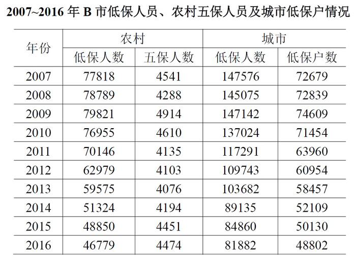

# 同比下降判断与年份数筛选（双指标同时下降计数）

考点：[[20-考点/资料分析/增长/同比下降判断与年份数筛选（双指标同时下降计数）|增长 / 同比下降判断与年份数筛选（双指标同时下降计数）]]
材料：[[15-材料/资料分析/191724 2007~2016年B市城乡低保（城|191724 2007~2016年B市城乡低保（城]]

**问法模型**：题干问'2008～2016年农村低保人数和五保人数均比上年有所下降的年份' → 逐年在表中做相邻年份同列比对，两指标同一年同时为负变化则计入计数

## 推理链
1. 第1步：从统计表提取两列数据，农村低保人数（2007~2016）：77818、78789、79821、76955、70146、62979、59575、51324、48850、46779；五保人数：4541、4288、4914、4610、4135、4103、4076、4194、4451、4474
2. 第2步：判定规则：比上年下降=当年数值<上年数值；'均下降'要求两列同一年同时满足，年份范围为2008~2016（2007为基期不计）
3. 第3步：逐年比对：2008年农村低保78789>77818（升）不符；2009年79821>78789（升）不符；2010年76955<79821且4610<4914符合；2011年70146<76955且4135<4610符合；2012年62979<70146且4103<4135符合；2013年59575<62979且4076<4103符合
4. 第4步：2014~2016年农村低保人数虽继续下降（51324→48850→46779），但五保人数连续回升（4076→4194→4451→4474），三年均不符
5. 第5步：符合'均下降'的年份为2010、2011、2012、2013共4年，与选项D（4年）对照，故选D

**最快解法**：⚡ 

## 易错点
- ⚠ 时间起点陷阱：从2008年起算，2007为基期不计；2008、2009年农村低保人数是上升的（78789>77818、79821>78789），看漏会错把这两年的五保下降计成'均下降'
- ⚠ 五保人数2014~2016连续回升（4076→4194→4451→4474），若只盯农村低保人数连年下降的趋势，会误数成更多年份（如误选A的7年）
- ⚠ 列定位陷阱：'低保人数'分农村、城市两列，同名指标数值口径不同，必须按列查数，不能串到城市低保人数列

## 母题抽象
> 🧩 当题干出现'某时间段内A、B两指标均比上年下降（上升）的年份有几个'时，逐年在表中做相邻年份同列比对，两指标变化同号（同降/同升）的年份计数即可，无需计算增长量数值

**同类特征**：均比上年有所下降、2008～2016年、农村低保人数和五保人数、年份计数、查表直接比较、双指标同时变化

## 相关题
（暂无）

---

### 题干
2008～2016年，农村低保人数和五保人数均比上年有所下降的有：

### 选项
- A. 7年
- B. 6年
- C. 5年
- D. 4年　✅

### 官方解析
根据题干“2008～2016年农村低保人数和五保人数均比上年有所下降的”可知，本题在图表中直接找到对应的数比较大小即可。定位到表格可知，农村低保人数和五保人数均比上年有所下降的为2010年、2011年、2012年、2013年，共4年。
故正确答案为D。

### 给定材料

       2016年B市有农村低保户数28925户，低保人数为46779人；全年累计支出农村低保资金38402.0万元。农村五保供养人数4474人，其中：集中五保供养人数1711人，分散供养人数2763人；全年累计支出农村五保供养资金5668.7万元，比上年增加支出596.3万元。

       2016年B市有城市低保户数48802户，低保人数为81882人；全年累计支出城市低保资金80215.8万元。

