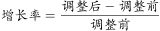
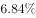
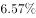
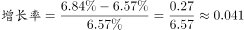
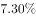
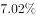
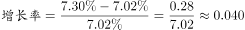
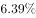
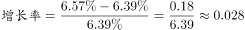
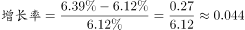

# 增长率比较（增长比率最大值比较）

考点：[[20-考点/资料分析/增长/增长率比较（增长比率最大值比较）|增长 / 增长率比较（增长比率最大值比较）]]
材料：[[15-材料/资料分析/192014 中国人民银行2015年内6次（3月1|192014 中国人民银行2015年内6次（3月1]]

**问法模型**：题干问'贷款基准利率增长比率最高的月份' → 逐月取本行'调整后/调整前'计算增长率（调整后÷调整前-1）并比较取最大（增长率比较模型）

## 推理链
1. 第1步：定位表格'贷款基准利率'两列，题干涉及4个月份的调整前/调整后为：3月18日6.12→6.39、5月19日6.39→6.57、7月21日6.57→6.84、9月15日7.02→7.30
2. 第2步：增长比率=（调整后-调整前）/调整前，基期必须取本行'调整前'（表内逐行链式衔接，本行调整前=上一行调整后）
3. 第3步：D项3月：0.27/6.12≈4.4%；C项5月：0.18/6.39≈2.8%
4. 第4步：A项7月：0.27/6.57≈4.1%；B项9月：0.28/7.02≈4.0%
5. 第5步：比较四项：3月4.4%＞7月4.1%＞9月4.0%＞5月2.8%，其中3月与7月增长量同为0.27，但3月基数6.12小于7月的6.57，故3月更大；9月增量0.28虽最大，但基数7.02过大，增长率反而不及3月
6. 第6步：对照选项，D项（3月）增长比率最高，选D

**最快解法**：⚡ 分数性质比较法（免精算）：四个分数为0.27/6.12、0.18/6.39、0.27/6.57、0.28/7.02。①3月vs7月：分子同为0.27，分母6.12<6.57，3月直接胜出；②3月vs9月：分子0.27→0.28仅增约3.7%，分母6.12→7.02却增约14.7%，分母增幅远超分子，3月胜；③5月分子0.18明显最小、分母又偏大，排除。故最大为3月，选D

## 易错点
- ⚠ 基期错取：误以年初6.12或其他行数值做基期；本题必须以各月本行'调整前'为基期（如7月基期是6.57而非6.12）
- ⚠ 增长比率与差额混淆：0.27等是绝对差（百分点），选项问'增长比率'必须除以基期得相对数%，不能直接比增量0.28最大就选9月
- ⚠ 月份与调整日对应及链式断裂：9月取9月15日行（7.02→7.30）；12月21日行贷款调整前7.29与9月15日调整后7.30不衔接，跨行推基期时最易踩坑；另注意两列数值相近，勿串列读成存款利率

## 母题抽象
> 🧩 当题干出现'XX指标增长比率（增长率）最高的月份/年份'且材料为'调整前/调整后'成对水平值时，逐行用（调整后-调整前）/调整前计算增长率，优先用分子分母同大同小的分数性质快速比较（同分子比分母、估分子分母增幅差），无需逐一精算

**同类特征**：增长比率最高、贷款基准利率、逐月比较取最大、调整前/调整后水平值、链式基期（本行调整前为基期）、增长率大小排序

## 相关题
- [[10-真题/资料分析/增长/5510339 同比增长率比较（多年份增速快慢排序）|5510339]]（山东 2023，相关度1）

---

### 题干
2015年，贷款基准利率增长比率最高的月份是：

### 选项
- A. 7月
- B. 9月
- C. 5月
- D. 3月　✅

### 官方解析

根据题干所求“······增长比率最高······”，可判定此题为一般增长率问题。定位表格，已知贷款基准利率调整前、调整后的具体值，所以贷款基准利率，代入选项：

A项：7月，定位表格，调整后为，调整前为，所以贷款基准利率；

B项：9月，定位表格，调整后为，调整前为，所以贷款基准利率；

C项：5月，定位表格，调整后为，调整前为，所以贷款基准利率；

D项：3月，定位表格，调整后为，调整前为，所以贷款基准利率。

所以D项最大。

故正确答案为D。

### 给定材料

