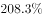
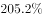
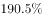
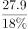
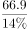
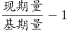
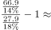
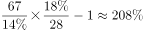

# 增长率计算（先由'分量÷占比'还原两期总量，再求总量增长率）

考点：[[20-考点/资料分析/增长/增长率计算（先由'分量÷占比'还原两期总量，再求总量增长率）|增长 / 增长率计算（先由'分量÷占比'还原两期总量，再求总量增长率）]]
材料：[[15-材料/资料分析/192018 A、B、C三个年份全民所有制单位职工|192018 A、B、C三个年份全民所有制单位职工]]

**问法模型**：题干'B年工资总额比A年上涨了'+选项为百分数 → 判定一般增长率问题，先用'总量＝分量÷占比'分别还原两年工资总额，再套（现期−基期）÷基期。

## 推理链
1. 第1步：定位左图，A年劳保福利费27.9亿元、相当于工资总额的18%；B年劳保福利费66.9亿元、相当于工资总额的14%（18、14是占比，不是增速也不是内部构成）。
2. 第2步：工资总额＝劳保福利费÷占比，做除法还原：A年工资总额＝27.9÷18%＝155亿元。
3. 第3步：B年工资总额＝66.9÷14%≈477.9亿元（量级从几十跳到几百，注意量级）。
4. 第4步：增长率＝（477.9−155）÷155＝322.9÷155≈2.08，即上涨约208%。
5. 第5步：与选项对照，选项A为约208%的表达，故正确答案为A；注意劳保福利费自身增速66.9÷27.9−1≈140%是干扰量，不能选。

**最快解法**：⚡ 公式法＋截位直除：两步除法还原总量（27.9÷0.18＝155；66.9÷0.14≈478），再做差相除322.9÷155，首两位商'20'锁定约208%，对照选项秒选A；亦可用合并式（66.9/27.9）×（18/14）−1≈2.398×1.286−1≈208%一次算完。

## 易错点
- ⚠ 把左图圆圈里的18、14误当增长率或劳保福利费的内部构成比重，实际是'劳保福利费占工资总额的比重'，求工资总额必须做除法（分量÷占比）而非乘法。
- ⚠ 量级陷阱：27.9÷18%＝155、66.9÷14%≈478，由几十亿元跳到几百亿元，截位时勿丢数量级。
- ⚠ 混淆对象：题干问的是'工资总额'的上涨率，若错用劳保福利费自身增幅（66.9−27.9）÷27.9≈140%即入坑；定性校验——福利费涨而占比由18%降到14%，说明工资总额增速必高于福利费增速，约208%量级合理。

## 母题抽象
> 🧩 当题干给出两期'分量及其占总量的比重'并问'总量上涨了百分之几'时，先分别用'总量＝分量÷比重'还原两期总量，再套增长率公式（现期−基期）÷基期，并与'分量自身增速'区分。

**同类特征**：工资总额比A年上涨了、选项为百分数、劳保福利费相当于工资总额的%、占比不同年份取值不同（18%与14%）、需先还原两期总量、两步连环：除法还原＋增长率

## 相关题
- [[10-真题/资料分析/增长/9629 一般增长率计算（现期需由增量倒推）|9629]]（安徽 2009，相关度1）
- [[10-真题/资料分析/比重/2604234 现期比重计算|2604234]]（广东 2020，相关度1）
- [[10-真题/资料分析/增长/27835 一般增长率计算（已知现期量与增长量求增长率）|27835]]（河北 2012，相关度1）
- [[10-真题/资料分析/平均数/10204497 平均数增长率（均价=值-量的比值增长率）|10204497]]（海南 2024，相关度1）
- [[10-真题/资料分析/增长/12536395 隔年（间隔）增长率|12536395]]（四川 2024，相关度1）

---

### 题干
全民所有制单位职工B年工资总额比A年上涨了：

### 选项
- A. 

　✅
- B. 

- C. 

- D. 

### 官方解析

根据题干所求“······B年比A年上涨了······”，且选项为百分数，可判定此题为一般增长率问题。定位图形材料1，A年全民所有制单位职工劳保福利费为27.9亿元，占工资总额的，故A年工资总额为；B年为66.9亿元，占工资总额的，故B年工资总额为。根据增长率计算公式，可计算出，全民所有制单位职工B年工资总额比A年上涨了。

故正确答案为A。

### 给定材料

