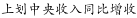
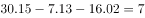

# 增长量（同比增收）的加和关系求未知分项增量

考点：[[20-考点/资料分析/增长/增长量（同比增收）的加和关系求未知分项增量|增长 / 增长量（同比增收）的加和关系求未知分项增量]]
材料：[[15-材料/资料分析/192253 2016年某市本级财政预算收支情况：|192253 2016年某市本级财政预算收支情况：]]

**问法模型**：表1'？'处数字 → 利用'其中'包含关系，总收入同比增收=三个分项同比增收之和，未知项=总量增收-已知分项增收

## 推理链
1. 第1步：表1中'其中'表明一般预算收入、上划中央收入、基金收入是财政预算总收入的三个分项，收入金额满足加和：26.26+47.57+35.33=109.16亿元
2. 第2步：'同比增收'列同样满足加和关系：30.15=7.13+16.02+？
3. 第3步：？=30.15-7.13-16.02=30.15-23.15=7.00亿元
4. 第4步：7.00与A项完全吻合，故选A

**最快解法**：⚡ 加和拆分口算：先加已知两分项增收7.13+16.02=23.15，再用总收入增收30.15-23.15=7.00，直选A；无需动用完成率95.1%做任何反推

## 易错点
- ⚠ 把预算完成率95.1%当增长率使用，试图用35.33×(1-95.1%)之类求增收——完成率分母是'预算收入金额'（计划数），不是上年实际数，完成率≠增速
- ⚠ 表1给'同比增收'（增量、亿元）、表2给'同比增速'（%、需用现期×r/(1+r)），两表口径不同，若套错公式必错
- ⚠ 未识别'其中'的包含关系，以为总收入与三项分项相互独立、数据不足以求解

## 母题抽象
> 🧩 当统计表出现'其中'分层结构，且总量与分项并列同一增量指标时，未知分项增量=总量增量-各已知分项增量之和，纯减法直取，不必引入比率列

**同类特征**：表中'？'处待求、'其中'包含关系、同比增收（增量）列、分项之和等于总计、财政预算总收入109.16、基金收入35.33

## 相关题
（暂无）

---

### 题干
表1中“？”处的数字应为：

### 选项
- A. 7　✅
- B. 7.5
- C. 8.5
- D. 9

### 官方解析

定位表1，可知，则亿元。

故正确答案为A。

### 给定材料

2016年该市本级完成财政一般预算支出49.86亿元，比上年增支16.79亿元，增长。

