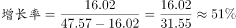
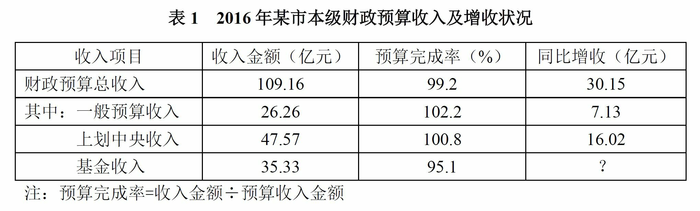
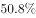
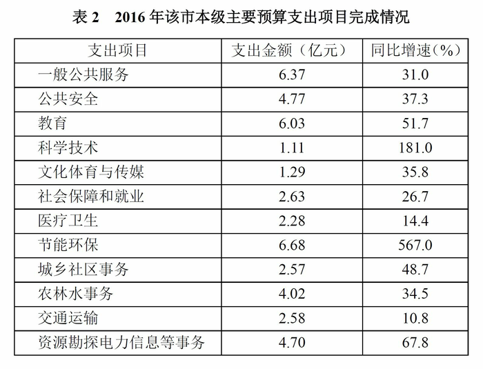

# 由同比增量求同比增长率（基期反推）

考点：[[20-考点/资料分析/增长/由同比增量求同比增长率（基期反推）|增长 / 由同比增量求同比增长率（基期反推）]]
材料：[[15-材料/资料分析/192253 2016年某市本级财政预算收支情况：|192253 2016年某市本级财政预算收支情况：]]

**问法模型**：题干问'同比约增长了'（选项为百分数），但材料只给现期量和同比增收（增量）→ 先用'基期=现期−增量'还原2015年数，再套'增长率=增量÷基期'

## 推理链
1. 第1步：题干锁定'上划中央收入'，定位表1：2016年收入金额47.57亿元，同比增收16.02亿元（注意'预算完成率100.8%'是完成率不是增长率，不能用）
2. 第2步：表1给的是增量而非增速，故先反推基期：基期（2015年上划中央收入）=现期−增量=47.57−16.02=31.55亿元
3. 第3步：套增长率公式：增长率=增量÷基期=16.02÷31.55
4. 第4步：截位直除：16.02÷31.55≈16÷31.5≈0.508，即约增长50.8%（若误用增量÷现期=16.02÷47.57≈33.7%，是典型错法）
5. 第5步：与选项对照，约50.8%对应选项C，故正确答案为C

**最快解法**：⚡ 截位直除+基期反推：先做减法47.57−16.02=31.55（基期），再算16.02÷31.55——分子分母同截两位≈16.0÷31.5≈0.508，约50.8%，直接选C；可用下限验证：16.02÷47.57≈33.7%是'增量÷现期'的下界，真实增速必明显大于33.7%，排除偏小选项

## 易错点
- ⚠ 把表1'预算完成率100.8%'误当同比增长率使用——完成率的分母是预算计划数（收入金额÷完成率），不是上年实际数，与增长率无关
- ⚠ 用'增量÷现期'=16.02÷47.57≈33.7%当答案——增长率公式分母是基期量（现期−增量），不是现期量
- ⚠ 两表口径混淆：表1给'同比增收'（增量，亿元）、表2给'同比增速'（增长率，%），本题增量求增速须先减出基期，不能像表2那样直接读数

## 母题抽象
> 🧩 当题干出现'同比约增长了'且材料只给现期量+同比增收（增量）时，用'基期=现期−增量'先还原基期，再算'增量÷基期'，验证结果明显大于'增量÷现期'的下界即可锁定选项

**同类特征**：上划中央收入、同比约增长了、同比增收（亿元）、现期量与增量已知、选项为百分数、增长率计算

## 相关题
- [[10-真题/资料分析/增长/9629 一般增长率计算（现期需由增量倒推）|9629]]（安徽 2009，相关度2）
- [[10-真题/资料分析/增长/15419179 一般增长率计算（各分项加总求总量增长率）|15419179]]（湖北 2025，相关度2）
- [[10-真题/资料分析/比重/2604234 现期比重计算|2604234]]（广东 2020，相关度1）
- [[10-真题/资料分析/增长/27835 一般增长率计算（已知现期量与增长量求增长率）|27835]]（河北 2012，相关度1）
- [[10-真题/资料分析/平均数/10204497 平均数增长率（均价=值-量的比值增长率）|10204497]]（海南 2024，相关度1）

---

### 题干
2016年该市上划中央收入同比约增长了：

### 选项
- A. 

- B. 

- C. 

　✅
- D. 

### 官方解析

由题意“2016年该市上划中央收入同比约增长了”且选项为百分数，判定此题为一般增长率问题，增长率公式为。定位表1，可知2016年该市上划中央收入金额为47.57亿元，同比增收为16.02亿元，则。

故正确答案为C。

### 给定材料

2016年该市本级完成财政一般预算支出49.86亿元，比上年增支16.79亿元，增长。

