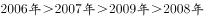

# 增长量比较

考点：[[20-考点/资料分析/增长/增长量比较|增长 / 增长量比较]]
材料：[[15-材料/资料分析/192255 2005～2015年各年末中国网民规|192255 2005～2015年各年末中国网民规]]

**问法模型**：题干要求'将年份按年末网民人数同比增量从多到少排序'→ 对相邻年份两两作差（当年末−上年末）求各年增长量，再按大小排序对照选项

## 推理链
1. 第1步：从双轴图柱状部分（左轴，万人）读出所需相邻年末网民数：2005年11100、2006年13700、2007年21000、2008年29800、2009年38400
2. 第2步：同比增长量=当年末网民数−上年末网民数（存量口径逐年作差，非年内累计）
3. 第3步：代入计算：2006年增量=13700−11100=2600万人；2007年增量=21000−13700=7300万人；2008年增量=29800−21000=8800万人；2009年增量=38400−29800=8600万人
4. 第4步：按增量从多到少排序：2008年(8800)＞2009年(8600)＞2007年(7300)＞2006年(2600)，其中2008与2009仅差200万人需精确比较
5. 第5步：对照选项，仅D项符合'2008年＞2009年＞2007年＞2006年'的排序，故选D

**最快解法**：⚡ 两两作差+精确比较：柱状图相邻柱高差心算即可（2600/7300/8800/8600），关键在8800与8600的接近项——先锁定2008＞2009这一对再排除干扰项；也可目测柱高差：2007→2008柱子抬升最陡，其次2008→2009，再次2006→2007，最小为2005→2006

## 易错点
- ⚠ 把'同比增量'误当'同比增速'，用增长率排序；本题比较的是绝对差值（万人）
- ⚠ 误把各年年末网民总量直接当增量排序，增量必须用'当年末−上年末'作差求得
- ⚠ 2008年(8800)与2009年(8600)增量非常接近，粗心估算易排反；另注意双轴图柱读左轴（万人）、线读右轴（%），勿混用折线数据参与比较

## 母题抽象
> 🧩 当题干出现'按…同比增量从多到少排序'且数据为逐年存量柱状图时，用相邻年份两两作差法（现期−基期）求各年增量，重点精确比较差值最接近的两项，再对照选项验证排序

**同类特征**：按年末网民人数同比增量、从多到少排序、柱状图逐年存量数据、相邻年份两两作差、增长量比较、年份排序型选项

## 相关题
- [[10-真题/资料分析/增长/465283 增长量比较|465283]]（江苏 2014，相关度3）
- [[10-真题/资料分析/增长/15121335 增长量比较|15121335]]（江苏 2024，相关度3）
- [[10-真题/资料分析/增长/18643862 增长量比较|18643862]]（四川 2026，相关度3）
- [[10-真题/资料分析/增长/2187833 增长量比较|2187833]]（山东 2018，相关度3）
- [[10-真题/资料分析/增长/2434313 增长量比较|2434313]]（新疆 2019，相关度3）

---

### 题干
将以下年份按年末网民人数同比增量从多到少排序，正确的是：

### 选项
- A. 

- B. 

- C. 

- D. 

　✅

### 官方解析

由题目要求将同比增量进行排序，可判定本题为增长量比较问题。根据公式，定位柱形图可得：

2006年网民人数；

2007年网民人数；

2008年网民人数；

2009年网民人数。

因此按增长量大小排序为：。

故正确答案为D。

### 给定材料

        2015年末，全国网民人数为68826万人，互联网普及率（网民人数占总人口数的比重）为。

        2015年新增网民中，低龄（19岁以下）、学生群体占比分别为、。2015年新增网民中，的人使用手机上网，占比较2014年末提升了7.4个百分点；的人使用台式电脑上网，较2014年有所下降。

