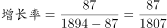
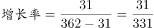
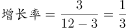

# 同比增长率比较（增长量÷基期量，基期=现期-增长量）

考点：[[20-考点/资料分析/增长/同比增长率比较（增长量÷基期量，基期=现期-增长量）|增长 / 同比增长率比较（增长量÷基期量，基期=现期-增长量）]]
材料：[[15-材料/资料分析/192257 2016年全国内河航道通航里程（总量|192257 2016年全国内河航道通航里程（总量]]

**问法模型**：题干问'哪种泊位数量同比增长最快'→ 对各选项套用增长率模型 r=增长量/(现期-增长量)，比较四个增长率取最大

## 推理链
1. 第1步：从题干锁定图2表格口径，提取四组数据：A全国万吨级及以上2317个、比上年增加96个；B沿海万吨级及以上1894个、增加87个；C全国10万吨级及以上362个、增加31个；D内河10万吨级及以上12个、增加3个
2. 第2步：材料只给现期量和增长量，增长率公式为 r=增长量÷基期量，其中基期=现期-增长量，不能直接用现期当分母
3. 第3步：代入计算：A=96/(2317-96)=96/2221≈4.3%；B=87/(1894-87)=87/1807≈4.8%；C=31/(362-31)=31/331≈9.4%；D=3/(12-3)=3/9=1/3≈33.3%
4. 第4步：比较四个增长率，A、B、C均不足10%，明显小于D的33.3%，故同比增长最快的是内河港口10万吨级及以上泊位，选D

**最快解法**：⚡ 先算小数选项D：基期=12-3=9，增长量3，3/9=1/3≈33.3%一眼锁定远超常识量级；再粗验其余三项分子（96/87/31）远小于分母（2221/1807/331），增长率均不足10%，无需精算即可选D（分数比较+截位直除）

## 易错点
- ⚠ 基期求错：直接用现期做分母（如D误算3/12=25%），或忘记用'现期-比上年末增加'求基期
- ⚠ 口径混淆：把'万吨级及以上合计2317个'与'10万吨级及以上362个'混为一谈，或误用正文的生产用码头泊位30388个、专业化/散货/件杂货口径，与图2吨级口径交叉混算
- ⚠ '最快'比增长率而非增长量：D的增量仅3个为四项最小，若按增量比较会误选A（增96个）

## 母题抽象
> 🧩 当题干出现'……同比增长最快/最慢'且材料以'现期量+比上年末增加X'形式给数时，用 r=增长量/(现期-增长量) 逐项求增长率比较；若某选项增长量与基期呈明显简单分数（如3/9=1/3）则优先验证该小基数选项，常为答案

**同类特征**：同比增长最快、泊位数量、比上年增加、增长率比较、基期=现期-增长量、表格吨级分组口径

## 相关题
- [[10-真题/资料分析/增长/2187792 同比增长率比较（增速最快年份判断）|2187792]]（黑龙江 2018，相关度2）
- [[10-真题/资料分析/增长/4658521 增长率（同比降幅）大小比较|4658521]]（四川 2021，相关度1）
- [[10-真题/资料分析/增长/18385420 同比增速比较（增长快慢）|18385420]]（浙江 2024，相关度1）
- [[10-真题/资料分析/增长/18643713 跨期增长率比较（2024年对2020年4年总增速，先合并价位档再比较）|18643713]]（天津 2026，相关度1）
- [[10-真题/资料分析/增长/2049328 增长率比较（跨指标增幅最大）|2049328]]（河南 2017，相关度1）

---

### 题干
2016年，下列哪种泊位数量同比增长最快？

### 选项
- A. 全国港口万吨级及以上泊位
- B. 沿海港口万吨级及以上泊位
- C. 全国港口10万吨级及以上泊位
- D. 内河港口10万吨级及以上泊位　✅

### 官方解析

由题干“同比增长最快”，可判定本题为增长率比较问题。定位表格材料，根据公式代入数据，则有：

A.全国港口万吨级及以上泊位；

B.沿海港口万吨级及以上泊位；

C.全国港口10万吨级及以上泊位；

D.内河港口10万吨级及以上泊位。

故比较可知，A、B、C项所求明显小于，D项所求等于，D项符合，即内河港口10万吨级及以上泊位数同比增长最快。

故正确答案为D。

### 给定材料

        2016年末，全国内河航道通航里程12.71万公里。等级航道6.64万公里，其中三级及以上航道1.21万公里，占总里程的，比上年提高0.4个百分点。各等级内河航道通航里程分别为：一级航道1342公里，二级航道3681公里，三级航道7054公里，四级航道10862公里，五级航道7485公里，六级航道18150公里，七级航道17835公里。等外航道6.07万公里。各水系内河航道通航里程分别为：长江水系64883公里，珠江水系16450公里，黄河水系3533公里，黑龙江水系8211公里，京杭运河1438公里，闽江水系1973公里，淮河水系17507公里。

2016年末，全国港口拥有生产用码头泊位30388个，比上年减少871个。其中，沿海港口生产用码头泊位5887个，减少12个；内河港口生产用码头泊位24501个，减少859个。全国港口拥有万吨级及以上泊位2317个，比上年增加96个。其中，沿海港口万吨级及以上泊位1894个，增加87个；内河港口万吨级及以上泊位423个，增加9个。全国万吨级及以上泊位中，专业化泊位1223个，比上年增加50个；通用散货泊位506个，增加33个；通用件杂货泊位381个，增加10个。

> [!warning] 疑点（官方解析可能有误，待人工复核）
> 官方解析中A、B、C三项的具体算式文字存在截断（'明显小于'后缺数字），但按公式补算A≈4.3%、B≈4.8%、C≈9.4%、D≈33.3%，与其'D项最大'的结论一致，答案无误
