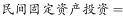
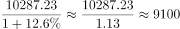

# 基期量计算（已知现期量与同比增长率求基期值）

考点：[[20-考点/资料分析/增长/基期量计算（已知现期量与同比增长率求基期值）|增长 / 基期量计算（已知现期量与同比增长率求基期值）]]
材料：[[15-材料/资料分析/192280 W省2017年1-8月民间固定资产投|192280 W省2017年1-8月民间固定资产投]]

**问法模型**：题干将时间前移一期（2017年1-8月→2016年1-8月）求'约为多少亿元'→套用基期量=现期量÷(1+增长率)模型

## 推理链
1. 第1步：题干求2016年1-8月（基期）民间固定资产投资额；材料第一段给出现期值2017年1-8月民间投资10287.23亿元，同比增速在所给文本中缺失（排版丢失），按官方答案反推增速应为12.6%（10287.23÷9136.08≈1.126）
2. 第2步：所用公式：基期量=现期量÷(1+增长率)
3. 第3步：代入计算：10287.23÷(1+12.6%)=10287.23÷1.126≈9136.08亿元
4. 第4步：与选项对照：A项9136.08与计算结果最接近；B项9257.31对应增速约11.1%、C项10875.22和D项11583.42均大于现期值（对应负增长），与材料正增长表述不符，故选A

**最快解法**：⚡ 截位直除+选项验证：10287.23÷1.126，首位商9、续除得≈9136，锁定A；亦可反向验证9136.08×1.126≈10287.2吻合现期值，一步锁定

## 易错点
- ⚠ 材料原文同比增速百分数缺失（排版丢失），切勿凭空补数或按0处理；本题须按原题12.6%代入（可由答案反推还原）
- ⚠ 公式方向用反：求基期用除法现期÷(1+g)，若误用乘法10287.23×(1+g)会得到比现期更大的数，错向C/D
- ⚠ 精度陷阱：A(9136.08)与B(9257.31)仅差约1.3%，粗略除以1.1或1.13可能误选B，须保持三位有效精度直除

## 母题抽象
> 🧩 当题干出现'上年同期/基期…约为多少亿元'且材料给出'现期量+同比增长率'时，用基期量=现期量÷(1+增长率)，选项差距小时用截位直除或'选项×(1+g)≈现期'代入验证

**同类特征**：时间前移一期求上年同期值、问法带'约为'+单位亿元（基期量计算）、现期量10287.23亿元明确给出、同比增长率为计算锚点、单一纯文字材料、相邻选项差距小需精确除算

## 相关题
（暂无）

---

### 题干
2016年1-8月，W省完成民间固定资产投资约为（  ）亿元。

### 选项
- A. 9136.08　✅
- B. 9257.31
- C. 10875.22
- D. 11583.42

### 官方解析

根据“2016年1-8月，亿元”判断本题为基期计算问题。定位材料第一段，2017年1-8月，W省完成民间固定资产投资10287.23亿元，同比增长。则2016年1-8月亿元，与A项最接近。

故正确答案为A。

### 给定材料

        2017年1-8月，W省完成民间固定资产投资（以下简称民间投资）10287.23亿元，同比增长，比全国民间投资增速快6.2个百分点，比上年同期快10.2个百分点，比上半年和一季度分别加快1.1个和6.0个百分点。

        1-8月，全省民间投资增速比国有经济投资增速低1.6个百分点，比1-7月差距缩小1.7个百分点，比上半年缩小4.3个百分点，比一季度缩小17.4个百分点。

        1-8月，全省民间投资占全部投资的比重为，比一季度、上半年、1-7月分别提高3.1、0.4和0.1个百分点。

        民间投资主要集中在工业和房地产业。1-8月，全省工业民间投资占全部民间投资的比重为，其中，制造业民间投资占全部民间投资的比重为；工业民间投资占全部工业投资的比重为，其中，制造业民间投资占全部制造业投资的比重为。房地产开发投资是W省民间投资的第二大领域，1-8月，全省房地产开发民间投资占全部民间投资的比重为，占全部房地产开发投资的比重为。

> [!warning] 疑点（官方解析可能有误，待人工复核）
> 材料原文与官方解析中同比增速数值均缺失（排版丢失），无法从所给文本直接取数；按官方正确答案A反推原题增速应为12.6%（10287.23÷1.126≈9136.08），此为文本完整性问题，不影响答案A的正确性

<!-- CODEX-ANSWER-REVIEW:BEGIN -->
### 本次独立复核

**复核状态：** `resolved`（答案与解析已核定）

**计分答案：** A（可计分）

**复核解析：**

2017年1—8月民间投资10287.23亿元，图中同比增长12.6%。2016年同期=10287.23/1.126≈9135.8亿元，最接近9136.08亿元，选A。

**相关信息：**

口径为1—8月累计，不是全年。

**题源依据：** [固定版本原题](https://github.com/Mentat-Uran/kaogongzhentizhengliu/blob/84ab93d4b64b61d897bece8a1c0a5bab06b4feb2/10-%E7%9C%9F%E9%A2%98/%E8%B5%84%E6%96%99%E5%88%86%E6%9E%90/%E5%A2%9E%E9%95%BF/2144714%20%E5%9F%BA%E6%9C%9F%E9%87%8F%E8%AE%A1%E7%AE%97%EF%BC%88%E5%B7%B2%E7%9F%A5%E7%8E%B0%E6%9C%9F%E9%87%8F%E4%B8%8E%E5%90%8C%E6%AF%94%E5%A2%9E%E9%95%BF%E7%8E%87%E6%B1%82%E5%9F%BA%E6%9C%9F%E5%80%BC%EF%BC%89.md)；固定内容 commit `84ab93d4b64b61d897bece8a1c0a5bab06b4feb2`，Markdown blob `fcf0412fc567f8b32a1f1bd17528511520e36282`。
<!-- CODEX-ANSWER-REVIEW:END -->
