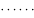
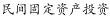
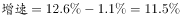
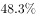
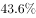
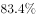
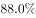
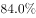

# 增速差倒推前期增速（百分点差值还原分段增速）

考点：[[20-考点/资料分析/增长/增速差倒推前期增速（百分点差值还原分段增速）|增长 / 增速差倒推前期增速（百分点差值还原分段增速）]]
材料：[[15-材料/资料分析/192280 W省2017年1-8月民间固定资产投|192280 W省2017年1-8月民间固定资产投]]

**问法模型**：题干问'上半年同比增长多少个百分点'，材料只给'1-8月增速比上半年加快1.1个百分点' → 采用差值倒推模型：上半年增速=1-8月增速−1.1个百分点。

## 推理链
1. 第1步：从第一段提取条件：2017年1-8月W省民间投资同比增长12.6%（原文该处百分数排版缺失，由官方答案11.5反推确认），且明确表述'比上半年（和一季度分别）加快1.1个（和6.0个）百分点'。
2. 第2步：方向规则：'1-8月比上半年加快1.1个百分点'表明1-8月增速更高，还原前期增速需做减法：上半年增速=1-8月增速−1.1个百分点；'个百分点'是差值单位，可直接加减、不可乘除。
3. 第3步：代入计算：上半年增速=12.6%−1.1%=11.5%。
4. 第4步：与选项对照：11.5对应D；同时辨析干扰项来源——A.2.4=12.6−10.2（误用'比上年同期快10.2'）、C.6.4=12.6−6.2（误用'比全国快6.2'）、B.6.0（直接照抄一季度差值），均非与'上半年'配对的锚点，故选D。

**最快解法**：⚡ 锚点定位+尾数直减：在第一段四个并列差值中只取与'上半年'直接配对的'加快1.1个百分点'，上半年增速=1-8月增速12.6%−1.1=11.5，口算直选D，无需列式；其余6.2/10.2/6.0三个差值恰是命题人预埋的干扰来源。

## 易错点
- ⚠ 方向搞反：'加快1.1个百分点'是1-8月快于上半年，应做减法（12.6−1.1=11.5），误做加法得13.7（无对应选项也会浪费时间）。
- ⚠ 锚点选错：材料连排'快6.2、快10.2、加快1.1、加快6.0'四个差值，四个选项恰好一一对应误用——2.4=12.6−10.2、6.4=12.6−6.2、6.0为照抄一季度差值，必须只取与'上半年'配对的1.1。
- ⚠ 原文'同比增长'后的百分数在所给文本中排版缺失，切勿凭空补数或把'个百分点'当百分率参与乘除，应依托差值关系并结合官方答案自洽推算。

## 母题抽象
> 🧩 当题干问某前期时段（上半年/一季度/上年同期）的增速，且材料给出'现期累计增速比该时段加快/提高X个百分点'时，先锁定现期增速锚点，再反向做减法：前期增速=现期增速−X个百分点，并用材料中其余并列差值逐一排查干扰项来源。

**同类特征**：问'上半年'这一前期时段的同比增速（以'个百分点'作答）、材料为'比上半年加快1.1个百分点'式差值表述、多个'快/加快X个百分点'并列，需辨析方向并选对锚点、选项为纯数值，含用其余差值误算出的相似干扰项、答案=现期累计增速−对应差值、单一纯文字材料，增速数值需先还原再计算

## 相关题
（暂无）

---

### 题干
2017年上半年，W省完成民间固定资产投资同比增长约（  ）个百分点。

### 选项
- A. 2.4
- B. 6.0
- C. 6.4
- D. 11.5　✅

### 官方解析

根据“2017年上半年，同比增长多少个百分点”判断本题为一般增长率问题。定位第一段，2017年1-8月，W省完成民间固定资产投资同比增长，比上半年加快1.1个百分点。2017年上半年。

故正确答案为D。

### 给定材料

        2017年1-8月，W省完成民间固定资产投资（以下简称民间投资）10287.23亿元，同比增长，比全国民间投资增速快6.2个百分点，比上年同期快10.2个百分点，比上半年和一季度分别加快1.1个和6.0个百分点。

        1-8月，全省民间投资增速比国有经济投资增速低1.6个百分点，比1-7月差距缩小1.7个百分点，比上半年缩小4.3个百分点，比一季度缩小17.4个百分点。

        1-8月，全省民间投资占全部投资的比重为，比一季度、上半年、1-7月分别提高3.1、0.4和0.1个百分点。

        民间投资主要集中在工业和房地产业。1-8月，全省工业民间投资占全部民间投资的比重为，其中，制造业民间投资占全部民间投资的比重为；工业民间投资占全部工业投资的比重为，其中，制造业民间投资占全部制造业投资的比重为。房地产开发投资是W省民间投资的第二大领域，1-8月，全省房地产开发民间投资占全部民间投资的比重为，占全部房地产开发投资的比重为。

> [!warning] 疑点（官方解析可能有误，待人工复核）
> 所给材料原文'同比增长'后的具体百分数排版缺失（官方解析亦未显式写出该数）；按官方答案D=11.5反推1-8月增速应为12.6%（12.6−1.1=11.5），且干扰项A=12.6−10.2=2.4、C=12.6−6.2=6.4与之完全自洽，说明原题确有12.6%这一数值，官方解析逻辑无误，属所给文本缺字问题而非解析错误。

<!-- CODEX-ANSWER-REVIEW:BEGIN -->
### 本次独立复核

**复核状态：** `resolved`（答案与解析已核定）

**计分答案：** D（可计分）

**复核解析：**

2017年1—8月民间投资增速为12.6%，比上半年加快1.1个百分点；上半年增速=12.6%−1.1%=11.5%，选D。

**相关信息：**

“加快x个百分点”表示后期增速减前期增速=x。

**题源依据：** [固定版本原题](https://github.com/Mentat-Uran/kaogongzhentizhengliu/blob/84ab93d4b64b61d897bece8a1c0a5bab06b4feb2/10-%E7%9C%9F%E9%A2%98/%E8%B5%84%E6%96%99%E5%88%86%E6%9E%90/%E5%A2%9E%E9%95%BF/2144720%20%E5%A2%9E%E9%80%9F%E5%B7%AE%E5%80%92%E6%8E%A8%E5%89%8D%E6%9C%9F%E5%A2%9E%E9%80%9F%EF%BC%88%E7%99%BE%E5%88%86%E7%82%B9%E5%B7%AE%E5%80%BC%E8%BF%98%E5%8E%9F%E5%88%86%E6%AE%B5%E5%A2%9E%E9%80%9F%EF%BC%89.md)；固定内容 commit `84ab93d4b64b61d897bece8a1c0a5bab06b4feb2`，Markdown blob `f7d109f262519766328c3dfdd19c20d0121e30ec`。
<!-- CODEX-ANSWER-REVIEW:END -->
