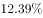
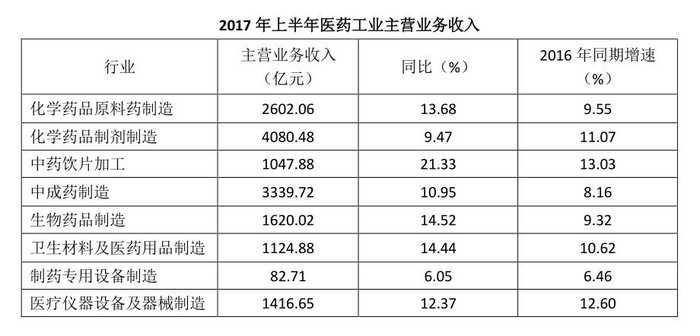

# 间隔增长率（隔年基期倍数）

考点：[[20-考点/资料分析/增长/间隔增长率（隔年基期倍数）|增长 / 间隔增长率（隔年基期倍数）]]
材料：[[15-材料/资料分析/192281 2017年上半年医药工业规模以上企业|192281 2017年上半年医药工业规模以上企业]]

**问法模型**：题干出现'2017年上半年约是2015年上半年的多少倍'（现期与基期隔一年）的倍数问法 → 采用间隔基期倍数模型：现期/间期基期=(1+g₁)×(1+g₂)，其中g₂由'提高2.25个百分点'推得。

## 推理链
1. 第1步：由题干'2017年上半年约是2015年上半年的（ ）倍'判定为隔年倍数问题，需2017H1总体增速g₁与2016H1总体增速g₂两期数据
2. 第2步：正文总增速数值空缺，以表格8个子行业收入为权重加权反推：Σ(收入×同比)≈355.96+386.42+223.52+365.70+235.23+162.43+5.00+175.24≈1909.5亿元，1909.5÷15314.40≈12.4%（精确约12.47%），即g₁≈12.4%
3. 第3步：由正文'增速较上年同期提高2.25个百分点'得g₂=12.4%−2.25%≈10.2%（可用表格'2016年同期增速'列按收入加权≈10.2%交叉验证，口径一致）
4. 第4步：代入间隔倍数公式：现期/间期基期=(1+g₁)(1+g₂)=1+g₁+g₂+g₁×g₂≈1+12.4%+10.2%+1.27%≈1.24
5. 第5步：与选项对照：A.1.13、B.0.13、C.1.24、D.0.24，问法为'是…的倍数'（含基数1，应约1.2倍量级），仅C≈1.24满足，故选C

**最快解法**：⚡ 公式法（间隔增长率）+加权速算：子行业增速多集中在9.5%~14.5%，以收入为权重心算总体增速g₁≈12.4%（21.33%与6.05%两端权重有限，拉偏很小）；由'提高2.25个百分点'得g₂≈10.2%；套1+g₁+g₂+g₁×g₂≈1+22.6%+1.3%≈1.24，直选C，并借选项排除0.x倍的数量级干扰。

## 易错点
- ⚠ '个百分点'与'%'混淆：'提高2.25个百分点'是两期增速之差，正确关系为2016H1增速=2017H1增速−2.25个百分点，勿把2.25%当作2016年增速或增速本身
- ⚠ 正文总增速数值空缺：必须以8个子行业收入为权重加权反推≈12.4%，勿直接取某子行业增速（如中药饮片21.33%）或简单平均（12.85%）代替加权平均
- ⚠ 倍数口径与数量级陷阱：'是…的倍数'为现期/基期（含基数1，约1.24），'增长/多…倍'为净增倍数（约0.24），B.0.13、D.0.24正是净增口径的数量级干扰项；另表格'同比%'与'2016年同期增速%'两列名相近，勿取错列

## 母题抽象
> 🧩 当题干出现'现期（如2017H1）约是隔一年基期（如2015H1）的几倍'且总体增速需由'较上年同期提高/回落n个百分点'+分行业数据反推时，先用收入加权定g₁、再定g₂=g₁−n，套间隔倍数公式(1+g₁)(1+g₂)，验证结果落在1.x倍量级并与选项对照，排除0.x的净增倍数干扰项。

**同类特征**：'2017年上半年约是2015年上半年的（几倍）'（隔年基期倍数问法）、'增速较上年同期提高2.25个百分点'、正文总增速数值空缺、需加权反推、选项同时含1.x与0.x两组数量级、是…的倍数（非'增长了几倍'）、半年度累计口径（非全年）

## 相关题
（暂无）

---

### 题干
在医药工业规模以上企业实现主营业务收入上，2017年上半年约是2015年上半年的（  ）。

### 选项
- A. 1.13倍
- B. 0.13倍
- C. 1.24倍　✅
- D. 0.24倍

### 官方解析
根据题干所求“······2017年······约是2015年······”，时间存在间隔，结合选项为倍数，可判定此题为间隔增长率问题。定位文字材料“2017年上半年医药工业······，同比增长，增速较上年同期提高2.25个百分点”，可知2016年上半年医药工业规模以上企业实现主营业务收入。所以，只有C满足。
故正确答案为C。

### 给定材料

        2017年上半年医药工业规模以上企业实现主营业务收入15314.40亿元，同比增长，增速较上年同期提高2.25个百分点。各子行业中，增长最快的是中药饮片加工，化学药品制剂、中成药、制药设备的增速低于行业平均水平。

> [!warning] 疑点（官方解析可能有误，待人工复核）
> 官方解析文字存在省漏：原文总体增速空缺，解析未展示'加权反推g₁≈12.4%、g₂≈10.2%'的计算过程即得出1.24；经按表格收入加权验算(1.1247×1.1022≈1.24)，答案C正确，仅解析表述不完整，不影响结论。
