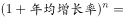
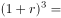
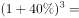
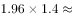
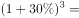
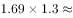
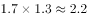
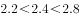
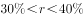

# 年均增长率计算（n=3，立方根型）

考点：[[20-考点/资料分析/增长/年均增长率计算（n=3，立方根型）|增长 / 年均增长率计算（n=3，立方根型）]]
材料：[[15-材料/资料分析/192295 2008—2015年全国工业污染治理|192295 2008—2015年全国工业污染治理]]

**问法模型**：题干问'2012年至2015年某指标年均增长率' → 采用年均增长率模型 r=(末期/初期)^(1/n)-1，n=3，或代入选项逆推验证 (1+r)^3 与倍数关系比对

## 推理链
1. 第1步：题干锁定'2012年至2015年治理噪声投资额年均增长率'，定位表格：2012年治理噪声=11627万元，2015年治理噪声=27892万元（注意是万级万元，勿串到相邻固废列247499/161468）
2. 第2步：2012→2015共3个增长期，n=3（不是4），公式 r=(27892/11627)^(1/3)-1
3. 第3步：27892/11627≈2.4，即需求2.4的立方根，试值验证：1.34^3=1.34×1.34×1.34≈2.406≈2.4
4. 第4步：故 r≈34%；将各选项数值代入(1+r)^3与2.4比对，只有B（约34%）吻合，锁定B

**最快解法**：⚡ 代入选项逆推法：先截位直除 27892/11627≈2.4，再对选项增长率逐个取三次方（1.34^3≈2.4）比对即可，避免硬开立方根；核心是记住n=3

## 易错点
- ⚠ 间隔年数n取错：2012至2015是3个增长期而非4年，误取n=4会把约34%算成约24%，落入偏小选项
- ⚠ 初末期认反：初期=2012年11627万元、末期=2015年27892万元，若倒置则得到负增长方向错误
- ⚠ 量级与串行陷阱：治理噪声列仅万级万元（11627、27892），与相邻固废列（247499、161468）差一个数量级，横向读表易串行或误判

## 母题抽象
> 🧩 当题干出现'某年至某年年均增长率约为'特征时，先确认间隔增长期数n=末期年-初期年，用 r=(末期/初期)^(1/n)-1，考场优选代入选项逆推（比较末期/初期的倍数与(1+r)^n），验证哪项的三次方约等于倍数

**同类特征**：两年区间（2012年至2015年）、年均增长率、治理噪声投资额、问'约为'（估算选项）、倍数小于3倍（2.4倍）、n=3个增长期

## 相关题
- [[10-真题/资料分析/增长/12881993 年均增长率（区间型选项验证）|12881993]]（广东 2025，相关度1）
- [[10-真题/资料分析/增长/15121362 年均增速比较（年均增长率大小比较）|15121362]]（江苏 2024，相关度1）
- [[10-真题/资料分析/增长/4651694 年均增长率比较（年均增速大小排序）|4651694]]（江苏 2022，相关度1）
- [[10-真题/资料分析/增长/2188386 年均增长率计算（选项代入验证）|2188386]]（江西 2018，相关度1）
- [[10-真题/资料分析/增长/2376755 年均增长率求解（已知基期、现期与年份差）|2376755]]（黑龙江 2019，相关度1）

---

### 题干
2012年至2015年，治理噪声投资额的年均增长率约为：

### 选项
- A. 

- B. 

　✅
- C. 

- D. 

### 官方解析

根据题干所求“2012年至2015年，治理噪声投资额的年均增长率”可判定此题为年均增长率计算。定位表格，2012年、2015年治理噪声投资额分别为11627万元、27892万元。代入公式：（），，根据选项计算，，，，因此，，只有B项满足要求。

故正确答案为B。

### 给定材料

