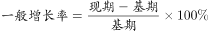
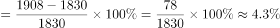

# 增长率计算（两期时点数之差÷基期）

考点：[[20-考点/资料分析/增长/增长率计算（两期时点数之差÷基期）|增长 / 增长率计算（两期时点数之差÷基期）]]
材料：[[15-材料/资料分析/193978 某地区2014年末与2015年末的人|193978 某地区2014年末与2015年末的人]]

**问法模型**：题干问“城镇人口自然增长率”而材料仅给两期年末人数、未给生率死亡率 → 用增长率公式（现期−基期）/基期直接计算

## 推理链
1. 第1步：定位统计表“其中：城镇”一行，提取2014年末城镇人口1830万人、2015年末城镇人口1908万人
2. 第2步：材料未给出生率/死亡率，“自然增长率”实为城镇人口增长率，公式为增长率=（现期−基期）/基期
3. 第3步：代入计算：(1908−1830)/1830=78/1830≈4.26%
4. 第4步：与选项对照，D项数值与4.26%最接近，故选D

**最快解法**：⚡ 截位直除：分子78、分母1830截位为78/183，首位商4、次位商2，约4.26%，直接锁定D

## 易错点
- ⚠ “自然增长率”字面诱导去找出生率/死亡率，材料只给两期年末人数，实为城镇人口增长率=(1908−1830)/1830
- ⚠ 基期现期混淆：分母应为基期2014年末的1830，误用2015年末1908会得约4.09%
- ⚠ 把表中比重43.0%→44.3%的1.3个百分点误当增长率（表中比重是结构占比，不是增长速度）

## 母题抽象
> 🧩 当题干问“某部分人口/指标的增长率（或增长幅度）”而材料只给两期时点数时，直接用（现期−基期）/基期，截位直除对照选项即可

**同类特征**：城镇人口、自然增长率、两期年末数对比、增长率计算、人口构成统计表

## 相关题
- [[10-真题/资料分析/增长/9629 一般增长率计算（现期需由增量倒推）|9629]]（安徽 2009，相关度1）
- [[10-真题/资料分析/增长/2166223 增长率计算（派生量：总人口-男性人口=女性人口）|2166223]]（深圳市考 2018，相关度1）
- [[10-真题/资料分析/增长/16592986 多主体求和后的一般增长率（同比）计算|16592986]]（青海 2024，相关度1）
- [[10-真题/资料分析/增长/16593066 同比增速计算（增量倒推+基期量求解）|16593066]]（甘肃 2024，相关度1）
- [[10-真题/资料分析/增长/18643744 一般增长率计算（现期在文字段、基期需图表两来源加总的跨材料拼接）|18643744]]（天津 2026，相关度1）

---

### 题干
某地区城镇人口自然增长率是多少？

### 选项
- A. 

- B. 

- C. 

- D. 

　✅

### 官方解析

由题干“······城镇人口自然增长率是······”，可判定本题为一般增长率计算问题。定位统计表中第三行，已知2014年末城镇人口数为1830万人，2015年末城镇人口数为1908万人，根据公式：，可得某地区城镇人口自然增长率，与D项最为接近。

故正确答案为D。

### 给定材料

> [!warning] 疑点（官方解析可能有误，待人工复核）
> 题干“自然增长率”与实际计算的“城镇人口增长率”表述口径不一致（材料未给出生率/死亡率），官方解析亦按增长率=(1908−1830)/1830≈4.26%处理且与D项一致，无实质矛盾
