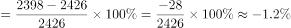
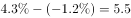

# 增长率（增长幅度）计算与带符号作差求百分点差值

考点：[[20-考点/资料分析/增长/增长率（增长幅度）计算与带符号作差求百分点差值|增长 / 增长率（增长幅度）计算与带符号作差求百分点差值]]
材料：[[15-材料/资料分析/193978 某地区2014年末与2015年末的人|193978 某地区2014年末与2015年末的人]]

**问法模型**：题干'A的增长幅度比B多几个百分点'→分别用(现期-基期)/基期求A、B两个增长率，再带符号相减得百分点差

## 推理链
1. 第1步：由统计表提取数据——城镇人口2014年末1830万人、2015年末1908万人；乡村人口2014年末2426万人、2015年末2398万人（乡村为负增长）
2. 第2步：材料未给出生率/死亡率，'增长幅度'须用两期年末人数自算，公式为增长率=(现期-基期)/基期，分母取基期2014年末数
3. 第3步：城镇幅度=(1908-1830)/1830=78/1830≈+4.26%（即第1题城镇'自然增长率'的结果，可复用）
4. 第4步：乡村幅度=(2398-2426)/2426=-28/2426≈-1.15%，结果带负号
5. 第5步：带符号相减：4.26%-(-1.15%)≈5.4个百分点（官方粗算按4.3%+1.2%=5.5），注意减负数等于加其绝对值
6. 第6步：对照选项，无5.4项，5.5（A）为最接近值且为官方答案，故选A

**最快解法**：⚡ 截位直除+符号相减：城镇78/1830≈4.3%，乡村-28/2426≈-1.2%；因乡村为负增长，'多几个百分点'化为两幅度绝对值相加：4.3%+1.2%=5.5，直接锁定A，无需精算第二位小数

## 易错点
- ⚠ 乡村人口2426→2398是负增长，'多几个百分点'必须带符号相减（4.26%-(-1.15%)）；若只减数值大小得4.26%-1.15%≈3.1，会误选D
- ⚠ 表中'比重(%)'是占总人口的结构比重而非增长速度，误用44.3%-43.0%=1.3、55.7%-57.0%=-1.3等比重差来算幅度属口径错误（差2.6，无对应选项）
- ⚠ 基期为2014年末，公式分母必须用2014年末数（1830、2426）；基期现期颠倒或分母误用2015年数会使幅度算错

## 母题抽象
> 🧩 当题干出现'A比B的增长幅度多/高几个百分点'特征时，分别用(现期-基期)/基期求两个增长率，负增长项带符号相减（等价于取绝对值相加），结果对照选项取最接近值

**同类特征**：增长幅度、多几个百分点、2014年末与2015年末两时点对比、城镇与乡村两行分组数据、增长率作差、含负增长项需带符号运算

## 相关题
（暂无）

---

### 题干
某地区城镇人口增长的幅度比乡村人口增长的幅度多几个百分点？

### 选项
- A. 5.5　✅
- B. 5.3
- C. 4.6
- D. 3.1

### 官方解析

由题干“······城镇人口增长的幅度比乡村人口增长的幅度多·····个百分点”，可判定本题为一般增长率计算问题。由上题可得某地区城镇人口增长的幅度为；定位统计表中第四行，已知2014年末乡村人口数为2426万人，2015年末乡村人口数为2398万人，根据公式可得某地区乡村人口增长的幅度；故某地区城镇人口增长的幅度比乡村人口增长的幅度多个百分点。

故正确答案为A。

### 给定材料

> [!warning] 疑点（官方解析可能有误，待人工复核）
> 按人数精确计算：78/1830≈4.26%，-28/2426≈-1.15%，差值≈5.42个百分点，四舍五入一位小数应为5.4；官方解析按≈4.3%与≈-1.2%的粗略取整相加得5.5。因选项中无5.4，A（5.5）为最接近选项且为官方唯一事实答案，本笔记不改答案，仅提示解析取位偏粗导致与精确值约有0.1个百分点的偏差
