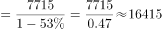
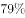
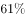
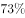

# 基期量计算（同比下降型）

考点：[[20-考点/资料分析/增长/基期量计算（同比下降型）|增长 / 基期量计算（同比下降型）]]
材料：[[15-材料/资料分析/193979 2014年中国银行结售汇（结汇-售汇|193979 2014年中国银行结售汇（结汇-售汇]]

**问法模型**：题干问'2013年（上年）银行累计结售汇顺差'→ 用基期量=现期量÷(1−同比降幅)，下降时分母做减法，先锁定币种口径再直除。

## 推理链
1. 第1步：题干求2013年（基期）的银行累计结售汇顺差，材料现期为2014年，判定为基期量计算题。
2. 第2步：定位材料第一段：2014年累计结售汇顺差7715亿元人民币（等值1256亿美元），较上年下降53%（材料文本该百分数空缺，按原题及官方答案口径代入）。
3. 第3步：套用基期量公式：基期=现期÷(1−降幅)，'下降'故分母为1−53%=0.47。
4. 第4步：代入计算：2013年顺差=7715÷0.47≈16415亿元人民币。
5. 第5步：与选项对照：B为16415亿元人民币，吻合；A=7715÷(1+53%)≈5042（误把下降当增长），C=1256÷53%≈2370（误用降幅本身作除数且换美元口径），均排除，故选B。

**最快解法**：⚡ 公式法＋截位直除：基期=7715÷(1−53%)=7715÷0.47，截两位直除商首两位'16'，得16400+，直选B；口算反向验证A=7715÷1.53≈5040，确认A是'下降当增长'陷阱后排除。

## 易错点
- ⚠ 降幅作除数的方向错误：'下降53%'求基期应除以(1−53%)=0.47，误除以(1+53%)得A（5042亿元），误直接除以53%得C类错误（2370亿美元）。
- ⚠ 币种口径混淆：现期顺差有7715亿元与等值1256亿美元双口径，美元口径基期≈1256÷0.47≈2672亿美元并不在选项中，混用美元数值易掉入C/D的双币种陷阱，须先确认选项币种再选除数。
- ⚠ 增速数据缺失与口径干扰：给定材料文本中'下降'后百分数空缺，需按原题53%代入；切勿把第二段'结汇率回落1个百分点、售汇率上升6个百分点'的百分点变化误当作本题的同比增速使用。

## 母题抽象
> 🧩 当题干出现'××（上年/基期年份）是多少'且材料给出现期量和'下降x%'时，用基期量=现期量÷(1−x%)（下降做减法），并先核对选项币种口径（人民币/亿美元）再截位直除验证。

**同类特征**：问2013年（上年/基期）的量、材料给出现期值并附同比'下降'、顺差类总量指标、选项人民币与亿美元双币种混排、基期量计算

## 相关题
- [[10-真题/资料分析/增长/2388015 基期量计算（同比下降型）|2388015]]（河北 2019，相关度3）
- [[10-真题/资料分析/增长/2031180 基期量计算（同比下降型）|2031180]]（北京 2017，相关度2）
- [[10-真题/资料分析/增长/2097108 基期量计算（同比下降型）|2097108]]（四川 2017，相关度2）
- [[10-真题/资料分析/增长/2616249 基期量计算（同比下降型）|2616249]]（海南 2020，相关度2）
- [[10-真题/资料分析/增长/12019697 基期量计算（现期累计值−当期新增值）|12019697]]（广东 2026，相关度1）

---

### 题干
2013年，银行累计结售汇顺差（    ）。

### 选项
- A. 5042亿元人民币
- B. 16415亿元人民币　✅
- C. 2370亿美元
- D. 2560亿美元

### 官方解析

由题意“2013年，银行累计结售汇顺差”，且材料时间是2014年，判定此题为基期计算问题。定位文字材料第一段，“2014年，······累计结售汇顺差7715亿元人民币（等值1256亿美元），下降。”可知2013年银行累计结售汇顺差亿元人民币。

故正确答案为B。

### 给定材料

        从银行结售汇数据看，2014年，银行累计结汇116422亿元人民币（等值18958亿美元），剔除汇率因素影响（下同），较上年增长，累计售汇108707亿元人民币（等值17702亿美元），增长，累计结售汇顺差7715亿元人民币（等值1256亿美元），下降。其中，银行代客累计结汇113339亿元人民币，累计售汇103742亿元人民币，累计结售汇顺差9597亿元人民币；银行自身累计结汇3084亿元人民币，累计售汇4965亿元人民币，累计结售汇逆差1882亿元人民币。一季度银行结售汇顺差1592亿美元，二季度降至290亿美元，三季度转为逆差160亿美元，四季度扩大为466亿美元。同期，银行代客累计远期结汇签约18442亿元人民币，累计远期售汇签约15015亿元人民币，累计远期净结汇3427亿元人民币，较上年下降。

        从银行代客涉外收付款数据看，2014年，银行代客累计涉外收入203855亿元人民币（等值33201亿美元），较上年增长，累计对外付款201375亿元人民币（等值32797亿美元），增长，累计涉外收付款顺差2480亿元人民币（等值404亿美元），下降。一、二季度累计涉外收付款顺差分别为455亿和407亿美元，三、四季度转为逆差200亿和258亿美元。衡量企业和个人结汇意愿的银行代客结汇占涉外外汇收入的比重（即结汇率）总体下降，由一季度的降至二、三季度的，四季度略有回升至，全年平均为，结汇率比上年回落了1个百分点；衡量购汇动机的银行代客售汇占涉外外汇支付的比重（即售汇率）逐季上升，由一季度的升至四季度的，全年为，售汇率比上年上升了6个百分点。

注：上述资料统计时，不同币种间价格换算采用当年平均汇率。

> [!warning] 疑点（官方解析可能有误，待人工复核）
> 给定材料文本中'累计结售汇顺差7715亿元……下降'后的百分数被空缺，官方解析亦未显示具体数值；按正确答案B=16415亿元反推，降幅应为53%（7715÷0.47≈16415，且7715÷1.53≈5042恰为干扰项A），即原题此处应为'下降53%'。此为材料文本缺失问题，不影响官方答案B的正确性。
