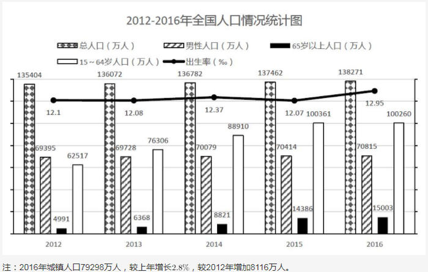

# 增长率计算（派生量：总人口-男性人口=女性人口）

考点：[[20-考点/资料分析/增长/增长率计算（派生量：总人口-男性人口=女性人口）|增长 / 增长率计算（派生量：总人口-男性人口=女性人口）]]
材料：[[15-材料/资料分析/193980 2012-2016年全国人口情况：总|193980 2012-2016年全国人口情况：总]]

**问法模型**：题干问'2016年某群体较2012年增长（ ）'且该群体（女性）未直接给出 → 先用'总人口-男性人口'派生两年女性人口，再套增长率=(现期-基期)/基期

## 推理链
1. 第1步：从图中读出2016年总人口138271万人、男性人口70815万人；2012年总人口135404万人、男性人口69395万人
2. 第2步：材料只给男性柱，女性人口须派生：女性=总人口-男性人口
3. 第3步：2016年女性人口=138271-70815=67456万人
4. 第4步：2012年女性人口=135404-69395=66009万人
5. 第5步：增长量=67456-66009=1447万人，增长率=1447÷66009≈2.19%（截位直除1447/66000≈2.2%）
6. 第6步：与选项对照，约2.2%对应D项，故选D

**最快解法**：⚡ 减法派生+截位直除：先算67456（138271-70815）与66009（135404-69395），增长量1447万人，1447/66009≈1447/66000≈2.2%，直接锁定D

## 易错点
- ⚠ 图中只有男性人口柱，没有女性人口柱，必须做'总人口-男性人口'减法派生，直接在图中找女性数据会落空
- ⚠ 增长率分母应为基期（2012年）女性人口66009万人，勿误用2016年现期值67456作分母（67456-66009差值相同但结果偏小）
- ⚠ 本题是2016对2012的单期增长（间隔4年但只比较两端），勿误套年均模型除以期数4

## 母题抽象
> 🧩 当题干所求指标未在图中直接给出时，先用'整体量-已知部分量'派生该指标（如总人口-男性=女性），再按增长率=(现期-基期)÷基期计算，分母固定取基期值，验证选项量级与方向

**同类特征**：女性人口、较2012年增长、现期2016基期2012、总人口减男性人口派生、增长率计算、单位万人

## 相关题
- [[10-真题/资料分析/增长/9629 一般增长率计算（现期需由增量倒推）|9629]]（安徽 2009，相关度1）
- [[10-真题/资料分析/增长/16592986 多主体求和后的一般增长率（同比）计算|16592986]]（青海 2024，相关度1）
- [[10-真题/资料分析/增长/16593066 同比增速计算（增量倒推+基期量求解）|16593066]]（甘肃 2024，相关度1）
- [[10-真题/资料分析/增长/18643744 一般增长率计算（现期在文字段、基期需图表两来源加总的跨材料拼接）|18643744]]（天津 2026，相关度1）
- [[10-真题/资料分析/增长/2166029 增长率计算（两期时点数之差÷基期）|2166029]]（天津 2018，相关度1）

---

### 题干
2016年全国女性人口较2012年增长（  ）。

### 选项
- A. 

- B. 

- C. 

- D. 

　✅

### 官方解析
由题干“2016年全国女性人口较2012年增长······”，可判定此题为一般增长率计算问题。定位统计图中2016年和2012年的柱形图，已知2016年总人口138271万人，男性人口70815万人，则；已知2012年总人口135404万人，男性人口69395万人，则万人；根据增长率公式可得2016年全国女性人口较2012年增长率。
故正确答案为D。

### 给定材料

