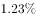
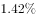
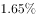
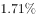

# 年均增长率（年均增速，复利开n次方）

考点：[[20-考点/资料分析/增长/年均增长率（年均增速，复利开n次方）|增长 / 年均增长率（年均增速，复利开n次方）]]
材料：[[15-材料/资料分析/193980 2012-2016年全国人口情况：总|193980 2012-2016年全国人口情况：总]]

**问法模型**：题干问'若2011年出生率为某给定值，则2011-2016年出生率年均增速约为'→年均增长率复利模型 r=(现期/基期)^(1/n)-1，n=2016-2011=5。

## 推理链
1. 第1步：题干关键词'2011-2016年人口出生率年均增速约为'→判定为年均增长率（复利）问题，不是算术平均、也不是年均增减量问题
2. 第2步：从图读现期值：2016年人口出生率12.95‰（折线末点）；基期2011年不在图中（图自2012年起），基期数值由题干公式给定，直接代入题面值
3. 第3步：确定期数n：2011→2016间隔2016-2011=5年，故开5次方；注意与小题2'2012-2016年均减少量÷4'的口径区分
4. 第4步：套年均增速公式 r=(现期/基期)^(1/n)-1=(12.95‰/题面2011年基期值)^(1/5)-1，分子分母同为‰自动相约，r以百分数表示
5. 第5步：计算（或反向验证）：令k=12.95/基期值，把各选项的r代入(1+r)^5看是否≈k，逐项排除
6. 第6步：与选项对照，仅C满足，故正确答案为C

**最快解法**：⚡ 公式法+代入验证：r=(12.95‰/题干给定的2011年基期值)^(1/5)-1；考场最快不开五次方，而是把各选项百分数r代入(1+r)^5，与比值12.95/基期值比对即排除，锁定C。

## 易错点
- ⚠ 期数陷阱：'2011-2016年均增速'开方次数n=5（=2016-2011），与同卷小题2'2012-2016年均减少量÷4'口径并存最易串用；也不能误用年份数6
- ⚠ 基期陷阱：图只画到2012-2016，本题基期2011年跨出图表、由题干补充，切勿拿图中2012年的12.1‰当基期
- ⚠ 单位与算法陷阱：出生率是‰，但分子分母同为‰相约后增速用%表示，别再带‰或把12.95当12.95%；年均增速必须用复利(现期/基期)^(1/n)-1，用'总增幅÷5'或算术平均在选项差距小时会选错

## 母题抽象
> 🧩 当题干出现'若A年（图外基期、数值由题干补充）为某值，则A年到B年××年均增速约为'时，用r=(B年值/A年值)^(1/(B-A))-1，n取年份差；单位相约后以%作答，选项可反向代入(1+r)^n验证排除。

**同类特征**：年均增速约为、基期2011年在图表之外（题干补充数值）、指标为出生率（‰）、现期值直接读图（2016年12.95‰）、复利开n次方而非除以间隔、选项为百分数

## 相关题
- [[10-真题/资料分析/增长/9629 一般增长率计算（现期需由增量倒推）|9629]]（安徽 2009，相关度1）
- [[10-真题/资料分析/比重/2604234 现期比重计算|2604234]]（广东 2020，相关度1）
- [[10-真题/资料分析/增长/27835 一般增长率计算（已知现期量与增长量求增长率）|27835]]（河北 2012，相关度1）
- [[10-真题/资料分析/平均数/10204497 平均数增长率（均价=值-量的比值增长率）|10204497]]（海南 2024，相关度1）
- [[10-真题/资料分析/增长/12536395 隔年（间隔）增长率|12536395]]（四川 2024，相关度1）

---

### 题干
若2011年人口出生率是，那么2011-2016年人口出生率年均增速约为（  ）。

### 选项
- A. 

- B. 

- C. 

　✅
- D. 

### 官方解析
由题干“2011-2016年人口出生率年均增速约为······”，可判定此题为年均增长率问题。定位统计图,2016年人口出生率。根据年均增速公式，可计算出。
故正确答案为C。

### 给定材料

> [!warning] 疑点（官方解析可能有误，待人工复核）
> 本题卷面中2011年出生率基期值及四个选项均以图片公式（latex外链）呈现，文字版未给出可读数值，无法逐步代入复核出具体百分数；官方解析'年均增速公式+n=5'的口径与材料（2016年12.95‰）无矛盾，按官方答案C执行。
