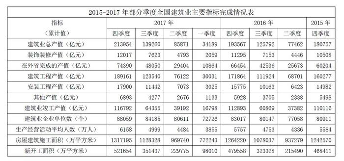

# 年均增长率外推（现期预测计算）

考点：[[20-考点/资料分析/增长/年均增长率外推（现期预测计算）|增长 / 年均增长率外推（现期预测计算）]]
材料：[[15-材料/资料分析/193981 2015—2017年部分季度全国建筑|193981 2015—2017年部分季度全国建筑]]

**问法模型**：题干'保持2015-2017年间的增速，求2019年约为'→用年均增速模型：先由2015、2017全年累计值求年均增速r，再按现期×(1+r)^间隔外推2019年

## 推理链
1. 第1步：题干要求按2015-2017年增速外推2019年，定位表中'建筑业总产值'行，取全年数（四季度累计值）：2015年为180757亿元，2017年为213954亿元
2. 第2步：确定间隔：2015→2017间隔2年，2017→2019间隔也为2年，两段间隔相等
3. 第3步：所用公式：年均增速r满足(1+r)²=213954/180757≈1.1836，则2019年=213954×(1+r)²=213954×(213954/180757)，即现期²÷基期
4. 第4步：代入计算：213954²/180757=45776314116/180757≈253248亿元（估算：214×214÷181×10³≈253×10³）
5. 第5步：与选项对照：253248与B项完全吻合；A(243377)、D(236488)偏小，C(219966)接近2017年现值213954，均不符合，选B

**最快解法**：⚡ 等间隔代换公式法（现期²÷基期）+截位直除：因2015→2017与2017→2019间隔均为2年，2019=213954²/180757；分子分母各截三位得214×214÷181×10³≈253×10³亿元，与B项253248一致，直选B

## 易错点
- ⚠ 时间口径坑：必须取'四季度累计值'（即全年数）180757和213954作基期与现期，全表均为累计值，误取2017年三季度139260等其他季度累计值则全错
- ⚠ 间隔数坑：2015-2017间隔是2年不是3年；若把两年总增速18.4%误当作年均增速再平方外推，会算出约2997xx亿元，选项中无对应值，易陷入死算浪费时间
- ⚠ 算式方向坑：正确为213954²/180757（现期为分子），若颠倒为180757²/213954≈15.2万，量级与选项完全不符

## 母题抽象
> 🧩 当题干出现'保持某年份区间的增速、预测未来某年数值'特征时，用年均增长率外推模型目标值=现期×(1+r)^间隔；若基期→现期与现期→目标年的间隔相等，则目标值=现期²÷基期，配合截位直除与选项量级对比即可秒杀

**同类特征**：继续保持…间的增速、2019年…约为、亿元、建筑业总产值、全年累计值(四季度列)、现期预测外推

## 相关题
- [[10-真题/资料分析/平均数/19797282 现期平均数（年均生产总值=多个年度GDP算术平均）|19797282]]（山西 2024，相关度1）
- [[10-真题/资料分析/其他/2394011 进出口顺差计算（顺差=出口-进口，简单作差）|2394011]]（青海 2019，相关度1）
- [[10-真题/资料分析/增长/5514931 年均增长量|5514931]]（广东 2023，相关度1）
- [[10-真题/资料分析/其他/2742291 简单加总·部分求整体（整体=私有云+公有云）|2742291]]（北京 2021，相关度1）
- [[10-真题/资料分析/增长/2434305 年均增长率外推求现期（预测值）|2434305]]（新疆 2019，相关度1）

---

### 题干
若建筑业总产值继续保持2015-2017年间的增速，则2019年建筑业总产值约为（  ）亿元。

### 选项
- A. 243377
- B. 253248　✅
- C. 219966
- D. 236488

### 官方解析
由题干“…保持2015-2017年间的增速…则2019年建筑业总产值约为······”，可判定此题为现期计算问题。定位统计表中第二行，2015年建筑业总产值（即四季度累计值）180757亿元，2017年建筑业总产值（即四季度累计值）213954亿元。若保持2015-2017年间的增速，则，亿元，与B项最接近。
故正确答案为B。

### 给定材料

