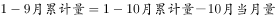
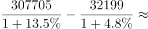
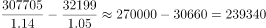

# 基期计算——基期和差（前期累计=基期累计−基期当月）

考点：[[20-考点/资料分析/增长/基期计算——基期和差（前期累计=基期累计−基期当月）|增长 / 基期计算——基期和差（前期累计=基期累计−基期当月）]]
材料：[[15-材料/资料分析/194330 2017年10月、11月、12月各月|194330 2017年10月、11月、12月各月]]

**问法模型**：题干求'2016年1-9月累计'这一前期基期值，而材料只给2017年10月表的'本月值+1-10月累计+两列增速' → 采用基期和差模型：现期累计/(1+累计增速)−现期当月/(1+当月增速)

## 推理链
1. 第1步：题干时间口径为2016年1-9月，材料未直接给出该期数据，须基期还原；定位2017年10月表'货物总发送量'行（万吨）
2. 第2步：提取数据：2017年10月本月32199万吨、同比+4.8%；2017年1-10月当年累计307705万吨、同比+13.5%
3. 第3步：确定关系：2016年1-9月 = 2016年1-10月累计 − 2016年10月当月，即基期和差
4. 第4步：代入基期公式（基期=现期/(1+增速)）：307705/(1+13.5%) − 32199/(1+4.8%)
5. 第5步：截位直除：307705/1.135≈271106，32199/1.048≈30724
6. 第6步：相减得271106−30724≈240382万吨，与C项240381最接近（可先用现期校验：2017年1-9月现期=307705−32199=275506，基期应明显小于它，秒排D）

**最快解法**：⚡ 基期和差+截位直除：先用'累计−当月'算出2017年1-9月现期=307705−32199=275506排除D项现期陷阱；再分别还原基期，307705/1.135≈271100（商首三位271）、32199/1.048≈30700（1/1.048≈0.954），相减约240400，锁定C

## 易错点
- ⚠ 现期/基期混淆：D项275506正是2017年1-9月现期累计（307705−32199），若漏除(1+增速)必错选D
- ⚠ 增速两列错配：本月32199对应当月增速+4.8%，累计307705对应累计增速+13.5%；若把两者混用或图省事整体算275506/1.135≈242737，偏差约2300（13.5%是1-10月累计增速而非1-9月增速，口径错位），严格算法必须分项还原后相减
- ⚠ 表格行列与口径陷阱：易串读到相邻旅客行或万人/万吨混淆；10月表的'当年累计'=1-10月口径，只能用10月表，不可用11月、12月表数据；跨表累计不能直接混用

## 母题抽象
> 🧩 当题干求'上年同期某前期累计量'（如2016年1-9月）而材料只有本期单月表（本月+当年累计+两列增速）时，用基期和差：现期累计/(1+累计增速)−现期当月/(1+当月增速)，并用'现期累计−现期当月'先排除现期值干扰项

**同类特征**：求上年同期（2016年）的前期累计值（1-9月）、材料仅给现期单月表：当月值+当年累计+当月/累计双增速、现期1-9月数据需'累计−当月'间接获得、累计增速与当月增速两列并存且数值不同、选项含现期数值作干扰（275506）、计算结果须与最接近选项匹配

## 相关题
（暂无）

---

### 题干
2016年1-9月份全国铁路货物总发送量累计约为（  ）万吨。

### 选项
- A. 215129
- B. 234836
- C. 240381　✅
- D. 275506

### 官方解析

由题干“2016年1-9月，全国铁路货物总发送量······”，结合表格材料1分别给出“2017年10月，全国铁路货物总发送量32199万吨，同比增速；2017年1-10月累计307705万吨，同比增速”，根据“”，判定本题为基期和差问题。代入公式：，2016年1-9月份全国铁路货物总发送量累计约为万吨，与C项最接近。

故正确答案为C。

### 给定材料

