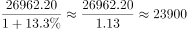

# 基期量计算（已知现期累计值与累计同比增速）

考点：[[20-考点/资料分析/增长/基期量计算（已知现期累计值与累计同比增速）|增长 / 基期量计算（已知现期累计值与累计同比增速）]]
材料：[[15-材料/资料分析/194330 2017年10月、11月、12月各月|194330 2017年10月、11月、12月各月]]

**问法模型**：题干求'2016年……当年累计完成约多少亿吨公里'，材料给2017年全年累计值及累计增速 → 用'基期量=现期累计值÷(1+累计增速)'的基期还原模型

## 推理链
1. 第1步：题干求2016年全年货物总周转量，应锁定12月表（当年累计=全年1-12月）：货物总周转量当年累计26962.20亿吨公里，累计同比增长13.3%
2. 第2步：基期计算公式：基期量=现期量÷(1+增长率)，此处增长率必须取累计增速13.3%而非12月当月增速-1.0%
3. 第3步：代入计算：26962.20÷(1+13.3%)=26962.20÷1.133≈23797亿吨公里（因1.133×23797≈26962，反验吻合）
4. 第4步：与选项对照：A.8018、B.21435、C.23797、D.333211，计算值23797与C项最接近，故选C

**最快解法**：⚡ 截位直除+选项量级排除：26962.20÷1.133，截位看作26962÷1.133，首两位商约2.38万；或把13.3%近似为1/7.5，26962.2×7.5/8.5≈26962.2×0.882≈23790，直接锁定C。同时用选项排除：C量级2.4万与现期2.7万÷1.133相符，B(2.1万)偏小、D(33万)超现期量级、A(0.8万)差一个数量级

## 易错点
- ⚠ 表格口径选错：必须用12月表的当年累计26962.20（=全年），误用10月表22278.33或11月表24629.08会算错
- ⚠ 增速列选错：须用累计增速13.3%，若误用12月当月增速-1.0%（负增长）会得约27236，落入错误区间
- ⚠ 基期现期混淆：求2016年应'除以(1+13.3%)'，误乘(1+13.3%)会得约30553
- ⚠ 隔行串值：货物总周转量单位为亿吨公里，勿串到相邻行货物总发送量（万吨）的数据

## 母题抽象
> 🧩 当题干出现'基期年份+当年累计完成约多少'时，锁定报告期末月（12月）表的'当年累计'值与'累计同比增速'，用现期累计÷(1+累计增速)直接还原基期，并用量级与选项对照验证

**同类特征**：2016年（基期年份）、当年累计完成、货物总周转量、约……亿吨公里、12月表累计=全年口径、基期还原计算

## 相关题
- [[10-真题/资料分析/增长/2616084 基期量计算与基期作差（基期差值）|2616084]]（云南 2020，相关度1）

---

### 题干
2016年全国铁路货物总周转量当年累计完成约（  ）亿吨公里。

### 选项
- A. 8018
- B. 21435
- C. 23797　✅
- D. 333211

### 官方解析

由题干“2016年······约为多少亿吨公里”，结合材料时间为“2017年”，判定本题为基期计算问题。定位表格材料3可得“2017年12月，全国铁路货物总周转量当年累计完成26962.20亿吨公里，同比增长”，代入公式：，可得：2016年全国铁路货物总周转量当年累计完成约亿吨公里，与C项最接近。

故正确答案为C。

### 给定材料

