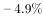
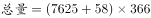
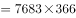
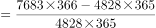
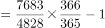

# 进出口总量增长率计算（分项加和后求一般增长率）

考点：[[20-考点/资料分析/增长/进出口总量增长率计算（分项加和后求一般增长率）|增长 / 进出口总量增长率计算（分项加和后求一般增长率）]]
材料：[[15-材料/资料分析/194329 2010年与2016年世界七大地区原|194329 2010年与2016年世界七大地区原]]

**问法模型**：『2016年某总量约比2010年增长了（%）』→ 先将现期与基期各分项加和成总量，套用增长率=（现期−基期）/基期。

## 推理链
1. 第1步：从条形图读取中国数据：2016年进口7625、出口58；2010年进口4767、出口61（单位千桶/天）。
2. 第2步：题干问『进出口总量』，必须进口+出口两列相加：2016年总量=7625+58=7683，2010年总量=4767+61=4828。
3. 第3步：套用一般增长率公式：r=(现期总量−基期总量)/基期总量=(7683−4828)/4828=2855/4828。
4. 第4步：截位直除：2855/4828≈2855/4830，首两位商59，即r≈59.1%～59.2%（或由7683/4828≈1.59反推r≈59%）。
5. 第5步：对照选项，计算值约59.2%与C项一致，故正确答案为C。

**最快解法**：⚡ 总量加和+截位直除：先加和得7683与4828，再算2855/4828≈2855/4830首两位商59（约59.1%），对照选项直接锁定C；千桶/天为日流量且两期同单位，求相对变化无需乘365换算。

## 易错点
- ⚠ 漏加出口列：只算进口7625/4767−1≈60.0%会选到错误选项，题干『进出口总量』必须进口+出口（7683、4828）。
- ⚠ 条形图中2016/2010年出口条（58、61）极小几乎不可见，漏读条内标注数字会误以为出口为0或条形不存在。
- ⚠ 基期现期方向搞反（错算(4828−7683)/7683）或把增长量2855当成增长率；另勿将千桶/天的日流量当作全年总量处理。

## 母题抽象
> 🧩 当题干出现『某年A（由多分项构成的总量）比另一年增长了（%）』特征时，先把现期、基期各分项分别加和成总量，再用（现期−基期）/基期截位直除，用首两位商验证并匹配选项。

**同类特征**：进出口总量、约比2010年增长了、百分数选项、增长率计算、中国数据在条形图中、两期对比

## 相关题
- [[10-真题/资料分析/增长/9629 一般增长率计算（现期需由增量倒推）|9629]]（安徽 2009，相关度1）
- [[10-真题/资料分析/增长/2166223 增长率计算（派生量：总人口-男性人口=女性人口）|2166223]]（深圳市考 2018，相关度1）
- [[10-真题/资料分析/增长/16592986 多主体求和后的一般增长率（同比）计算|16592986]]（青海 2024，相关度1）
- [[10-真题/资料分析/增长/16593066 同比增速计算（增量倒推+基期量求解）|16593066]]（甘肃 2024，相关度1）
- [[10-真题/资料分析/增长/18643744 一般增长率计算（现期在文字段、基期需图表两来源加总的跨材料拼接）|18643744]]（天津 2026，相关度1）

---

### 题干
2016年中国原油进出口总量约比2010年增长了（  ）。

### 选项
- A. 

- B. 

- C. 

　✅
- D. 

### 官方解析

根据题干“2016年……约比2010年增长”，结合选项为百分数，可判定此题为一般增长率计算问题。，代入统计图数据可得，2016年中国原油进出口千桶，2010年进出口千桶；代入公式：。

故正确答案为C。

### 给定材料

