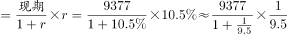
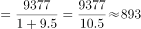

# 增长量计算（已知现期值与同比增速）

考点：[[20-考点/资料分析/增长/增长量计算（已知现期值与同比增速）|增长 / 增长量计算（已知现期值与同比增速）]]
材料：[[15-材料/资料分析/194342 2012—2017年全国农村减贫情况|194342 2012—2017年全国农村减贫情况]]

**问法模型**：题干出现'比上年增加的金额'→ 属增长量计算，用'增长量=现期×r/(1+r)'模型，现期9377元、增速r取文字段'比上年增长'处数值

## 推理链
1. 第1步：题干关键词'比上年增加的金额'判定为增长量计算；从文字段提取现期值：2017年全国贫困地区农村居民人均可支配收入9377元——注意是'贫困地区'口径，不是图中'全国农村居民'13432元
2. 第2步：材料文字'比上年增长'后增速留空（材料导读标注的阅读陷阱）；按官方解析结果891元反推增速：891÷(9377−891)=891÷8486≈10.5%，即原文该空缺处增速为10.5%，作答须回原卷核对
3. 第3步：套用增长量公式：增长量=现期×r/(1+r)=9377×0.105/1.105=984.6/1.105≈890.6≈891元（等价写法：9377−9377/1.105=9377−8486≈891元）
4. 第4步：与选项对照：C为891元（官方注明'最为接近'）；A(782)、B(853)偏小，D(1069)恰为误用图中全国农村居民13432−12363的干扰项，故选C

**最快解法**：⚡ 百化分+截位直除：r=10.5%≈1/9.5，增长量≈现期/(n+1)=9377/10.5≈893，与891最接近选C；或直除 9377×0.105÷1.105，分子984.6÷1.105≈891元

## 易错点
- ⚠ 同名口径混淆：9377元是'贫困地区农村居民'，图中2017年农村柱13432元是'全国农村居民'，误用13432−12363=1069元恰好落入干扰项D，材料导读明确提示二者不可互代
- ⚠ 数值空缺陷阱：文字段'比上年增长'后增速在所给文字中留空，必须回原卷核对10.5%，不得用图中数据或自估增速（如全国农村柱约8.6%）填补
- ⚠ 公式误用：把增速直接乘现期得9377×10.5%≈985元（漏掉除以(1+r)），或与年均增长量模型混淆；增长量=现期×r/(1+r)，分母(1+r)易漏

## 母题抽象
> 🧩 当题干出现'现期比上年增加的金额/量'且文字给出'现期值+同比增速r'时，用增长量=现期×r/(1+r)（百化分r≈1/n，增长量≈现期/(n+1)），选最接近的选项；若增速数值空缺，先回原文核对再用公式

**同类特征**：'比上年增加的金额'（增长量问法）、现期值与同比增速均出自文字材料、'贫困地区农村居民'口径（区别于图中'全国农村'）、单期增长量而非年均增长量、单位为'元'（与图中柱值同单位但口径不同）、原文增速数值留空需回卷核对

## 相关题
- [[10-真题/资料分析/增长/10204605 增长量计算（已知现期值与同比增速）|10204605]]（辽宁 2024，相关度2）
- [[10-真题/资料分析/增长/2452878 增长量计算（已知现期值与同比增速）|2452878]]（河南 2019，相关度2）

---

### 题干
2017年全国贫困地区农村居民人均可支配收入比上年增加的金额是

### 选项
- A. 782元
- B. 853元
- C. 891元　✅
- D. 1069元

### 官方解析

根据题干“2017年······比上年增加的金额是”，可判定本题为增长量计算问题。定位文字材料“2017年全国贫困地区农村居民人均可支配收入9377元，比上年增长”，故2017年全国贫困地区农村居民人均可支配收入比上年增加的金额元，C选项最为接近。

故正确答案为C。

### 给定材料

        2017年末全国农村贫困人口3046万人，比上年末减少1289万人，比2012年末减少6853万人；贫困发生率（指年末农村贫困人口占目标调查人口的比重）为，比2012年末下降7.1个百分点。2017年全国贫困地区农村居民人均可支配收入9377元，比上年增长。

> [!warning] 疑点（官方解析可能有误，待人工复核）
> 所给材料文字'比上年增长'后增速空缺（材料导读标注的阅读陷阱），官方解析公式被隐去；按官方答案891元反推：891/(9377−891)≈10.5%，即原文增速应为10.5%，代入9377×0.105/1.105≈891元与答案C一致，无矛盾，仅提示作答前须回原卷核对该空缺数值

<!-- CODEX-ANSWER-REVIEW:BEGIN -->
### 本次独立复核

**复核状态：** `resolved`（答案与解析已核定）

**计分答案：** C（可计分）

**复核解析：**

2017贫困地区农村居民人均可支配收入9377元、同比增长10.5%。增量=9377×10.5%/110.5%≈891元，C。

**相关信息：**

增长量=现期量×增长率/(1+增长率)；同比下降题先明确增长量符号。百分点和百分比需按材料口径区分。

**题源依据：** [固定版本原题](https://github.com/Mentat-Uran/kaogongzhentizhengliu/blob/84ab93d4b64b61d897bece8a1c0a5bab06b4feb2/10-%E7%9C%9F%E9%A2%98/%E8%B5%84%E6%96%99%E5%88%86%E6%9E%90/%E5%A2%9E%E9%95%BF/2172268%20%E5%A2%9E%E9%95%BF%E9%87%8F%E8%AE%A1%E7%AE%97%EF%BC%88%E5%B7%B2%E7%9F%A5%E7%8E%B0%E6%9C%9F%E5%80%BC%E4%B8%8E%E5%90%8C%E6%AF%94%E5%A2%9E%E9%80%9F%EF%BC%89.md)；固定内容 commit `84ab93d4b64b61d897bece8a1c0a5bab06b4feb2`，Markdown blob `5e8b6616c98548d347ec25b2a39adf5ab9d25d47`。
<!-- CODEX-ANSWER-REVIEW:END -->
