# 同比与环比增速关系转化（增长率逐月比较）

考点：[[20-考点/资料分析/增长/同比与环比增速关系转化（增长率逐月比较）|增长 / 同比与环比增速关系转化（增长率逐月比较）]]
材料：[[15-材料/资料分析/194343 2016年江苏规模以上光伏产业的年度|194343 2016年江苏规模以上光伏产业的年度]]

**问法模型**：问'环比增速低于上年同期的月份个数'而图1只给逐月同比增速 → 转化为'本月同比增速<上月同比增速'后直接数折线下降的月份个数

## 推理链
1. 第1步：从题干提取要求——2016年3—12月中，每个月的环比增速要低于上年同期（即2015年同月环比）；图1提供2016年2—12月各月同比增速：2月21.1%、3月16.4%、4月20.2%、5月19.7%、6月20.9%、7月14.7%、8月4.9%、9月-9.1%、10月-6.2%、11月0.0%、12月9.9%。
2. 第2步：建立等价条件——设2016年m月同比增速为a_m，则2016年m月环比=(1+a_m)/(1+a_{m-1})-1；2015年m月环比=2015年m月产值/2015年(m-1)月产值-1；两式相除比较可得：2016年m月环比<2015年同月环比 ⟺ (1+a_m)<(1+a_{m-1}) ⟺ a_m<a_{m-1}，即本月同比增速低于上月。
3. 第3步：在图1中逐月比较相邻两点（限3—12月）：3月16.4<21.1✓、4月20.2>16.4✗、5月19.7<20.2✓、6月20.9>19.7✗、7月14.7<20.9✓、8月4.9<14.7✓、9月-9.1<4.9✓、10月-6.2>-9.1✗、11月0.0>-6.2✗、12月9.9>0.0✗。
4. 第4步：满足'同比增速较上月下降'的有3月、5月、7月、8月、9月，共5个月，对照选项得C（5个）。

**最快解法**：⚡ 转化比较法（零计算）：记住结论'本月环比低于上年同期 ⟺ 本月同比增速低于上月同比增速'，直接在图1折线上数'下降段'——21.1→16.4（3月）、20.2→19.7（5月）、20.9→14.7→4.9→-9.1（7、8、9月），共5段下降，秒选C。

## 易错点
- ⚠ 直接在图1中找'环比'数据会落空——图1只有同比增速，必须先做'本月环比<上年同期环比 ⟺ 本月同比<上月同比'的等价转化
- ⚠ 负值与零值的符号处理：10月-6.2%高于9月-9.1%（上升，不满足），11月0.0%高于10月-6.2%（不满足），若忽略正负号易把9、10、11月数错；相邻差值小的月份（如5月19.7 vs 4月20.2）需逐点精确比较，不能凭曲线大致走势粗判
- ⚠ 时间范围限定3—12月：2月（21.1%）不在统计范围内；若误把10月判为'下降'或将范围扩至2月都会数错个数

## 母题抽象
> 🧩 当题干问'环比增速低于/高于上年同期的月份个数'而材料只给逐月同比增速时，用等价条件'本月环比<上年同期环比 ⟺ 本月同比增速<上月同比增速'，直接数同比折线下降（或上升）的月份个数即可，全程无需计算产值。

**同类特征**：环比增速低于上年同期、月份个数计数、逐月同比增速折线图、只给增速无产值绝对值、等价条件转化、限定3—12月范围

## 相关题
（暂无）

---

### 题干
2016年3—12月，江苏规模以上光伏产业产值环比增速低于上年同期的月份个数为：

### 选项
- A. 2个
- B. 3个
- C. 5个　✅
- D. 8个

### 官方解析

由题目问“环比增速低于上年同期的月份个数”，即每个月的环比增速要与上年同期比较，判定为一般增长率比较问题。定位图1可得“2016年2-12月每个月份同比增长率”，根据增长率公式可得：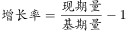，即：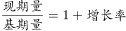，故可得：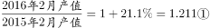

；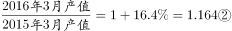。

将②÷①，可得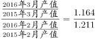，整理得：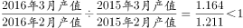,即2016年3月环比增速低于上年同期的环比增速。

由此可得：若本月产值同比增长率小于上月，则本月环比增长率低于上年同期，满足条件的有3月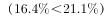、5月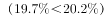、7月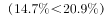、8月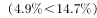、9月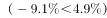，共5个月份。

故正确答案为C。

### 给定材料

        2016年江苏规模以上光伏产业总产值2846.2亿元，比上年增长，增速较上年回落3.5个百分点；主营业务收入2720.5亿元，增长，增速回落2.5个百分点；利润总额153.6亿元，增长，增速回落8.8个百分点。苏南、苏中、苏北地区规模以上光伏产业产值分别比上年增长、、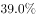。2016年江苏光伏发电新增装机容量123万千瓦，年末累计装机容量546万千瓦。

> [!warning] 疑点（官方解析可能有误，待人工复核）
> 官方解析中公式表达式存在显示缺失（'根据增长率公式可得：，即：'等处符号空缺），但推导方向与最终结论（同比低于上月即满足，共3、5、7、8、9月5个月）正确，不影响答案C。
