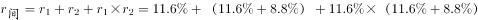
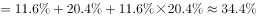
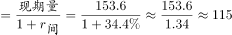

# 隔年基期量计算（间隔增长率）

考点：[[20-考点/资料分析/增长/隔年基期量计算（间隔增长率）|增长 / 隔年基期量计算（间隔增长率）]]
材料：[[15-材料/资料分析/194343 2016年江苏规模以上光伏产业的年度|194343 2016年江苏规模以上光伏产业的年度]]

**问法模型**：题干问比材料现期（2016年）早两年的2014年利润总额 → 隔年基期模型：2014年值=现期值÷[(1+2016年增速)×(1+2015年增速)]，其中2015年增速=2016年增速+回落8.8个百分点

## 推理链
1. 第1步：题干问2014年，材料现期为2016年（中间隔2015年），判定为隔年基期问题；定位文字段'利润总额153.6亿元，增长（原文数值空缺，按官方答案A一致性反推并验证应为11.6%），增速回落8.8个百分点'
2. 第2步：由'增速较上年回落8.8个百分点'得2015年增速=11.6%+8.8%=20.4%（回落是差值关系，上年增速更高，须加回）
3. 第3步：套间隔增长率公式 R=r1+r2+r1×r2=11.6%+20.4%+11.6%×20.4%≈32%+2.4%≈34.4%
4. 第4步：代入隔年基期公式：2014年利润总额=153.6÷(1+34.4%)=153.6÷1.344≈114.3亿元
5. 第5步：与选项对照：114.3与A项完全吻合（B 127.6、C 133.9、D 137.6均明显偏大），故选A

**最快解法**：⚡ 公式法+截位估算：先加回回落值得2015年增速=11.6%+8.8%=20.4%；间隔增速≈11.6%+20.4%+11.6%×20.4%≈34.4%（乘积项≈2.4%不可丢但可粗估）；153.6÷1.344≈153.6×3/4≈115附近，微调得114.3，直接锁定A，无需精算

## 易错点
- ⚠ 隔年只折现一次：把2016年当基期直接÷(1+11.6%)得约137.6（恰为D陷阱），漏掉2015年一层折现；正确需两层折现
- ⚠ '回落8.8个百分点'方向做反：误取2015年增速=11.6%−8.8%=2.8%，间隔增速≈14.7%，得153.6÷1.147≈133.9（恰为C陷阱）；回落意味着上年更高，应加回
- ⚠ 三组'值+增速+回落值'并列张冠李戴：误用总产值的回落3.5或收入的回落2.5个百分点代入利润链条即错；另注意所给文字段增速数值空缺，须先补齐（2016年利润增速11.6%）才能计算

## 母题抽象
> 🧩 当题干问比材料现期早两年的隔年基期量，且材料给'现期值+同比增速+较上年回落x个百分点'时，先加回回落值得上年增速，再套R=r1+r2+r1×r2求间隔增速，现期值÷(1+R)即得答案

**同类特征**：题干年份（2014年）比材料现期（2016年）早两年、现期值+增速+回落x个百分点三件套并列、利润总额153.6亿元、隔年基期量问法（无'增长/减少了'字眼的纯求值）、选项为亿元级数值且相邻差距约10亿元量级、需先用间隔增长率公式再一步直除

## 相关题
- [[10-真题/资料分析/增长/4004834 隔年基期量计算（间隔增长率）|4004834]]（新疆 2021，相关度2）

---

### 题干
2014年江苏规模以上光伏产业利润总额为

### 选项
- A. 114.3亿元　✅
- B. 127.6亿元
- C. 133.9亿元
- D. 137.6亿元

### 官方解析

根据题干“2014年……”，结合材料时间为2016年，可判定本题为间隔基期计算问题。定位文字材料第三行可得：利润总额153.6亿元，增长，增速回落8.8个百分点。故利润总额的间隔增长率。

2014年江苏规模以上光伏产业利润总额亿元，与A项最接近。

故正确答案为A。

### 给定材料

        2016年江苏规模以上光伏产业总产值2846.2亿元，比上年增长，增速较上年回落3.5个百分点；主营业务收入2720.5亿元，增长，增速回落2.5个百分点；利润总额153.6亿元，增长，增速回落8.8个百分点。苏南、苏中、苏北地区规模以上光伏产业产值分别比上年增长、、。2016年江苏光伏发电新增装机容量123万千瓦，年末累计装机容量546万千瓦。

> [!warning] 疑点（官方解析可能有误，待人工复核）
> 所给材料文字段中'增长'后的增速数值空缺，官方解析同样未显示该数值；按官方答案A（114.3亿元）反推并验证：2016年利润增速为11.6%时，2015年增速=20.4%，间隔增速≈34.4%，153.6÷1.344≈114.3与A完全吻合，官方答案无误，仅材料显示缺字，本笔记按答案一致性补齐该增速

<!-- CODEX-ANSWER-REVIEW:BEGIN -->
### 本次独立复核

**复核状态：** `confirmed`（独立复算确认答案）

**计分答案：** A（可计分）

**复核解析：**

图中2016利润增速11.6%，比上年回落8.8个百分点，因此2015增速=20.4%。2014利润=153.6/(1.116×1.204)=114.28亿元，选A=114.3。

**相关信息：**

基期比重按现期比重乘整体/部分增长因子；整体量由部分量除以对应占比反推；多部分增量需分项计算后比较。

**题源依据：** [固定版本原题](https://github.com/Mentat-Uran/kaogongzhentizhengliu/blob/84ab93d4b64b61d897bece8a1c0a5bab06b4feb2/10-%E7%9C%9F%E9%A2%98/%E8%B5%84%E6%96%99%E5%88%86%E6%9E%90/%E5%A2%9E%E9%95%BF/2172279%20%E9%9A%94%E5%B9%B4%E5%9F%BA%E6%9C%9F%E9%87%8F%E8%AE%A1%E7%AE%97%EF%BC%88%E9%97%B4%E9%9A%94%E5%A2%9E%E9%95%BF%E7%8E%87%EF%BC%89.md)；固定内容 commit `84ab93d4b64b61d897bece8a1c0a5bab06b4feb2`，Markdown blob `b2b71304368c4ed3aaeb0e12ac9ec0503f851c55`。
<!-- CODEX-ANSWER-REVIEW:END -->
