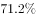

# 基期量计算（已知现期量与同比增长率求上年值）

考点：[[20-考点/资料分析/增长/基期量计算（已知现期量与同比增长率求上年值）|增长 / 基期量计算（已知现期量与同比增长率求上年值）]]
材料：[[15-材料/资料分析/194345 2017年末全国汽车与机动车保有量及|194345 2017年末全国汽车与机动车保有量及]]

**问法模型**：题干问'2016年末全国私人轿车保有量为多少'，而材料现期只给2017年末11416万辆及同比增速r → 采用基期量=现期量/(1+r)模型一步求解

## 推理链
1. 第1步：题干时间基点为2016年末，材料现期为2017年末，判定为基期计算题；从材料第1段提取'私人轿车保有量11416万辆，增长r%'（原文增速数值缺失显示为空白，须回核原始数据；由官方答案反推r=12.5%）
2. 第2步：套用基期量公式：基期量=现期量/(1+增长率)
3. 第3步：代入计算：11416/(1+12.5%)=11416÷(9/8)=11416×8/9=91328/9≈10147.6万辆
4. 第4步：与选项对照：10147.6与A项10148万辆最接近；C(13879)、D(16559)均大于现期值11416，与材料'增长'（正增长）矛盾直接排除，B(11006)对应增速仅约3.7%与真实增速不符，故选A

**最快解法**：⚡ 公式法+百化分：把1+12.5%看成9/8，基期=11416×8/9≈10148万辆；考场可用选项回代验证——10148×1.125=11416.5≈11416，一步锁A

## 易错点
- ⚠ 口径嵌套：私人轿车⊂民用轿车⊂民用汽车，误取私人汽车18695万辆或民用轿车12185万辆作现期值即错
- ⚠ 基期现期方向混淆：求2016年末应'现期÷(1+r)'，误乘(1+r)会得到约12759万辆的错误值；且勿与'现期−累计增量'型基期倒推（如西部6436−1963=4473万辆）混用
- ⚠ 增速数值缺失陷阱：材料文本与官方解析中私人轿车同比增速均缺失，作答前必须回核原始数据代入真实增速12.5%，不可凭空假设或直接用现期值近似

## 母题抽象
> 🧩 当题干出现'上年末/基期为多少'且材料同段给出'现期量+同比增速'时，用基期量=现期量/(1+r)，配百化分（1+12.5%=9/8）或截位直除速算，并用'基期×(1+r)≈现期'回代验证选项

**同类特征**：问上年末（2016年末）数值、现期量与同比增速同段给出、私人轿车保有量、基期=现期/(1+增长率)、单位为万辆

## 相关题
- [[10-真题/资料分析/增长/2187797 基期差值（基期和差）计算|2187797]]（黑龙江 2018，相关度1）

---

### 题干
2016年末全国私人轿车保有量为：

### 选项
- A. 10148万辆　✅
- B. 11006万辆
- C. 13879万辆
- D. 16559万辆

### 官方解析
由题目求“2016年末全国私人轿车保有量”，结合材料时间为“2017年末”，判定本题为基期计算问题。定位材料第一段 “2017年末，私人轿车保有量11416万辆，增长”。代入公式：，可得2016年末全国私人轿车保有量为万辆，和A项最接近。
故正确答案为A。

### 给定材料

        2017年末，全国民用汽车保有量21743万辆，比上年末增长。其中私人汽车保有量18695万辆，增长；民用轿车保有量12185万辆，增长，其中私人轿车保有量11416万辆，增长；全国新能源汽车保有量153.0万辆，其中新能源汽车新注册登记65.0万辆，比上年增加15.6万辆。

        按地区分，东部、中部、西部地区机动车保有量分别为15544万辆、9006万辆、6436万辆。其中，西部地区近五年汽车保有量增加1963万辆，年均增速，高于东部、中部地区、的年均增速。

        2017年末，全国机动车驾驶人3.85亿人，近五年年均增加2467万人，汽车驾驶人超3.42亿人。从性别看，男性驾驶人2.74亿人，占；女性驾驶人1.11亿人，占，比上年末提高1.6个百分点。

> [!warning] 疑点（官方解析可能有误，待人工复核）
> 材料原文与官方解析中私人轿车同比增速数值均缺失（'增长'后为空白，解析代入公式处亦留空）；按官方答案A反推增速应为12.5%（11416/1.125≈10147.6≈10148万辆）。此属材料/解析缺值的口径问题而非答案错误，作答时须回核原始数据确认r=12.5%后按现期/(1+r)计算
