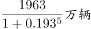
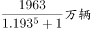
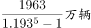
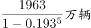

# 基期量计算（现期-五年累计增量倒推2012年末）

考点：[[20-考点/资料分析/增长/基期量计算（现期-五年累计增量倒推2012年末）|增长 / 基期量计算（现期-五年累计增量倒推2012年末）]]
材料：[[15-材料/资料分析/194345 2017年末全国汽车与机动车保有量及|194345 2017年末全国汽车与机动车保有量及]]

**问法模型**：题干以2017年末为现期、给'近五年汽车保有量增加1963万辆'求2012年末基期量 → 基期量=现期量-五年累计增量（勿绕道年均增速公式）

## 推理链
1. 第1步：题干求'2012年末西部地区汽车保有量'，材料现期时点为2017年末，'近五年'的起点恰为2012年末，判定为基期量计算
2. 第2步：定位材料第二段：2017年末西部地区保有量为6436万辆，'近五年汽车保有量增加1963万辆'，即1963万辆为2012→2017年的五年累计增量
3. 第3步：由'基期量=现期量-累计增量'得：2012年末保有量=6436-1963=4473万辆
4. 第4步：尾数速验：6-3=3，所求数值末位应为3，与4473一致
5. 第5步：对照选项，C对应4473万辆，故选C

**最快解法**：⚡ 直减+尾数法：基期=6436-1963=4473万辆，末位6-3=3锁定尾数，秒选C；切勿尝试用年均增速公式(1+r)^5回推——材料中东部/中部/西部年均增速数值缺失且本题根本不需要

## 易错点
- ⚠ '近五年增加1963万辆'是五年累计增量，勿误当成年均增量（若误算6436-1963×5=减少量则荒谬）或误当2012年末保有量本身
- ⚠ 口径陷阱：第二段总量口径为'机动车'（含摩托车等），而'增加1963万辆'与题干均表述为'汽车'，跨段、跨口径数值不能随意加减比较；本题按材料设定直接以6436减1963处理
- ⚠ 与第1题对照：求基期有两条路——有增速时用'现期/(1+r)'，给累计增量时用'现期-累计增量'，本题材料增速缺失，只能走直减路线，误走增长率公式会卡壳

## 母题抽象
> 🧩 当题干出现'现期时点+近N年累计增加X'求N年前基期量的特征时，直接用基期=现期-累计增量（如6436-1963=4473），验证尾数后锁定选项，不必动用年均增速公式

**同类特征**：2012年末、近五年增加1963万辆、西部地区、保有量、基期倒推、万辆

## 相关题
- [[10-真题/资料分析/比重/2172071 基期比重计算|2172071]]（广州市考 2018，相关度1）
- [[10-真题/资料分析/其他/2021926 简单计算—跨图做差比较最大差值|2021926]]（吉林 2016，相关度1）

---

### 题干
2012年末西部地区汽车保有量为：

### 选项
- A. 

- B. 

- C. 

　✅
- D. 

### 官方解析
由题目求“2012年末西部地区汽车保有量”，结合材料时间为“2017年末”判定本题为基期计算问题。定位材料第二段“2017年末，西部地区近五年汽车保有量增加1963万辆，年均增速”，根据年均增长率公式：，可得：，故可推出2012年末西部地区汽车保有量为万辆。
故正确答案为C。

### 给定材料

        2017年末，全国民用汽车保有量21743万辆，比上年末增长。其中私人汽车保有量18695万辆，增长；民用轿车保有量12185万辆，增长，其中私人轿车保有量11416万辆，增长；全国新能源汽车保有量153.0万辆，其中新能源汽车新注册登记65.0万辆，比上年增加15.6万辆。

        按地区分，东部、中部、西部地区机动车保有量分别为15544万辆、9006万辆、6436万辆。其中，西部地区近五年汽车保有量增加1963万辆，年均增速，高于东部、中部地区、的年均增速。

        2017年末，全国机动车驾驶人3.85亿人，近五年年均增加2467万人，汽车驾驶人超3.42亿人。从性别看，男性驾驶人2.74亿人，占；女性驾驶人1.11亿人，占，比上年末提高1.6个百分点。

> [!warning] 疑点（官方解析可能有误，待人工复核）
> 官方解析表述'根据年均增长率公式'但材料中东部/中部/西部的年均增速数值均缺失、公式内容未显示，实际可行且与答案C一致的算法为'基期=现期-五年累计增量'=6436-1963=4473万辆；另第二段总量口径为'机动车'而增量与题干为'汽车'，解析未辨析该口径差异，按材料设定照算不影响答案
