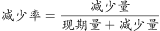
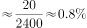
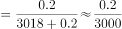
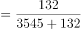
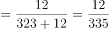

# 增长率（减少速度）比较

考点：[[20-考点/资料分析/增长/增长率（减少速度）比较|增长 / 增长率（减少速度）比较]]
材料：[[15-材料/资料分析/194405 2017年我国粮食及主要农作物（小麦|194405 2017年我国粮食及主要农作物（小麦]]

**问法模型**：题干问'种植面积减少速度最快的是'→ 减少率比较模型：减少速度=减量÷基期，其中基期=现期+减量，四者取商最大者。

## 推理链
1. 第1步：从文字段1提取数据：2017年小麦种植面积2399万公顷、减少20万公顷；稻谷3018万公顷、减少0.2万公顷；玉米3545万公顷、减少132万公顷；棉花323万公顷、减少12万公顷。
2. 第2步：文字只给同比减量、未给2016年基期值，需先还原基期：基期面积=现期+减量；减少速度=减量÷基期面积。
3. 第3步：还原基期并列式：小麦20/2419、稻谷0.2/3018.2、玉米132/3677、棉花12/335。
4. 第4步：截位粗算分层：稻谷0.2/3018.2≈0.007%、小麦20/2419≈0.83%明显偏小，可先排除；玉米132/3677≈3.59%与棉花12/335≈3.58%非常接近，须精确比较。
5. 第5步：同分子放缩精算：将棉花12/335的分子分母同乘11得132/3685，与玉米132/3677分子相同，分母3677<3685，故玉米减少速度＞棉花。
6. 第6步：四种作物中玉米降幅最大，对照选项选C（玉米）。

**最快解法**：⚡ 同分子放缩+截位直除：先截位排除稻谷（≈0.007%）和小麦（≈0.8%）；对玉米132/3677与棉花12/335，将棉花分子分母同乘11化为132/3685，分子相同比分母，3677<3685，玉米>棉花，直接锁定C。

## 易错点
- ⚠ 把'减少速度'误当'减少量'直接比大小：虽减量132>20>12>0.2侥幸指向玉米，但模型上率=减量÷基期，且不能用现期3545/323作分母（正确分母是还原后的3677/335），口径必须先摆正。
- ⚠ 基期还原方向搞反：材料给'2017年面积+减少量'，基期=现期+减量（玉米3677=3545+132），误写成'现期-减量'会把降幅系统性算大。
- ⚠ 玉米与棉花降幅仅差约0.01个百分点（约3.59%对3.58%），截位粗糙或口算不精极易误选D棉花；另需区分'面积段'与'产量段'数据，勿误用玉米产量21589万吨、棉花产量549万吨。

## 母题抽象
> 🧩 当题干出现'减少/增长速度最快'且材料只给现期值与同比增减量时，用'增减量÷（现期+减量或现期-增量）'还原基期求增减率，若两项数值接近，再用同分子放缩或高位截除精比，验证谁最大。

**同类特征**：减少速度最快、种植面积、四种农作物比较、材料只给同比增减量、增长率比较

## 相关题
- [[10-真题/资料分析/增长/2187792 同比增长率比较（增速最快年份判断）|2187792]]（黑龙江 2018，相关度1）
- [[10-真题/资料分析/增长/4658521 增长率（同比降幅）大小比较|4658521]]（四川 2021，相关度1）
- [[10-真题/资料分析/增长/18643713 跨期增长率比较（2024年对2020年4年总增速，先合并价位档再比较）|18643713]]（天津 2026，相关度1）
- [[10-真题/资料分析/增长/2049328 增长率比较（跨指标增幅最大）|2049328]]（河南 2017，相关度1）
- [[10-真题/资料分析/增长/2374732 增长率比较（同比增幅大小排序）|2374732]]（广东 2019，相关度1）

---

### 题干
2017年，我国小麦、稻谷、玉米、棉花四种农作物中，种植面积减少速度最快的是（  ）。

### 选项
- A. 小麦
- B. 稻谷
- C. 玉米　✅
- D. 棉花

### 官方解析

由题干“减少速度最快的是”，可判定本题为一般增长率比较问题。定位文字材料第一段可得“我国2017年小麦种植面积2399万公顷，减少20万公顷；稻谷种植面积3018万公顷，减少0.2万公顷；玉米种植面积3545万公顷，减少132万公顷；棉花种植面积323万公顷，减少12万公顷”，代入公式：，可得四种农作物种植面积减少速度分别为：小麦；稻谷；玉米；棉花。由于玉米和棉花的减少速度非常接近，故需要精确计算。可得种植面积减少速度最快的是玉米。

故正确答案为C。

### 给定材料

        我国2017年粮食种植面积为11222万公顷，比上年减少81万公顷。其中，小麦种植面积2399万公顷，减少20万公顷；稻谷种植面积3018万公顷，减少0.2万公顷；玉米种植面积3545万公顷，减少132万公顷。棉花种植面积323万公顷，减少12万公顷。油料种植面积1420万公顷，增加7万公顷。糖料种植面积168万公顷，减少1万公顷。

        2017年粮食产量61791万吨，比上年增加166万吨，增产。其中，夏粮产量14031万吨，增产；早稻产量3174万吨，减产；秋粮产量44585万吨，增产。全年谷物产量56455万吨，比上年减产。其中，稻谷产量20856万吨，增产；小麦产量12977万吨，增产；玉米产量21589万吨，减产。全年棉花产量549万吨，比上年增产。油料产量3732万吨，增产。糖料产量12556万吨，增产。茶叶产量255万吨，增产。

> [!warning] 疑点（官方解析可能有误，待人工复核）
> 官方解析中增长率公式及各作物具体降幅数值在给定文本中显示为空白占位，但按公式复算（玉米132/3677≈3.59%＞棉花12/335≈3.58%＞小麦0.83%＞稻谷0.007%）结论'玉米最快'成立，答案C无误。
