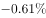
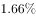
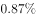

# 环比增速读数与大小比较

考点：[[20-考点/资料分析/增长/环比增速读数与大小比较|增长 / 环比增速读数与大小比较]]
材料：[[15-材料/资料分析/194869 2016年1—12月网购固定篮子价格|194869 2016年1—12月网购固定篮子价格]]

**问法模型**：题干问'环比增速最快的月份'→ 按图例锁定方块线（环比序列），只读取四个选项月份的带符号增速值，直接比较取最大者

## 推理链
1. 第1步：题干要求比较'环比增速'，由图例确认方块线=环比(%)，三角线=同比(%)，故只读方块线；选项限定比较1月、2月、7月、12月四个月份
2. 第2步：从方块线逐点读取：201601为-0.61%、201602为1.66%、201607为0.8%、201612为0.87%
3. 第3步：带符号比较四个数值：1.66 > 0.87 > 0.8 > -0.61
4. 第4步：最大值为2月的1.66%，且2月是全年唯一超过1%的环比点；对照选项，2月为B，故选B

**最快解法**：⚡ 直接读数比较法（无需计算）：认准方块线后只盯四个选项月份标签——2月1.66为四点中唯一显著高于1%者（7月0.8、12月0.87均低于1%，1月-0.61为负），秒选B；关键动作是排除7月旁'1.01'标签的干扰（那是三角线同比）

## 易错点
- ⚠ 序列错位陷阱：7月的'1.01'是同比（三角线）数据标签，若按标签高低误读为环比，会错选C（7月0.8反被1.01取代）；必须按标记形状对号，不能按标签上下位置猜归属
- ⚠ 同比环比混淆：2月同比为-1.19（负值），若错用同比序列比较，2月会被排除；类似地201608的-0.61与-0.66、201606的双-1.4标签并列，均易串行
- ⚠ '最快'=环比增速数值最大（带符号比较），不是涨幅变化幅度或涨跌绝对量；1月-0.61为负、12月0.87与7月0.8均小于2月的1.66

## 母题抽象
> 🧩 当题干出现'某增速最快/最高的月份'且材料为环比/同比双折线增速图时，第一步按图例标记形状锁定对应序列，第二步只读取选项所列月份的带符号数值直接比大小，重点验证邻近点另一序列标签的归属（防串行）

**同类特征**：环比增速最快、双折线图双序列辨析、选项为具体月份（1/2/7/12月）、带符号百分数直接比较、标签密集易串行的读数题

## 相关题
- [[10-真题/资料分析/增长/2187891 环比增长率比较＋比重排名查找（复合题）|2187891]]（山东 2018，相关度1）
- [[10-真题/资料分析/增长/1796220 环比增速比较（增长率分数比较）|1796220]]（黑龙江 2016，相关度1）
- [[10-真题/资料分析/增长/18508046 环比增长率计算与比较|18508046]]（山东 2025，相关度1）

---

### 题干
2016年网购固定篮子价格指数环比增速最快的月份是：

### 选项
- A. 1月
- B. 2月　✅
- C. 7月
- D. 12月

### 官方解析

定位图形材料可知，2016年1月、2月、7月、12月的环比增速分别为、、、，2月12月7月1月，所以环比增速最快的月份是2月份。

故正确答案为B。

### 给定材料

> [!warning] 疑点（官方解析可能有误，待人工复核）
> 官方解析文字中四个具体数值缺失（'分别为、、、'留空），比较式'2月12月7月1月'的排版依赖补全；按图中读数（-0.61、1.66、0.8、0.87）结论B无误，仅解析文本不完整

<!-- CODEX-ANSWER-REVIEW:BEGIN -->
### 本次独立复核

**复核状态：** `confirmed`（独立复算确认答案）

**计分答案：** B（可计分）

**复核解析：**

只比较图例明确标为环比的折线点：1月−0.61%、2月1.66%、7月0.80%、12月0.87%。最大为2月，选B。

**相关信息：**

用同一统计口径比较年度变化；增长量由现期与基期之差求得，给出现期量和增长率时使用现期×r/(1+r)。

**题源依据：** [固定版本原题](https://github.com/Mentat-Uran/kaogongzhentizhengliu/blob/84ab93d4b64b61d897bece8a1c0a5bab06b4feb2/10-%E7%9C%9F%E9%A2%98/%E8%B5%84%E6%96%99%E5%88%86%E6%9E%90/%E5%A2%9E%E9%95%BF/2184622%20%E7%8E%AF%E6%AF%94%E5%A2%9E%E9%80%9F%E8%AF%BB%E6%95%B0%E4%B8%8E%E5%A4%A7%E5%B0%8F%E6%AF%94%E8%BE%83.md)；固定内容 commit `84ab93d4b64b61d897bece8a1c0a5bab06b4feb2`，Markdown blob `2f8bebee6ba229b30ccd1d62d01321b42ffdb964`。
<!-- CODEX-ANSWER-REVIEW:END -->
