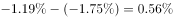
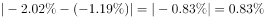
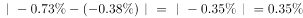
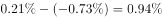

# 同比增速逐月差值（两期增速变化量）比较

考点：[[20-考点/资料分析/增长/同比增速逐月差值（两期增速变化量）比较|增长 / 同比增速逐月差值（两期增速变化量）比较]]
材料：[[15-材料/资料分析/194869 2016年1—12月网购固定篮子价格|194869 2016年1—12月网购固定篮子价格]]

**问法模型**：问'同比增速与上月该数字之间的差值最大的月份'→锁定同比序列后逐月带符号作差（本月同比−上月同比），比较差值代数值取最大

## 推理链
1. 第1步：按标记形状锁定三角线'同比'序列并逐月读数：1月-1.75、2月-1.19、3月-2.02、4月-1.21、5月-0.97、6月-1.4、7月-1.01（标签印作'1.01'但点位在-1附近）、8月-0.66、9月-0.5、10月-0.38、11月-0.73、12月0.21
2. 第2步：规则：差值=本月同比−上月同比（带符号）；1月缺2015年12月基数不可比，从2月起算
3. 第3步：代入四个选项：2月=-1.19-(-1.75)=0.56；3月=-2.02-(-1.19)=-0.83；11月=-0.73-(-0.38)=-0.35；12月=0.21-(-0.73)=0.94
4. 第4步：校验其余月份无更大值：4月=-1.21-(-2.02)=0.81＜0.94，5月0.24、6月-0.43、7月=-1.01-(-1.4)=0.39、8月0.35、9月0.16、10月0.12均更小
5. 第5步：比较：选项内0.94＞0.56＞-0.35＞-0.83，且12月0.94为全月最大，故选D（12月）

**最快解法**：⚡ 折线升段目测+选项作差验证：'与上月差值最大'即同比折线相邻两点抬升最陡的一段，目测11月(-0.73)→12月(0.21)升0.94为全图最大升幅（次大4月0.81、2月0.56）；再对选项验证12月0.21-(-0.73)=0.94＞2月0.56，3月与11月差值为负，秒选D

## 易错点
- ⚠ 序列错认：须用三角线'同比'而非方块线'环比'——2月环比1.66恰为全图峰值，误用环比会错选2月；标签交错时按标记形状对号，勿按数据标签上下位置猜归属
- ⚠ 带符号作差：负减负易丢负号，如11月=-0.73-(-0.38)=-0.35、3月=-2.02-(-1.19)=-0.83；且'差值最大'比的是代数值而非绝对值
- ⚠ 口径与读数陷阱：1月缺2015年12月数据不可比须跳过；201607同比标签印作'1.01'但点位在-1附近（应为-1.01），若按+1.01计算7月差值达2.41会误判，须以图中点位为准

## 母题抽象
> 🧩 当题干出现'某指标（增速）与上月该数字之间的差值最大/变化最大'特征时，先按图例标记锁定正确序列，再逐月带符号作差（本月−上月，首月因缺基数跳过），取差值代数值最大者对照选项

**同类特征**：同比增速、与上月该数字之间的差值、差值最大的月份、逐月两两作差、双折线图按标记形状选序列、负数带符号运算

## 相关题
- [[10-真题/资料分析/综合/10297333 综合分析选非题（同比增速逐年比较+年均增长量+比重百分点还原）|10297333]]（浙江 2025，相关度1）
- [[10-真题/资料分析/增长/13504272 一般增长率计算与计数比较（同比增速-5%年份计数）|13504272]]（云南 2025，相关度1）
- [[10-真题/资料分析/增长/19283744 同比增速（增长率）逐年比较|19283744]]（国考 2025，相关度1）
- [[10-真题/资料分析/增长/2388036 同比增长率比较（增速最大年份判定）|2388036]]（河北 2019，相关度1）
- [[10-真题/资料分析/增长/2423335 同比增长率计算与逐年增速趋势比较|2423335]]（甘肃 2019，相关度1）

---

### 题干
2016年各月网购固定篮子价格指数同比增速与上月该数字之间的差值最大的月份是：

### 选项
- A. 2月
- B. 3月
- C. 11月
- D. 12月　✅

### 官方解析

定位图形材料可知，2016年各月固定篮子价格指数同比增速与上月该数字之间的差值分别为：A项，2月，；B项，3月，；C项，11月，；D项，12月，。差值最大的是12月。

故正确答案为D。

### 给定材料

> [!warning] 疑点（官方解析可能有误，待人工复核）
> 官方解析中各选项差值的具体算式与数值被省略（原文留白），按图补算为：2月0.56、3月-0.83、11月-0.35、12月0.94，与官方答案D一致。另存在口径问题：图中201607同比标注'1.01'无负号，但该三角点绘制位置约在-1（应为-1.01），官方答案D（12月差值0.94最大）与点位口径自洽；若按标注+1.01理解，7月差值2.41将为全月最大，但7月不在选项中，不影响选项内比较结论
