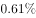
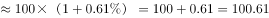
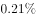
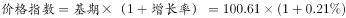

# 指数还原（由增速求现期指数，环比连乘-同比放大）

考点：[[20-考点/资料分析/增长/指数还原（由增速求现期指数，环比连乘-同比放大）|增长 / 指数还原（由增速求现期指数，环比连乘/同比放大）]]
材料：[[15-材料/资料分析/194869 2016年1—12月网购固定篮子价格|194869 2016年1—12月网购固定篮子价格]]

**问法模型**：题干给定某月指数=100求当年12月指数 → 将各月环比增速化为小数后按(1+环比)逐月连乘还原，或先由1月环比反推2015年12月指数再用12月同比一步放大

## 推理链
1. 第1步：题干给定2016年1月指数=100；从图中读出2016年1月环比=-0.61%，12个月环比依次为-0.61、1.66、-1.28、0.56、-0.05、-1.4、0.8、-0.61、0.16、0.44、-0.29、0.87（%），12月同比=0.21%
2. 第2步：指数还原规则：12月指数=100×(1+r₂月)×…×(1+r₁₂月)，百分数须除以100化小数；或官方捷径：2015年12月指数=100÷(1-0.61%)，12月指数=该值×(1+12月同比0.21%)
3. 第3步：代入计算——捷径：100÷0.9939≈100.6，100.6×1.0021≈100.8；连乘验证：100×1.0166×0.9872×1.0056×0.9995×0.986×1.008×0.9939×1.0016×1.0044×0.9971×1.0087≈100.8
4. 第4步：两种路径均得约100.8，与A项101最接近（B106、C95、D99均偏离），故选A

**最快解法**：⚡ 同比一步法（官方路径）：由1月环比-0.61%反推基期100÷(1-0.61%)≈100.6，再乘12月同比(1+0.21%)≈100.8≈101，两步口算即可，避开12个月连乘；若走连乘路线，可先用12个环比直接加总(+0.25)估量级再精算校验

## 易错点
- ⚠ 图中给的是增速而非指数：须将%化为小数按(1+r)连乘，直接把百分数相加（约+0.25）方法错误，本例因量级相近易被掩盖
- ⚠ 连乘应从2月环比开始：1月环比-0.61%对应2015年12月→2016年1月的变化，基期既定为100则不能再乘1月环比；若走同比捷径，反推基期须用除法100÷(1-0.61%)而非乘100×(1-0.61%)
- ⚠ 双线标签易串行：方块=环比、三角=同比，须按标记形状取数，误把同比（如12月0.21旁的-0.29等）当环比会算错方向

## 母题抽象
> 🧩 当题干出现'若某月指数为100，求另一月指数约多少'特征时，用(1+环比增速)逐月连乘还原指数，或借'反推基期÷(1-环比)再乘(1+同比)'两步捷径，验证结果最接近的选项

**同类特征**：若…指数为100、当年12月该指数约为、价格指数还原、环比增速连乘、双折线增速图、现期计算

## 相关题
- [[10-真题/资料分析/平均数/2030140 日均值×当月天数换算月总量后按阈值计数筛选|2030140]]（四川 2016，相关度1）
- [[10-真题/资料分析/增长/2050272 现期量计算（按同比增速外推一期）|2050272]]（湖南 2017，相关度1）
- [[10-真题/资料分析/比重/1796626 现期比重计算|1796626]]（广东 2016，相关度1）
- [[10-真题/资料分析/增长/2367783 年均增速外推终值（预测型现期计算）|2367783]]（江苏 2019，相关度1）
- [[10-真题/资料分析/增长/2423342 现期值计算（已知上一期值与同比增速求现期）|2423342]]（甘肃 2019，相关度1）

---

### 题干
若2016年1月网购固定篮子价格指数为100，则当年12月该指数约为：

### 选项
- A. 101　✅
- B. 106
- C. 95
- D. 99

### 官方解析

由题意，给出2016年1月的指数，求2016年12月的指数，判定本题为现期计算问题。定位材料可知2016年1月环比下降，故2015年12月网购固定篮子价格指数；根据材料可知，2016年12月网购固定篮子价格指数同比增长率为，故可知2016年12月网购固定篮子，与A项最接近。

故正确答案为A。

### 给定材料

> [!warning] 疑点（官方解析可能有误，待人工复核）
> 官方解析文字中具体数值缺失（'环比下降'后未标-0.61%、'同比增长率为'后未标0.21%，疑为公式排版丢失），按图补全后计算100.6×1.0021≈100.8≈101，与答案A一致，不构成答案错误；另图中201607同比标注1.01与点位约-1存在图文观感不一致，但该数据不参与本题计算
