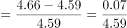
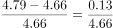
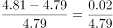
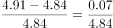

# 同比增长率比较（逐年增速大小比较）

考点：[[20-考点/资料分析/增长/同比增长率比较（逐年增速大小比较）|增长 / 同比增长率比较（逐年增速大小比较）]]
材料：[[15-材料/资料分析/194911 广东省医疗卫生资源2009—2016|194911 广东省医疗卫生资源2009—2016]]

**问法模型**：题干问'2010—2016年同比上一年增长率最高的是哪一年' → 对各年依次用 现期值÷上年值−1 计算同比增长率并比较大小

## 推理链
1. 第1步：题干锁定2010—2016年逐年同比增速，选项为2012/2013/2014/2016；定位图1读取机构数（万个）：2009年4.43、2010年4.49、2011年4.59、2012年4.66、2013年4.79、2014年4.81、2015年4.84、2016年4.91
2. 第2步：同比增长率=（现期值−上年值）÷上年值=现期÷基期−1，基期取图1中上一年数据
3. 第3步：代入四个选项：2012年=0.07/4.59≈1.5%；2013年=0.13/4.66≈2.8%；2014年=0.02/4.79≈0.4%；2016年=0.07/4.84≈1.4%
4. 第4步：补验选项外年份防遗漏：2010年0.06/4.43≈1.4%、2011年0.10/4.49≈2.2%，均低于2013年约2.8%
5. 第5步：四个选项中2.8%>1.5%>1.4%>0.4%，且全区间内2013年最高，故选B

**最快解法**：⚡ 增量÷基期直除比较（分子分母定性筛选）：先看各年增量，2013年增量0.13万个为最大且其基期4.66不是最大，分子最大分母居中，直除0.13/4.66≈2.8%即可锁定，四个选项中其余年份增量仅0.02~0.07，无需精算即可判定B

## 易错点
- ⚠ 问的是'增长率最高'而非'增量最大'：须用增量÷上一年基期，若只盯柱点落差直觉判断易错（本题2013年恰好增量也最大，但方法上必须按率算）
- ⚠ 同比增长率的基期是'上一年'，如2012年增速分母应取2011年4.59、2016年分母取2015年4.84，取错年份或与2009年4.43混淆即出错
- ⚠ 图1数据为各年期末存量而非累计增量，比较范围是2010—2016共7个年份，选项外的2011年（≈2.2%）也高于A/C/D选项，只是低于2013年，不能默认'四个选项里最大就是答案'而不验算

## 母题抽象
> 🧩 当题干出现'某连续年份中同比增长率最高（最快）的年份'特征时，从折线图逐年取值，用'当年增量÷上一年基期'直除比较，优先锁定'增量最大且基期偏小'的年份，再抽验选项外年份防遗漏

**同类特征**：同比上一年增长率最高的是哪一年、限定连续年份区间（2010—2016）、折线图逐年时点存量数据（万个）、选项给出四个候选年份逐一算率、增量与基期需错位一年取数

## 相关题
（暂无）

---

### 题干
2010—2016年，全省医疗卫生机构数同比上一年增长率最高的是（  ）年。

### 选项
- A. 2012
- B. 2013　✅
- C. 2014
- D. 2016

### 官方解析

根据题干“2010-2016年···同比上一年增长率最高的是···年”，可判定本题为增长率比较问题。定位图一可得，2009-2016年每年全省医疗卫生机构数，根据增长率，求出选项各年增长率进行比较即可。

A.2012年：定位图一可得，2011年全省医疗卫生机构数4.59万个，2012年为4.66万个，则增长率；

B.2013年：定位图一可得，2012年全省医疗卫生机构数4.66万个，2013年为4.79万个，则增长率；

C.2014年：定位图一可得，2013年全省医疗卫生机构数4.79万个，2014年为4.81万个，则增长率；

D.2016年：定位图一可得，2015年全省医疗卫生机构数4.84万个，2016年为4.91万个，则增长率。

比较可知同比增长率最高的为2013年。

故正确答案为B。

### 给定材料

<b>根据下列资料，回答</b><b>96</b><b>～</b><b>100</b><b>题：</b>

        近年来，广东全省医疗卫生资源总量继续增加，医疗服务能力不断增强。截止2016年底，全省医疗卫生机构4.91万个，医疗卫生机构拥有床位46.5万张，其中：医院37.2万张，卫生院5.7万张。医疗卫生机构卫生技术人员66.8万人，其中：执业（助理）医师24.4万人，注册护士28.4万人，医护比1：1.16。

