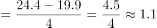
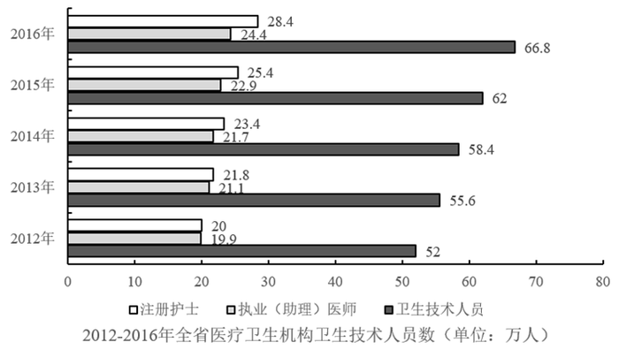

# 年均增长量计算（基期前移型）

考点：[[20-考点/资料分析/增长/年均增长量计算（基期前移型）|增长 / 年均增长量计算（基期前移型）]]
材料：[[15-材料/资料分析/194911 广东省医疗卫生资源2009—2016|194911 广东省医疗卫生资源2009—2016]]

**问法模型**：题干出现'2013—2016年平均每年较上一年增加'→ 判定为年均增长量模型，'较上一年'意味着2013年也要与2012年比较，基期前移至2012年，用（2016年值−2012年值）÷4求解

## 推理链
1. 第1步：题干关键词'平均每年较上一年增加'，'较上一年'表明2013年也需与上一年比较，故基期为2012年，而非2013年；2013—2016年共4个增长年份
2. 第2步：定位图3（横向条形图，2012—2016年卫生技术人员），读最底行2012年执业（助理）医师19.9万人（灰色中条），最顶行2016年为24.4万人
3. 第3步：套用年均增长量公式：年均增长量=（末期值−基期值）÷年份差=(24.4−19.9)÷4
4. 第4步：代入计算：24.4−19.9=4.5，4.5÷4=1.125≈1.1万人
5. 第5步：与选项对照：1.125最接近1.1，锁定B选项

**最快解法**：⚡ 年均增长量公式法+截位直除：直接读图3两端2012年19.9与2016年24.4，差值4.5÷4，商首位1、次位1，得1.125≈1.1，秒选B；无需逐 年列增量（0.7+1.6+1.3+0.9=4.5再除以4，结果相同但更慢）

## 易错点
- ⚠ 基期误判：若按题干字面把基期当2013年（21.1万人），用(24.4−21.1)÷4=0.825会误选A（0.9）；'较上一年'必须把基期前移至2012年，除数为4
- ⚠ 2012年数据易漏读：图3时间范围只有2012—2016年，2012年（19.9万人）藏在横向条形图最底行，是最易被忽略的基期数据
- ⚠ 数据行看混：图3中2012年注册护士20与执业（助理）医师19.9数值极近、2016年护士28.4与医师24.4也在相邻行，需认准图例'执业（助理）医师'对应的中间灰条，勿错取护士数据（若误用护士：(28.4−20)÷4=2.1会误选D）

## 母题抽象
> 🧩 当题干出现'某年段平均每年较上一年增加/减少'特征时，判定为年均增长量问题，基期前移一年（首年也需与上年比较），用（末年值−首前一年值）÷年份数（末年−基期年）计算，并警惕基期数据藏在图表边缘首末行

**同类特征**：2013—2016年、平均每年、较上一年增加、执业（助理）医师、约……万人、年均增长量问法

## 相关题
- [[10-真题/资料分析/增长/1752596 年均增长量计算（五年规划期口径）|1752596]]（北京 2016，相关度1）
- [[10-真题/资料分析/平均数/2374830 年均新增量计算（各年流量求和÷年数）|2374830]]（广东 2019，相关度1）

---

### 题干
2013—2016年，全省医疗卫生机构平均每年较上一年增加执业（助理）医师约（  ）万人。

### 选项
- A. 0.9
- B. 1.1　✅
- C. 1.7
- D. 2.1

### 官方解析

根据题干“2013-2016年…平均每年较上一年增加…约（）万人”，结合材料时间，可判定本题为年均增长量计算问题，且根据“较上一年”可知，2013-2016年中的每一年都需要和上一年相比较，所以2013年需与2012年比较，则本题基期为2012年。定位图三可得，2012年全省医疗卫生机构执业（助理）医师数为19.9万人，2016年为24.4万人。根据年均增长量可得，2013-2016年全省医疗卫生机构平均每年增加执业（助理）医师万人。

故正确答案为B。

### 给定材料

<b>根据下列资料，回答</b><b>96</b><b>～</b><b>100</b><b>题：</b>

        近年来，广东全省医疗卫生资源总量继续增加，医疗服务能力不断增强。截止2016年底，全省医疗卫生机构4.91万个，医疗卫生机构拥有床位46.5万张，其中：医院37.2万张，卫生院5.7万张。医疗卫生机构卫生技术人员66.8万人，其中：执业（助理）医师24.4万人，注册护士28.4万人，医护比1：1.16。

