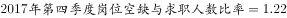
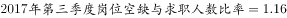
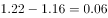

# 比率（岗位空缺与求职人数比）的环比差值计算（图表数据点相减）

考点：[[20-考点/资料分析/增长/比率（岗位空缺与求职人数比）的环比差值计算（图表数据点相减）|增长 / 比率（岗位空缺与求职人数比）的环比差值计算（图表数据点相减）]]
材料：[[15-材料/资料分析/194915 2015—2017年（重点2017年|194915 2015—2017年（重点2017年]]

**问法模型**：题干问'2017年第四季度比率较第三季度上升了多少'→ 环比口径，直接从折线图取相邻两季度数据点相减，得绝对差值而非增长率

## 推理链
1. 第1步：审题干口径——问的是2017年第四季度较第三季度（环比）的上升幅度，题干给了4个小数差值选项，属绝对差值题型
2. 第2步：从折线图读取数据点——2017年第三季度比率=1.16，2017年第四季度比率=1.22（注意文字段'比去年同期上升0.09'是同比，不适用于本题）
3. 第3步：代入差值公式——环比上升幅度=1.22-1.16=0.06
4. 第4步：口径交叉验证——同比口径为1.22-1.13（2016年第四季度）=0.09，对应文字段'上升0.09'，与本题环比口径0.06区分，0.09为C项干扰
5. 第5步：与选项对照——0.06对应B项，故正确答案为B

**最快解法**：⚡ 图表取点直减法：在折线图横轴对准'2017年'，取第三季度点1.16与第四季度点1.22，1.22-1.16=0.06，口算秒选B，无需任何速算技巧

## 易错点
- ⚠ 同比/环比口径混淆：文字材料'比去年同期上升0.09'是同比（1.22对比2016Q4的1.13），题干问的是环比（对比2017Q3），误用0.09会错选C
- ⚠ 差值与增长率混淆：比率上升0.06是绝对差值（无量纲），不能除以基期1.16再换算成百分比，四个选项均为差值形式，直接相减即可
- ⚠ 折线图读数错位：图中1.13出现两次（2016Q4与2017Q1），且与1.16相邻易看串，须对准2017年横轴逐点取数，误取1.10（2016Q3）会得0.12错选D

## 母题抽象
> 🧩 当题干出现'某比率/指标较上一期（季度）上升或下降了多少'且选项为小数差值时，先辨同比还是环比口径，再到对应图表取相邻两期数据点直接相减验证选项

**同类特征**：第四季度较第三季度、岗位空缺与求职人数比率、上升了（差值问法）、选项为小数差值0.03/0.06/0.09/0.12、环比口径、折线图取相邻数据点

## 相关题
- [[10-真题/资料分析/平均数/2185132 现期平均数计算（折线图多期数据算术平均，削峰填谷-基准线法）|2185132]]（广东 2018，相关度1）
- [[10-真题/资料分析/其他/2185136 岗位空缺与求职人数比率读数与极值比较（供求匹配程度判断）|2185136]]（广东 2018，相关度1）
- [[10-真题/资料分析/综合/2185139 综合判断题（比率与供求关系多选项交叉验证）|2185139]]（广东 2018，相关度1）

---

### 题干
2017年，第四季度岗位空缺与求职人数比率较第三季度上升了（  ）。

### 选项
- A. 0.03
- B. 0.06　✅
- C. 0.09
- D. 0.12

### 官方解析

定位折线图可得，；。故上升了。

故正确答案为B。

### 给定材料

根据下列资料，回答91～95题：

        2017年第四季度，人力资源部门对东、中、西三大区域共95个城市的公共就业服务机构市场供求信息进行了统计分析，部分数据如下：

        总体而言，用人单位通过公共就业服务机构招聘各类人员约433.7万人，进入市场的求职者约354.2万人，岗位空缺与求职人数的比率约为1.22，比去年同期上升0.09，市场需求略大于供给。

        与去年同期相比，需求人数增加15.6万人，求职人数减少17.3万人。与上季度相比，需求人数和求职人数分别减少了58.9万人和73.2万人，各下降了和。

        分区域看，东、中、西部市场岗位空缺与求职人数的比率分别为1.22、1.18、1.29，市场需求均略大于供给。

