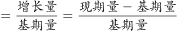
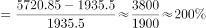
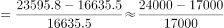
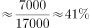
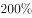

# 一般增长率比较（跨期2012→2016）

考点：[[20-考点/资料分析/增长/一般增长率比较（跨期2012→2016）|增长 / 一般增长率比较（跨期2012→2016）]]
材料：[[15-材料/资料分析/195079 2016年（含2012-2016年趋|195079 2016年（含2012-2016年趋]]

**问法模型**：题干'2016年与2012年相比，两个主体营收…'的定性比较问法 → 分别取柱状图两主体的现期与基期值计算增长率并比较大小

## 推理链
1. 第1步：从柱状图读取数字出版业营收：2012年1935.5亿元、2016年5720.85亿元；新闻出版产业营收：2012年16635.3亿元、2016年23595.8亿元（注意白柱=数字出版、斜纹柱=新闻出版产业）
2. 第2步：增长模型公式 r=(现期-基期)/基期，两个主体各算一次
3. 第3步：数字出版 r=(5720.85-1935.5)/1935.5=3785.35/1935.5≈196%；新闻出版产业 r=(23595.8-16635.3)/16635.3=6960.5/16635.3≈42%
4. 第4步：比较可得196%＞42%，数字出版（前者）增长快于新闻出版产业（后者）
5. 第5步：对照选项：两者均在增长故排除D'均下降'；增速差异悬殊（196%对42%）谈不上'同步增长'排除A；B说法与结论相反，故锁定C'前者增长快于后者'

**最快解法**：⚡ 截位直除+倍数粗判：直接算'现期÷基期'——数字出版5720.85÷1935.5≈2.96倍（增长约196%），新闻出版23595.8÷16635.3≈1.42倍（增长约42%），现期基期倍数大者增长率必大，无需精算即可锁定C

## 易错点
- ⚠ 双柱图例看混：白柱=数字出版、斜纹柱=新闻出版产业，两列数据串行会得出'后者增长快'的反向错误结论选B
- ⚠ 基期取错年份：题干是2016年与2012年相比，基期应取2012年16635.3/1935.5，误取2015年数据（21655.9/4403.5）则比较失据
- ⚠ '同步增长'迷惑项：二者确实都在增长，但本题考的是增速快慢的精确比较，二者增速差距悬殊（约196% vs 约42%），A表述不构成正确答案

## 母题抽象
> 🧩 当题干出现'A年与B年相比，两个主体谁增长快'特征时，从图表中取两主体的现期与基期值，用'现期÷基期'的倍数大小直接判定增长率大小（倍数大者增长快），再与定性选项对照验证

**同类特征**：2016年与2012年相比（跨期比较）、两个主体营收对比、增长快慢定性比较（不需求具体增速数值）、数据取自双柱并排柱状图、选项为定性描述（同步增长/前者快/后者快/下降）

## 相关题
（暂无）

---

### 题干
2016年与2012年相比，我国数字出版业营收和新闻出版产业营收：

### 选项
- A. 二者同步增长
- B. 后者增长快于前者
- C. 前者增长快于后者　✅
- D. 二者均出现下降态势

### 官方解析

根据题干“2016年与2012年相比······”结合选项为增长率比较，可判定本题为一般增长率问题。定位材料统计图可得：数字出版业2016年营收5720.85亿元，2012年营收1935.5亿元；新闻出版业2016年营收23595.8亿元，2012年营收16635.5亿元。故2016年与2012年相比，我国数字出版业营收增长率，新闻出版业营收增长率，通过比较可得：2016年与2012年相比，我国数字出版业营收增长速度（）&gt;我国新闻出版业营收增长速度（）。

故正确答案为C。

### 给定材料

根据下面资料回答101-105题：

        2017年7月24日，国家新闻出版广电总局发布的《2016年新闻出版产业分析报告》指出，2016年全国出版、印刷和发行服务实现营业收入23595.8亿元，较2015年增加1939.9亿元，增长。其中，数字出版实现营业收入5720.85亿元，比2015年增长，对全行业营业收入增长贡献超三分之二。

        2016年，全国共出版图书、期刊、报纸、音像制品和电子出版物512.53亿册（份、盒、张）。其中，出版图书49.99万种，重版、重印23.75万种。

> [!warning] 疑点（官方解析可能有误，待人工复核）
> 官方解析中新闻出版业2012年营收写作'16635.5亿元'，与柱状图标注的16635.3亿元不一致（解析笔误），但不影响增长率大小比较结论，答案C仍正确

<!-- CODEX-ANSWER-REVIEW:BEGIN -->
### 本次独立复核

**复核状态：** `resolved`（答案与解析已核定）

**计分答案：** C（可计分）

**复核解析：**

2012至2016数字出版营收由1935.5亿元增至5720.85亿元，增长率约195.6%；新闻出版产业由16635.3亿元增至23595.8亿元，增长率约41.9%。前者增长速度更快，选C。原解析将新闻出版2012读数写作16635.5，图表实际是16635.3；该0.2亿元差异不影响比较。

**相关信息：**

跨期增长率=(2016值/2012值)-1；两行业分母各取自身2012营收。

**题源依据：** [固定版本原题](https://github.com/Mentat-Uran/kaogongzhentizhengliu/blob/84ab93d4b64b61d897bece8a1c0a5bab06b4feb2/10-%E7%9C%9F%E9%A2%98/%E8%B5%84%E6%96%99%E5%88%86%E6%9E%90/%E5%A2%9E%E9%95%BF/2187532%20%E4%B8%80%E8%88%AC%E5%A2%9E%E9%95%BF%E7%8E%87%E6%AF%94%E8%BE%83%EF%BC%88%E8%B7%A8%E6%9C%9F2012%E2%86%922016%EF%BC%89.md)；固定内容 commit `84ab93d4b64b61d897bece8a1c0a5bab06b4feb2`，Markdown blob `c1fbd8d006600156f8560223e9c5ccc8b876e551`。
<!-- CODEX-ANSWER-REVIEW:END -->
